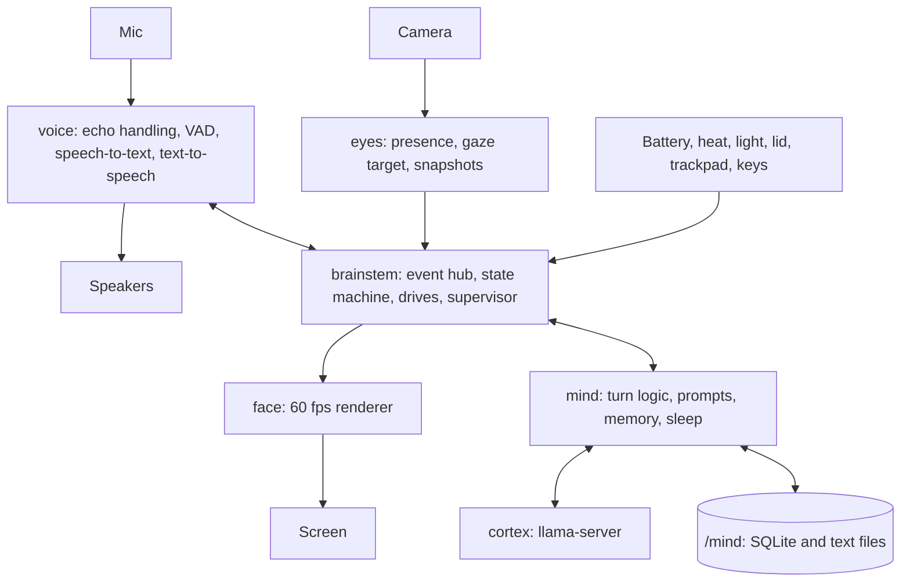
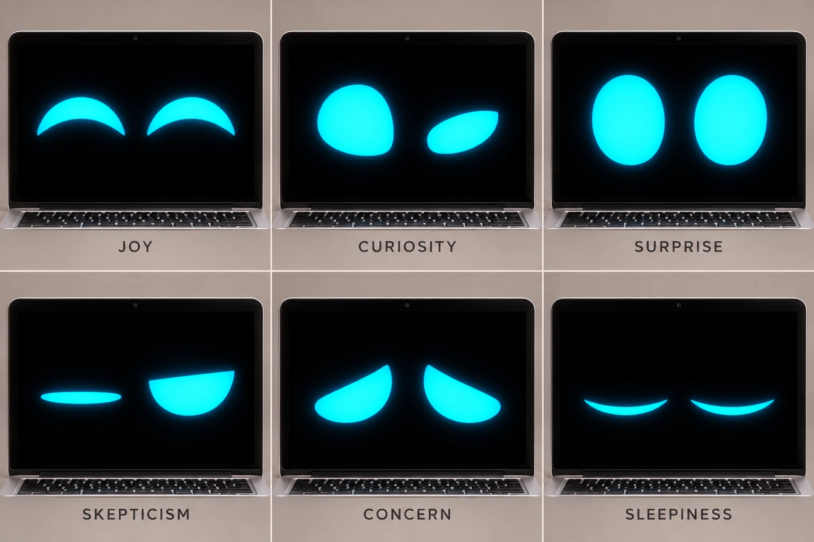

# BeingOS: a 2012 MacBook Pro that is its own AI

> **Historical (marked 23 November 2026).** The product is now **PipOS**
> ("Persistent Intelligence Platform Operating System"); the being is Pip.
> This file is the original design of 20 November, kept as a record. The current statement of
> intent is [docs/DESIGN.md](docs/DESIGN.md), changed commitments are in
> [docs/DECISIONS.md](docs/DECISIONS.md), status is in [STATUS.md](STATUS.md)
> and the work ahead is in [docs/IMPROVEMENT-PLAN.md](docs/IMPROVEMENT-PLAN.md).
> Two things below are out of date: the dream model default is now
> **Qwen3-1.7B**, shipped as Q4_K_M (a 4B only as an optional arm; §7 and §8 say 4B), and
> the CPU is recorded as an **i5-3210M**, to be confirmed on the first boot.

*Design and phased plan, written 2026-11-20 and budgeted for the 13-inch MacBookPro9,2. Building started the same day. The OS image now exists and runs in a virtual laptop on a development Mac; [README.md](README.md) says where it stands and [docs/LAB.md](docs/LAB.md) how. Nothing has been installed or measured on the real laptop yet. "BeingOS" is a working title.*


## TL;DR

- **It is feasible, and it will be slow in one specific way.** The test machine is the 13-inch, so inference runs on two cores without AVX2. Expect an estimated 6–9 tokens/s from a 2B-class model or 12–16 from a 1B-class one, and a first spoken word two to three seconds after you stop talking. Nothing is measured yet; Phase 1 does that.
- **Build the being first, then shrink the OS around it.** Stripping the kernel buys a five-second boot and power-cut safety, not intelligence. Phases 0–5 run on minimal Debian. Phase 6 replaces it with a Buildroot image: a custom 6.18 kernel, a read-only A/B system, and separate partitions for models and memory.
- **Six small processes.** A face that never freezes, a brainstem, a voice, eyes, a cortex (`llama-server`) and a mind. The face and reflexes carry the sense of life. The language model is the slow part behind them.
- **Keep the first reply fast.** Reuse the model's cached prompt where verified. Let a final utterance take priority over speculative reading, and measure whether reading while listening improves the time to first useful audio on the MacBook.
- **Daytime conversation and overnight work.** Use a small model for conversation. Start overnight consolidation with the same model in bounded batches and benchmark a larger optional model separately.
- **The character fits the brain.** Few words, expressive eyes, chirps.
- **Memory is the being.** It lives on its own partition as SQLite and text, inspectable and backed up. The OS is disposable.
- **Wi-Fi and Internet are part of the design.** Conversation and recall run locally. Owner-enabled connectivity adds signed updates, time sync, paired maintenance, and later requested web lookups.
- **Three chores under macOS before wiping it:** the final firmware update, a charge-cap test, and a macOS installer stick. The battery also has to stay in, because without one the CPU is pinned near 1.2 GHz.
- **Settled:** it is the 13-inch MacBookPro9,2. Of the 2012 models that is the easiest body for Linux and the slower brain, so every budget here is for two cores.

## 1. What this is

One machine, one character. The laptop boots in a few seconds into a pair of eyes, with no desktop or login behind them. It hears through the built-in mic, speaks through the built-in speakers, sees through the camera, and feels what the laptop's own sensors report: battery, heat, room light, the lid, a touch on the trackpad. Its memories live on the SSD and survive reboots and OS updates. Conversation and recall run locally. Optional Wi-Fi and Internet functions include updates, paired health reports, and requested public lookups.

What it is not:

- **Not a general assistant.** A 1–2B-parameter model on a 2012 CPU can hold a short, warm, coherent conversation and remember things about you. It can't write code or reason through hard problems, and the design doesn't ask it to.
- **Not a desktop OS with an app on top.** There is no window system, no package manager and no shell on the screen.
- **Not a network that retrains itself.** Its weights never change. It learns the way a diary-keeper does: through memory it writes, consolidates and re-reads.

Open-LLM-VTuber, AIRI and OpenVoiceOS are apps or assistant platforms that sit on a general-purpose OS, with avatars and software stacks much heavier than this machine and this face need. They are worth reading for ideas. None of them is the base here.

## 2. The machine and what it allows

The test machine is the 13-inch, non-Retina MacBookPro9,2.

| Part | Detail |
|---|---|
| CPU | i5-3210M or i7-3520M: Ivy Bridge, 2 cores, 4 threads. Phase 0 records which; the i7 is roughly 15% faster |
| Memory | 16 GB DDR3-1600, the most this model takes |
| Graphics | Intel HD 4000 only. OpenGL 4.2 and GLES 3.0 through Mesa, which is plenty for the face |
| Screen | 1280×800 |
| Storage | 256–512 GB SATA SSD. Record the installed drive, negotiated SATA speed, and discard behavior during bring-up |
| Camera | FaceTime HD over plain USB video, which works with the stock Linux driver |
| Audio | Cirrus CS4206 codec with built-in speakers and mic; works |
| Sensors | Battery, temperatures, fans, ambient light, accelerometer, lid and keyboard backlight, all through in-kernel drivers |
| Network | Gigabit Ethernet and 802.11n Wi-Fi on the Apple specification. The internal radio and Linux firmware path need validation on this unit. [Apple specifications](https://support.apple.com/en-au/111958) |

Of the three 2012 models it could have been, this is the easiest body and the slower brain. It has one GPU, so there is no graphics switching to tame, and its camera and motion sensor are confirmed working under Linux. The price is two cores where the 15-inch has four, so every budget below is for two cores.

Four facts shape everything else:

1. **AVX without AVX2.** These Ivy Bridge CPUs lack the instructions most prebuilt AI binaries assume. llama.cpp built on a newer machine crashes here with an illegal-instruction error, and a local build with native detection switched off turns AVX2 on by default. Everything is compiled on the laptop, or explicitly for it.
2. **CPU-only inference.** The GPU cannot run the model. Mesa's Vulkan driver for this Intel generation is incomplete, and in one [OpenCL test](https://github.com/nipegun/llama.cpp-opencl) adding the HD 4000 made a 3B model slower than the CPU alone (2.3 against 4.8 tokens/s). The GPU draws the face and nothing else.
3. **Speed is the limit, not memory.** The whole talking pipeline fits in about 5 GB. The other 10 GB goes to a larger model that only runs during sleep, to keeping every model loaded, and to caches.
4. **Reading costs as much as writing.** A modern CPU reads its prompt several times faster than it generates. On AVX-only hardware the one [direct measurement](https://www.mgroeber.de/benchmarking-llamacpp-on-legacy-hardware-2.html) found shows the two at about the same speed. So every token put in front of the model, whether a memory, a sensor reading or your own words, delays the reply by about as long as one spoken token takes to generate. Section 7 is built around this.

Expected generation speed on this machine at 4-bit quantisation. The middle column is an estimate until Phase 1 measures it:

| Model size | This machine (est.) | Nearest real measurement |
|---|---|---|
| ~1B | 12–16 tokens/s | Raspberry Pi 5, 1B models: about 11 |
| ~2B | 6–9 | Pi 5, Gemma 4 E2B: 9.0 |
| ~4B | 3–4 | Ivy Bridge laptop, Granite 4.2 3B: 4.8. Pi 5, Qwen3.5-4B: 3.1 |
| ~7–9B | 1.5–2.5 | Ivy Bridge i5-3470T, Llama-2 7B: 2.5 |

For scale, speech runs at about 3 tokens per second. A 2B model generates two to three times faster than it can be spoken, which is workable but thin once speech synthesis shares the two cores. A 1B-class model has comfortable headroom.

**Two cores, shared.** The language model gets both physical cores. The face, audio and recogniser run on the hyperthread siblings at higher priority. Two overlaps matter: the recogniser and the model's reading both run while you speak, and speech synthesis and generation both run while it speaks. Phase 1 measures both, because they decide whether the reflex model is 2B-class or 1B-class.

## 3. Principles

1. **Liveness comes from reflexes, not from the language model.** Blinking, eye contact, reacting to a sound within 100 ms, a chirp of acknowledgement: none of it needs an LLM. A fast reflex layer keeps the being alive at 60 fps while the slow cortex thinks. On this hardware that matters more than any model choice.
2. **Latency beats model size.** A smaller model that answers in two seconds feels more alive than a smarter one that answers in eight.
3. **The character fits the brain.** Few words, curious, asks questions, says when it doesn't know. Short replies are cheap to generate, quick to speak, and hide a small model's limits. A robot that barely talks is exactly what this CPU can afford.
4. **The mind is sacred and the OS is disposable.** The OS image can be reflashed at will. The memory partition is the being: updates never touch it, and it is backed up.
5. **An honest body.** It only says true things about itself. Battery level comes from the battery and warmth from the sensors; those facts are handed to the model, never invented by it.
6. **Everything is inspectable.** You can read, correct and delete any memory.
7. **Locally independent.** Voice, memory, and the face work with the network disconnected. Wi-Fi or Ethernet can stay connected for the functions the owner enables.

## 4. Architecture

Six small processes ("organs") around a message hub. The split follows failure domains and timing needs: the face must never freeze because the language model is busy or has crashed.



| Organ | Job | Timing | Built with |
|---|---|---|---|
| `face` | Draws the eyes. Idle life (blink, drift, breathing) runs with no input at all. | 60 fps, never blocks, starts first | Rust and one GLES shader, straight to KMS/DRM |
| `brainstem` | Event hub, state machine, body sensors, drives (energy, arousal, comfort), supervises the other organs, pets the hardware watchdog | milliseconds | Rust |
| `voice` | Owns the mic and speakers: echo handling, voice activity, attention, speech-to-text, text-to-speech, chirps | realtime audio thread | Rust and sherpa-onnx through its C API |
| `eyes` | Owns the camera. The first slice reports presence and face position. Deliberate snapshots are a later capability. | Up to 5 detections/s in the first slice, low priority | Python supervisor, native V4L2 capture and pico face detection |
| `cortex` | The language model server: upstream `llama-server`, unmodified | slow and bursty, takes all spare CPU | llama.cpp |
| `mind` | Turn-taking, prompt assembly, memory, tools, sleep-time consolidation | event-driven | Python, standard library only, at first |

Rust for the long-running realtime organs is a recommendation, not a requirement; C++ would do. The process boundaries matter more than the language.

How they fit together:

- **The bus.** A Unix-domain socket carrying one JSON object per line: `hear.partial`, `hear.final`, `say.request`, `say.level`, `see.presence`, `body.battery`, `state.changed`, `face.express`. Audio and video never cross it. Each stays inside the organ that owns the device, which is also why no sound server is needed.
- **Cortex behind a standard API.** `mind` speaks the OpenAI-compatible HTTP API to `llama-server`. Swapping models is a config change. Pointing it at the Mac Studio for an optional assisted mode is a URL change, with identity and memory staying on the laptop.
- **Scheduling.** Face and audio run at realtime priority and never wait. The language model gets the physical cores. Dream work runs only when the being is idle and cool.
- **Failure.** Each organ restarts alone. If `cortex` dies mid-sentence the eyes show confusion, not a frozen frame. If the brainstem heartbeat stops, the face drifts into an "unwell" look by itself, and the hardware watchdog reboots the machine if the brainstem doesn't return.
- **A simulated body.** Every organ reaches its device through a thin interface, so the whole being also runs on the Mac Studio in a window, using the Mac's mic and camera. Most development happens there. The laptop is for hardware bring-up, benchmarks and soak tests.

### States

| State | Entered when | Face | What is running |
|---|---|---|---|
| Waking | Power on, lid open, or morning | Eyes open slowly | Models loading; this animation *is* the loading screen |
| Idle | Awake, nobody engaging | Neutral, wandering glances | VAD, presence detection |
| Attending | Its name is heard, or someone looks at it up close | Eyes lock on, slightly wider | Speech-to-text armed |
| Listening | Speech detected while attending | Focused, small reactions to your voice | Streaming transcription |
| Thinking | You stopped talking | Glance away, chirp | Retrieval, then the language model |
| Speaking | First sentence synthesised | Eyes pulse with its voice | Model and speech synthesis overlap |
| Drowsy | Late, dark or long idle | Heavy lids | Nothing new |
| Asleep | After drowsy, or lid closed | Closed, slow breathing, backlight off | Bounded dream work when power, cooling, and privacy conditions allow |
| Muted | Mute key | Distinct "ears covered" look | Mic closed in software, visibly |
| Unwell | An organ is down | Dazed | Supervisor restarting it |

## 5. The face

Taken from your mockups: two glowing cyan shapes on black, with no mouth and no head.



- **Rendering.** One full-screen fragment shader. Each eye is a signed-distance shape: a rounded superellipse cut by an upper and a lower lid curve. The glow is a falloff on the same distance field, and the fine LED-grid texture in the mockup is one multiply. It is resolution-independent and trivial for a 2012 integrated GPU.
- **Parameters.** About ten numbers per eye: position, width, height, roundness, tilt, upper-lid height, slant and curve, lower-lid height and curve, brightness. An expression is a named set of those numbers.
- **Motion.** Every parameter chases its target through a damped spring, so nothing snaps or moves linearly. Layers add on top: gaze offset, blink, breathing, micro-saccades, speech pulse.
- **Speaking without a mouth.** The eyes pulse with the speech envelope, brightness plus a slight vertical stretch, driven by `say.level` events at 50 Hz.
- **Gaze.** `eyes` reports where a face sits in the camera frame and both eyes shift toward it. With nobody there, it glances around slowly.
- **Sound is half the face.** Short synthesised chirps and hums for "heard you", "thinking", "happy" and "no". They are generated procedurally and play instantly. A chirp 200–300 ms after you stop talking covers most of the wait for the first spoken word.
- **Screen care.** The backlight follows room light and switches off entirely during sleep, because black on an LCD still glows. The eyes drift a few pixels so nothing sits static.
- **Its own character.** EVE is the reference for the genre: simple eyes, few words. The shapes, motion, sounds and name should be its own.

| Expression | Shape recipe |
|---|---|
| Joy | Lower lids pushed up into arcs, leaving two upward crescents |
| Curiosity | Asymmetric: one eye wide and round, the other narrowed and tilted |
| Surprise | Both eyes tall ovals, a little brighter |
| Skepticism | One eye flattened to a line, the other half-lidded from above |
| Concern | Upper lids slanting down toward the outside, inner corners raised |
| Sleepiness | Thin downward arcs, dimmed |

Beyond the six in your sheet it needs neutral, listening, thinking, speaking, asleep, dreaming, waking, muted, unwell and low-battery.

## 6. Hearing and speaking

One organ, `voice`, owns both directions, so it always knows what it is saying itself.

| Stage | Default | Why | Alternative |
|---|---|---|---|
| Voice activity | Silero VAD | 2 MB and well under 1 ms per 30 ms of audio | TEN VAD |
| Attention | sherpa-onnx keyword spotter listening for its name | Open vocabulary: the name is a line in a text file, with no training | A trained openWakeWord-format model |
| Live speech-to-text | Streaming Zipformer in sherpa-onnx | True word-by-word partials for a few percent of one core, in the same library as everything else | Moonshine v2 Small Streaming, which has better published accuracy but needs its own C++ library |
| End of turn | Recogniser endpointing plus a silence timeout | Simple and dependable | Smart Turn v3.2 (8 MB), to stop waiting sooner when a sentence is clearly complete |
| Night-time speech-to-text | Parakeet TDT 0.6B v2 | The most accurate measured option. Too heavy and non-streaming for live use, right for re-transcribing during sleep | whisper.cpp small |
| Text-to-speech | Piper, medium voice | The only option with solid measurements well under real time on weak CPUs. A slightly synthetic voice suits the character | Phonon 31m, which streams in 80 ms frames but has vendor numbers only; Kitten TTS nano |
| Speaker ID | CAM++ in sherpa-onnx | About 30 MB and an estimated tens of milliseconds per utterance | WeSpeaker ResNet34 |

- **One library.** sherpa-onnx covers voice activity, keyword spotting, streaming and offline recognition, synthesis and speaker ID, with C and Rust APIs and no Python at runtime.
- **ONNX Runtime is built from source for this CPU.** The prebuilt binaries the Rust `ort` crate downloads target AVX2 and are confirmed to crash on Ivy Bridge. Microsoft's own build has been shown to run under Ivy Bridge emulation, so a source build should work, but nobody has published a speech benchmark on an AVX-only CPU. Every speed above comes from Raspberry Pi-class ARM boards. The first Phase 1 test is simply whether it loads, then 8-bit against 32-bit models, since 8-bit loses its fast paths without AVX2.
- **Half-duplex first.** While it speaks the recogniser is closed, and Esc or a tap on the trackpad interrupts it. Interrupting by voice arrives in Phase 7. Echo cancellation alone is not enough on laptop speakers: the projects that make it work also require the wake word or a speaker match while speech is playing.
- **Attention.** Its name opens a conversation. Once attending, follow-ups need no name for about 20 seconds. From Phase 5, eye contact at close range opens attention too.
- **Natural voices are out of reach here.** Kokoro and Pocket TTS are estimated to run at or below real time on this CPU once the language model shares it.
- **Mute is a key.** `voice` closes the mic stream and the face shows it.
- **Licence note.** Piper is GPL-3.0, which only matters if the image is ever distributed.

## 7. The cortex

### Model roles and candidates

| Job | When | Size class | Candidates to benchmark |
|---|---|---|---|
| Reflex: conversation | Every turn | 1–2B | Qwen3.5-2B, LFM3-1.7B, Gemma 4 E2B, MiniCPM5-2B, with Qwen3.5-0.8B as the speed floor |
| Deep: sleep-time consolidation | Eligible overnight work | Start with the conversation model, then test 4B-class | Qwen3.5-4B as the first optional pack after measuring wake handoff and memory quality |
| Look: one camera frame | On request | Reuse a multimodal model | Gemma 4 E2B, which llama.cpp officially supports and whose image-token budget can be turned down |
| Recall: embeddings | Every turn, in milliseconds | 20–35M | bge-small or all-MiniLM. Larger embedders cost too much per turn on this CPU |

- **No independent chat-quality comparison of these models exists.** The published numbers are the vendors' own. Phase 1 picks by measurement on the laptop: speed first, then a blind A/B of in-character conversation.
- **Thinking modes stay off** for the reflex model (`--reasoning off` in llama-server). LFM3's card warns that its off-switch is inconsistent, which needs testing before it is trusted.
- **Sizes mislead.** Gemma 4 E2B is 3.1 GB at 4-bit despite the "2B", because its total parameter count is 5.1B.
- **Licences.** All Apache 2.0 or MIT except Liquid's LFM models, whose own licence is fine for personal use.
- **Qwen4 small models** are promised with no date. The Phase 1 benchmark harness is kept, so trying a new model is one evening's re-run.
- **Speech-to-speech models cannot replace the pipeline here.** In a [community test](https://github.com/govindplal/kutty-jarvis/pull/5) on a CPU-only laptop, LFM3-Audio produced speech 1.35–2.1 times slower than real time. Moshi-class models need a GPU.
- **Looking is slow.** One image costs an estimated 15–40 s before the first word, extrapolated from 15 s [measured on a Pi 5](https://mjrovai.com/articles/slm-on-raspberry-pi-mtp/). It says "let me look", squints, and answers when ready. A lower image-token budget shortens this.

### The prompt is append-only

```
[ identity ]              static                 } cached, rebuilt only during sleep
[ core memory ]           rewritten during sleep }
[ conversation so far ]   grows by appending
[ this turn ]             senses line, your words, recalled memories
```

- Nothing above the newest turn is edited while it is awake. An edit throws away the cache from that point on, and re-reading a cold 1,000-token prefix takes an estimated two minutes on a 2B model and five on a 4B.
- Identity plus core memory stay under about 600 tokens.
- The cached state is saved to disk at shutdown and restored on waking (`--slot-save-path`). Otherwise every boot would begin with minutes of re-reading.
- When the context fills, compaction waits for an idle stretch or for sleep.
- The model choice interacts with this. Qwen3.5 is a hybrid recurrent design that cannot rewind its state, so llama.cpp reuses its prefix through checkpoints. Whether save and restore, and rollback, behave for each candidate is a Phase 1 test.

### Thinking while listening

Streaming speech recognition can supply settled words before the end of a turn. Reading those words in advance can save time if they extend a warm cache and the work finishes before the final utterance. With one model slot, unfinished speculative work can delay the answer. Use final-only inference as the baseline. Keep read-ahead only where a bounded and interruptible policy wins on the measured first-audio and correctness tests below.

The same idea applies to everything else in the turn. The senses line goes in the moment it starts attending, before you speak. Recalled memories go after your words, capped at about 25 tokens, and only when retrieval is confident.

### Reply shape

- **One emotion token first**, constrained by a grammar to a fixed list. It drives the face before any word is spoken.
- **Then free text**, streamed to speech synthesis clause by clause. The character opens with a short clause so speech can start after about eight tokens.
- **Commands never reach the model.** Remember, forget, the time, volume, sleep, mute and "look at this" are matched in code and answered directly.
- **Short social replies are reflexes.** Standalone greetings and check-ins get varied local replies while the model can keep warming. The archive keeps both sides of the exchange. A greeting with a substantive request goes through the conversation path.
- **No tools for the reflex model at first.** `mind` hands it facts; small models call tools unreliably.

### Latency budget

From the end of your speech to its first spoken word on this machine. All estimates:

| Step | 2B-class reflex model | 1B-class reflex model |
|---|---|---|
| Chirp and eye reaction | at 0.2–0.3 s | at 0.2–0.3 s |
| End-of-turn detection | 0.4–0.6 s | 0.4–0.6 s |
| Reading the last words and turn markers (~8 tokens) | ~1 s | ~0.5 s |
| Recalled memories, when used (up to 25 tokens) | +2–3 s | +1.5–2 s |
| First clause (~8 tokens) | ~1 s | ~0.6 s |
| First audio from speech synthesis | 0.2–0.5 s | 0.2–0.5 s |
| **Total without recall** | **about 3 s** | **about 2 s** |
| **Total with recall** | **5–6 s** | **3.5–4 s** |

Which column the being lives in is the main question Phase 1 answers. The 2B models should converse better; the 1B models answer about a second sooner. llama.cpp's multi-token-prediction drafting is a further knob: it lifted Gemma 4 E2B from 9.0 to 13.1 tokens/s on a Pi 5.

### Optimisation order and acceptance

In one traced QEMU voice turn, **137.2 of the 168.4 seconds** between the final transcript and first audible response were spent waiting behind speculative prompt work. The final request did reuse 222 tokens. This establishes a queueing problem even when caching succeeds. Streaming synthesis and playback took about 1.5 seconds once a clause was available. The timing is from emulation. Physical latency remains unmeasured. Voice latency trace (`out/logs/l4-cortex-latency.log`), [Pinned llama.cpp server controls](https://github.com/ggml-org/llama.cpp/blob/v1.0.0/tools/server/README.md).

1. **Prioritise the real turn.** Compare final-only inference with bounded read-ahead on the same short, long, hesitant, and revised utterances. Give the final transcript priority over prefill, startup warmup, compaction, and dreams. Measure when the server actually releases its single slot after client cancellation. Start speculative work only with a stable prefix and a measured token and time budget. Keep deterministic commands on the existing direct path. [Mind scheduling](mind/turn.py), [Cortex service](os/package/cortex/being-cortex.service).
2. **Warm the exact prompt the model will see.** The shipped Qwen3.5 template rejects a system-only chat. Test rendering a disposable placeholder user turn to derive the prefix, then compare token IDs with the prefix of real requests before enabling the warmup. A restored slot should show an actual cache hit after a reboot, lid cycle, or model restart. Check that corrections and forgetting invalidate older cached content. Compare prompt budgets and shorten repetitive identity text and irrelevant context while keeping the character and sourced recall. [Qwen template](https://huggingface.co/Qwen/Qwen3.5-0.8B/blob/2fc06364715b967f1860aea9cf38778875588b17/chat_template.jinja), [Pinned prompt and slot API](https://github.com/ggml-org/llama.cpp/blob/v1.0.0/tools/server/README.md), [Hybrid-model restore report](https://github.com/ggml-org/llama.cpp/issues/28194).
3. **Keep recall cheap and correct.** Keep the current parser and SQLite path on the speaking path. Test better ranking, date filters, and recognition-aware aliases, including uncommon names and near-homophones such as “quire” and “choir.” Limit how much text goes into the prompt and ask a short clarification when sources conflict. The fixed OpenJev veto improved routing on the fresh set and lost a correct archive match. Keep it in experiments, and require a new candidate to preserve explicit commands and correct sources on a fresh set. [Fresh second-opinion test](#fresh-second-opinion-test).
4. **Tune the model and CPU under real load.** Use the current two-thread Ivy Bridge build as the baseline. Try 1, 2, and 4 threads, with separate settings for prompt processing and token generation. Try Q4_K_M and Q5_K_M for the same small model, then try a conventional attention model such as Qwen2.5-1.5B on the same cache and conversation tests. Use `llama-bench` for prompt and generation throughput, then repeat a voice conversation with audio, face, and network active. The two SMT siblings on a core share execution resources, so measure scheduling and CPU frequency. Compare p95 response, audio underruns, frame gaps, heat, and power over a sustained session. Preserve the current safety mitigations and use service priorities and resource limits before kernel tuning. [llama-bench](https://github.com/ggml-org/llama.cpp/tree/v1.0.0/tools/llama-bench), [Qwen2.5-1.5B](https://huggingface.co/Qwen/Qwen2.5-1.5B-Instruct), [CPU topology](https://docs.kernel.org/admin-guide/cputopology.html), [Intel P-state](https://docs.kernel.org/admin-guide/pm/intel_pstate.html), [systemd resource controls](https://www.freedesktop.org/software/systemd/man/latest/systemd.resource-control.html).
5. **Profile speech, graphics, and boot.** Use real wake phrases and near-misses in a quiet room and with the fan running. Measure endpoint delay and missed or false wakes. Trace first-clause synthesis and speaker playback before trialling a persistent Flite/ALSA path. The face already slows updates in sleep and when the panel is blank. Measure whether event-driven blank-panel rendering saves power while preserving the first-frame acknowledgement on reopen. Timestamp power-button-to-face separately from face-to-ready, and keep Wi-Fi discovery, clock sync, and model warmup out of the face's boot dependencies. [Current voice path](mind/voice.py), [Face render loop](crates/face/src/main.rs), [ALSA PCM timing](https://alsa.alsa-project.org/alsa-doc/alsa-lib/pcm.html), [KMS timing](https://docs.kernel.org/gpu/drm-kms.html), [systemd-analyze](https://www.freedesktop.org/software/systemd/man/latest/systemd-analyze.html).

For each run, log time from end of speech to final transcript, queue time, new prompt tokens and cache hits, first token, first speakable clause, and actual first useful speaker audio. Report median and p95 for cold and warm boots, direct commands, normal conversation, and recall. Measure a bounded Internet lookup separately. Run hardware tests on Ethernet and Wi-Fi, with a report transfer or dream job competing for resources. Promote changes on end-to-end responsiveness and held-out recall quality, with temperature, power, and uninterrupted audio and animation as constraints.

**Implemented lab baseline.** A completed turn that needs the model cancels read-ahead, startup warmup and idle model work before it submits the request. Standalone greetings can speak while warmup continues. Read-ahead is off by default. Cold warmup verifies the exact token prefix and sends it in 32-token increments up to 256 tokens. A successfully restored slot stays available for the next turn. A failed or interrupted cache erase blocks saves of the invalidated slot. [Mind scheduling](mind/turn.py), [Verified token prefix](mind/cortex.py).

On the Mac Studio with the pinned server and two CPU threads, a four-utterance synthetic comparison over 12 turns per mode measured **834 / 976 ms** p50/p95 from final text to first speakable clause cold, and **265 / 417 ms** with verified warmup. The experimental bounded read-ahead measured **214 / 272 ms** on the same set. Warmup reused 187 tokens, including after saving and restoring a slot. Long cold-prefill cancellation left the slot occupied for 6.75–8.00 seconds under concurrent lab load. A single 32-token batch released it in 0.35–0.76 seconds in a separate run under load. The model echoed the short greeting in every mode. These timings measure clause availability and do not establish either reply quality or the MacBook's speech latency. Native transcript matrix (`out/logs/turn-latency-native.json`), Warmup and restore trials (`out/logs/turn-latency-prefix-native.json`).

The rebuilt QEMU guest warmed the same 187 tokens and spoke a reply to a recorded greeting. The first ALSA playback samples arrived **65.69 seconds** after the final transcript in that warmed run. This measured the speech path under emulation with generated input. QEMU voice run (`out/logs/foreground-qemu.log`).

**Liquid 350M audition.** On the pinned native CPU build, the official LFM2.5-350M QAD Q4_0 candidate rendered the chat template, drove the face emotion event, and reused its verified cache after a slot restore. It reached the first speakable clause in 61 ms median versus 257 ms for Qwen. A blind review of 24 matched turns found zero complete Liquid answers without a hard failure and six for the shipped Qwen. Keep Qwen in the appliance until a candidate improves useful replies as well as latency. [Lab method and results](docs/LAB.md#conversation-model-audition).

### MacBookPro9,2 performance profile

The dedicated laptop runs one model slot with two generation threads and two prompt threads. Each can be tuned independently for the two physical cores and their SMT siblings. The server keeps the active prompt prefix available and can save and restore the slot across wakes. The separate host-memory prompt cache is disabled, and Qwen keeps at most six recurrent checkpoints. In nine growing native turns the saved slot shrank from 585.47 MiB to 123.08 MiB, and all 13 seeded replies and measured cache hits matched the previous limit. The restored continuation reused 612 tokens in both settings. A separate probe confirmed that each release could restore the other's saved slot and produce the same continuation with the same cache hits. The laptop's SSD write time and full-turn latency still need measurement. [Cortex unit](os/package/cortex/being-cortex.service), Native checkpoint results (`out/logs/cortex-ivy-checkpoints-native.json`), Upgrade and rollback probe (`out/logs/ivybridge-slot-upgrade.json`).

The face calculates tilt, shape expansion and conservative eye bounds per vertex. Pixels beyond those bounds skip the expensive eye calculation where the halo contribution is below a fraction of an 8-bit color level. At 1280×800, 18 paired Mac Studio renders covering preset expressions and lid wake differed by at most one level in any channel. The median elapsed GPU time for the offscreen draw fell by about 47% in this probe. After the lid closes the face presents one black frame and keeps listening for input and the lid. Reopening presents the wake frame before the backlight is restored. [Face loop](crates/face/src/main.rs), Image comparison (`out/logs/ivybridge-face-comparison.json`), GPU timings (`out/logs/ivybridge-face-before-timer.log`), Revised GPU timings (`out/logs/ivybridge-face-after-timer.log`).

The kernel enables `intel_idle` for Ivy Bridge, core temperature and RAPL package energy readings, and direct, parallel-decompression support for the gzip SquashFS slots. The existing AHCI, ext4 and GPT arrangement still applies. Apple EFI brings up this board, i915/Crocus draws the face, and llama.cpp uses AVX and F16C on the CPU. Screen pacing, power, thermals, SATA behavior and voice latency are the remaining physical qualification. [Kernel config](os/board/beingos/linux.config), [MacBook qualification](docs/LAB.md#qualify-performance-on-the-macbookpro92).

The mind now reuses a completed slot save while the model cache and the saved file both match. In a native pinned-server trial, the software-sleep, local-greeting and shutdown sequence went from two 118 MiB writes to one. A real model turn after the sleep save still triggered a second write. In both cases the restored replies and cached-token counts matched the baseline. Memory edits cancel background warmup before erasing the active slot. If erasure is interrupted, the saved conversation records the pending invalidation and restart bypasses the stale slot. Baseline trial (`out/slot-write-ab/baseline.json`), Tuned trial (`out/slot-write-ab/candidate.json`).

While the mic is armed, voice activity detection keeps running and opens PocketSphinx's keyword search at speech onset. The search catches up from up to 720 ms of original audio in batches of at most six frames. This keeps the start of short wake phrases and spreads the replay across several input callbacks. Capture stop clears the buffered audio. On the Mac Studio, a 90-second synthetic fan-noise fixture took 1.77 s of CPU time before the change and 9 ms after. The 172-case replay preserved all 56 baseline detections of the intended wake phrase and added no false activations. The Ivy Bridge guest loaded the exact revised recognizer and exercised wake, mute, transcript, clock playback and interrupt. The physical microphone and room-noise checks are still pending. [Recognition source](mind/recognition.py), Native replay (`out/wake-idle/matched-full.json`), Guest voice check (`out/logs/wake-idle-qemu-final.log`).

The brainstem schedules its existing 100 ms housekeeping and lid poll on the organ channel's receive deadline. A slow poll leaves time for queued organ events before the next poll. Three paired native idle runs showed a drop from three threads to two. [Brainstem timing](crates/brainstem/src/main.rs), Thread counts (`out/logs/brainstem-timer-native.json`).

## 8. Memory and continuity

Memory lives on its own partition, `/mind`, as plain SQLite plus a few text files.

| Layer | What it holds | In the prompt? | When it changes |
|---|---|---|---|
| Identity | A profile on `/mind` holds its name, what to call you, wake phrase, voice, temperament, and initiative settings. `identity.md` supplies the default character prompt. | Always, as the static prefix | On setup or owner edit |
| Working memory | Recent turns, the current topic, and disposable model state | Within the active model's measured context budget | Every turn, with optional recent resume |
| Core memory | A short, source-linked note of confirmed facts and unfinished threads | A small selection when useful | On confirmed edits and eligible overnight work |
| Episodes | Timestamped text from conversations with the being, with speaker and stable episode ID | A small shortlist when relevant | Appends on each turn; edits follow the owner's retention, correction, and forgetting choices |
| Facts | Short statements extracted from episodes, each linked to its source episodes, with a confidence and a last-confirmed date | The top two to four by relevance | During sleep, or at once on "remember that…" |
| Journal | Summaries per conversation, day and week | Retrieved when relevant | During sleep |
| People | Voice print (later, face) → name → their facts | Through speaker ID | On introduction |

- **Retrieval.** The current lab image searches its conversation archive and explicit facts with SQLite FTS5, with date and speaker filtering. It can supply a matching excerpt and a nearby turn. An optional semantic index could widen the shortlist for paraphrases. Favor a short set of source excerpts because each added token costs reading time on this CPU. [Memory implementation](mind/memory.py), Archive regression (`out/logs/history-qemu-verified.log`), [SQLite FTS5](https://sqlite.org/fts5.html).
- **Explicit memory commands run in code.** "Remember that…", "what do you remember about…", "forget that", and "that's wrong, it's…". Correction and forgetting update the record and invalidate linked derivatives. New summary and vector stores must honor the same edit.
- **Continuity across power-off.** The lab currently saves recent conversation context for up to 24 hours. The searchable archive persists beyond that window. First-run settings could control whether to resume the recent thread and how much to bring into the next wake. [Context implementation](mind/turn.py).
- **Guarding against bad memories.** Mis-heard speech is the main way wrong facts get in. Every fact keeps its sources. A fact with a single low-confidence source stays tentative ("I think you said…") until confirmed. Optionally, sleep re-transcribes the day's saved speech with a bigger speech model before extracting facts.
- **Backup and restore.** `being-backup` uses SQLite's online backup API, then compacts the copy and encrypts it to an owner-selected age key. An offline restore can recover the life record, profile and time zone on a replacement disk. Restoring the conversation archive requires a deletion proof confirmed against a separately retained current checkpoint. The proof contains opaque record references for correction and forgetting. Replay removes affected records and derived replies in the staging archive before it can become active. Without a verified current checkpoint, choose identity and settings with an empty archive. An old snapshot can carry stale text in its ciphertext. Retiring old copies is a separate retention action. [Backup lab guide](docs/LAB.md#back-up-and-restore-a-being), [SQLite backup API](https://sqlite.org/backup.html).
- **Privacy.** Text only by default. Raw audio is kept for a few days only if re-transcription is switched on. A "don't remember this" mode covers guests.
- **Learning.** New knowledge arrives through memory, not weight updates. Fine-tuning a small adapter on its journals using the Mac Studio is a possible later experiment and is out of scope here.

### Local long-term memory engine

**Keep SQLite as the source of truth.** This is one offline being with one owner and a small number of writers. SQLite gives it transactions, the current search index, inspectable migrations, and a compact backup path. The part worth custom-designing is how it links dated conversations, confirmed facts, preferences, and unfinished threads to their evidence. Use one short transaction for a memory edit and invalidate every derived entry and cached view linked to the edited source. PostgreSQL becomes a candidate if a future design has several machines writing to a shared memory service or if measured query requirements outgrow the embedded design. [Appropriate uses for SQLite](https://sqlite.org/whentouse.html), [PostgreSQL architecture](https://www.postgresql.org/docs/current/tutorial-arch.html).

| Option | Fit for BeingOS |
|---|---|
| **SQLite + FTS5** | Default. BeingOS searches the archive by topic, date, and speaker. FTS5 also supports phrase and proximity queries for future retrieval work. Existing lab evidence covers lookup, correction, and forgetting after a cold boot. [FTS5](https://sqlite.org/fts5.html), Archive regression (`out/logs/history-qemu-verified.log`) |
| **SQLite + an optional vector index** | Rebuildable semantic search over conversation excerpts and summaries. Trial all-MiniLM-L6-v2 and a pinned `sqlite-vec` build compiled for Ivy Bridge. Check the build flags because upstream can select AVX2 on an AVX-capable build host. Its 384 float32 values would take about 146 MiB for 100,000 embeddings before metadata and index overhead. Measure query embedding latency and paraphrase recall before adding it to the speaking path. [Embedding model](https://huggingface.co/sentence-transformers/all-MiniLM-L6-v2), [sqlite-vec](https://github.com/asg017/sqlite-vec), [Build flags](https://github.com/asg017/sqlite-vec/blob/main/Makefile) |
| **PostgreSQL + pgvector** | A good option for concurrent clients and a shared catalog. It adds a server, vacuum and backup operations. Exact search and HNSW or IVFFlat offer useful choices if archive benchmarks establish a need for a larger index. [PostgreSQL maintenance](https://www.postgresql.org/docs/current/routine-vacuuming.html), [pgvector indexing](https://github.com/pgvector/pgvector#indexing) |
| **DuckDB** | An embedded option for offline analysis of diagnostic or benchmark exports. Its bulk analytical strengths are useful for research on the development Mac. [DuckDB concurrency](https://duckdb.org/docs/1.4/connect/concurrency) |

Start with full-text and date filters, then combine their shortlist with semantic matches if testing shows a gain. Keep original statements separate from summaries and possible inferences. Link derived rows to source episode IDs and a revision so an old dream, index rebuild, or restored snapshot cannot undo a correction or forget request. Test removal from query results, indexes, cache, and backups separately. Physical SSD erasure still needs a hardware check. SQLite's core secure-delete setting and FTS5 cleanup have separate behavior. [FTS5 secure delete](https://sqlite.org/fts5.html#the_secure_delete_configuration_option), [SQLite secure-delete pragma](https://sqlite.org/pragma.html#pragma_secure_delete).

### Dreams and overnight maintenance

An overnight job should produce a useful result the next time the being wakes. For example, if you moved the orchids to a different window on Tuesday and corrected which room they were in on Thursday, Friday's answer should use the Thursday correction and be able to trace it to the conversation. Reflection over dated episodes is an established agent design pattern. Published experiments provide test ideas, while quality and cost on this MacBook still need measurement. [Generative Agents](https://doi.org/10.1145/3586183.3606763), [LongMemEval](https://xiaowu0162.github.io/long-mem-eval/).

1. **Organize new memories.** A checkpoint marks the last processed episode. Work through a small batch, link any summaries and possible facts to the source turns, flag conflicts and speech-recognition guesses, and update open threads. Explicit corrections take precedence. A dream journal can show the owner what changed and why. Include any imagined rehearsal only in a separate scratch area, with synthetic test fixtures clearly marked as such.
2. **Validate and publish.** Check source IDs, dates, and consent before accepting a batch. Stage derived changes and publish them atomically only if their source revision still matches. After a wake or power cut, resume from the last committed checkpoint. If an owner edits or forgets an episode during processing, discard results built from its superseded revision. Rebuild context or embeddings as budget allows.
3. **Check its health.** Collect a small report with software and model versions, restart counts, free space, drive health when available, database checks, latency and temperature trends, and which dream jobs finished. Keep a short local history on the writable partition. A paired Mac can pull an allowlisted report, or the owner can opt in to sending it to that Mac on the local network. The report schema contains only typed counters, statuses, and version fields. Sharing a report any further is a separate owner choice. [SQLite quick check](https://sqlite.org/pragma.html#pragma_quick_check), [OpenSSH controls](https://man.openbsd.org/sshd_config.5).
4. **Improve in two stages.** Validated memory and retrieval changes can take effect automatically. A diagnostic can suggest a software fix on the development Mac, where it can be researched and tested. With owner approval, a signed RAUC update can deploy it and roll back on failed health checks. Offer a separately enabled, time-limited, key-only maintenance login for the owner and approved tools. Use a separate restricted account for report transfer. The dream worker operates with access only to its memory and diagnostics work. [RAUC update workflow](https://rauc.readthedocs.io/en/latest/using.html), [OpenSSH controls](https://man.openbsd.org/sshd_config.5).

**Schedule around the MacBook.** Start with a small night window, one low-priority worker, and a measured wall-clock limit. Require fresh confirmed AC power and acceptable temperatures throughout heavy work. Pause at once on lid open, interaction, power loss, or stale telemetry. Keep mic and camera closed under the closed-lid policy. Run with the screen off while Linux is awake. During system suspend the work waits. Leave timed wake disabled, and validate actual closed-lid cooling and power before using that mode for sustained work. systemd timers and resource limits help enforce the budget. The worker also checks the window and health directly because timers can catch up after resume and `ConditionACPower=` alone can accept a system with no known connector. [Linux sleep states](https://docs.kernel.org/admin-guide/pm/sleep-states.html), [systemd timers](https://www.freedesktop.org/software/systemd/man/latest/systemd.timer.html), [systemd conditions](https://www.freedesktop.org/software/systemd/man/latest/systemd.unit.html), [systemd resource limits](https://www.freedesktop.org/software/systemd/man/latest/systemd.resource-control.html).

**Acceptance.** Compare the same dated conversations with dreams off and on. Measure correct sources, cross-session recall, correction handling, abstention on unknown answers, and resurrection of forgotten data after restore. Simulate a wake and a power cut mid-batch. On the physical MacBook, measure fan behavior, power, heat, and first-word latency with the worker idle, running, and interrupted. Start with deterministic maintenance and the current small model in separate batches. Offer a deeper overnight model only after the measurements show a practical benefit. [LongMemEval](https://xiaowu0162.github.io/long-mem-eval/).

## 9. Body and senses

| Sense | Source under Linux | What the being does with it |
|---|---|---|
| Hearing | Built-in mic, Cirrus CS4206 codec (`snd-hda-intel`) | Conversation |
| Voice | Built-in speakers, same codec | Speech and chirps |
| Sight | FaceTime HD camera over plain USB video (`uvcvideo`) | Presence, gaze, "look at this". The green LED is wired to the camera, so it lights whenever the being is looking |
| Energy | Battery and AC state through ACPI | Looks tired when low and asks to be plugged in; notices being unplugged |
| Warmth | `applesmc` temperature sensors and fan speeds | Knows when it is working hard; dream work backs off when hot |
| Room light | `applesmc` ambient light sensor | Sets the backlight; notices the lights going out; feeds drowsiness |
| Touch | Trackpad and keyboard events | A stroke on the trackpad is felt. Esc interrupts. The mute, volume and brightness keys act on its own body |
| Balance | `applesmc` accelerometer | Notices being picked up, tilted or bumped |
| Lid | ACPI lid switch | Closing the lid puts it to sleep; opening wakes it |
| Time | Hardware clock | Day and night rhythm, timers |
| Keyboard glow | `applesmc` LED | An output, not a sense: a slow pulse while asleep |

- **Drives.** The brainstem keeps four slow numbers with no model involved: energy (battery and AC), arousal (recent stimuli), social (time since anyone spoke to it) and comfort (temperature). They tilt the expression, so it droops at 10% battery, and they are summarised in the one-line senses block the model sees.
- **Lid sleep and power.** The being's sleep state can blank the display and close the mic and camera while Linux remains awake. Dream jobs use that awake time when the hardware permits it. Physical suspend behavior and closed-lid cooling still need testing. The power button saves state and shuts down. [Verified L5 behavior](#l5-implementation-and-verification), [Linux sleep states](https://docs.kernel.org/admin-guide/pm/sleep-states.html).
- **Initiative.** By default Pip replies when addressed and announces due reminders and timers. The owner can turn off automatic announcements or set quiet hours in Pip's local time zone. Pending items wait for a later chance to speak. A separate opt-in allows one greeting per local date while idle with fresh authorized camera presence. Low-battery speech is a separate planned exception. [Everyday things to ask](docs/manual/USER-GUIDE.md#everyday-things-to-ask)

### Body care

- **The battery has to stay in.** Without one, these MacBooks throttle hard: this exact model under Linux was [measured](https://tinyapps.org/blog/201811150700_macbook_slow_no_battery.html) at 1.2 GHz on every core. A register workaround exists, with a risk of sudden shutdowns when demand exceeds the adapter. The better course is a healthy battery, replaced if worn, and inspected now and then for swelling because it will live on the charger.
- **A charge cap would be ideal but is unverified on 2012 firmware.** An out-of-tree driver sets one through a controller setting that reportedly persists across operating systems. Test it under macOS before wiping.
- **Heat.** Clean the fans and renew the thermal paste before anything else. The paste is 14 years old and the being will run this CPU harder than macOS ever did.

## 10. The OS

### Build the being first, then shrink the OS around it

> **Revised 2026-11-20.** This section argued for building the OS last. A virtual machine removed the reason to wait: the Buildroot image is being built and tested now, in the lab ([docs/LAB.md](docs/LAB.md)). One part still holds: stripping the kernel down to the laptop's own drivers waits for the laptop's hardware inventory. Until then one kernel serves both the laptop and the lab machine.

Stripping the kernel buys a boot measured in seconds, safety against power cuts, and a machine that contains nothing but the being. It buys almost no speed or intelligence: a stock kernel idles at around 1% CPU and a few hundred megabytes. The right kernel configuration is also only knowable once the being's needs are known. So the work runs in two stages:

| | Stage A: a borrowed OS (Phases 0–5) | Stage B: its own OS (Phase 6) |
|---|---|---|
| Base | Debian 13 minimal, no desktop | A Buildroot image |
| Kernel | Debian's stock kernel, with every Mac driver present | A custom 6.18 LTS configuration with only this laptop's drivers |
| Why | Everything works on day one. Debian's packages target baseline x86-64, so nothing crashes on this CPU. Iteration is fast | Five-second boot, read-only system, A/B updates, the whole body as one versioned image |
| How it feels | Already an appliance: boots to the face, no login | The finished thing |

**Why Buildroot.** It builds kernel, root filesystem and bootloader into one image from one configuration. Home Assistant OS is built this way and is the structural template: read-only A/B system slots, a data partition, signed update bundles and automatic fallback. Buildroot 2026.08 already packages llama.cpp, the Mesa driver for this GPU, SDL with direct-to-screen output, ALSA, SQLite, systemd, the RAUC updater and Mac fan control.

**The gap.** Buildroot has no package for ONNX Runtime or sherpa-onnx. Those two become ours to write and maintain, and ONNX Runtime is the harder one. It has to be built from source for this CPU in any case.

**The fallback.** If that packaging turns into a time sink, a Debian image built with mkosi gives the same read-only A/B behaviour in a larger image. NixOS has every package but a steep learning curve.

No project found ships a bootable image that boots into a local AI character, so there is nothing to fork for this part.

### Disk layout (256 GB)

| Partition | Size | Mounted | Contents |
|---|---|---|---|
| EFI | 512 MB | at boot only | Bootloader at the firmware's fallback path, and the A/B state file |
| System A | 2 GB | `/`, read-only | The OS image |
| System B | 2 GB | not mounted | The other slot |
| Models | 48 GB | `/models`, read-only in normal use | Model files and a manifest, updated separately from the OS |
| Mind | about 185 GB | `/mind` | Memory database, identity, journal, cached model state, backups, optional audio |

There is no swap. Model memory is locked in RAM.

### Boot

1. Apple firmware loads GRUB from the fallback path `\EFI\BOOT\BOOTX64.EFI`. The A/B choice and its attempt counter live in a file beside it, not in firmware variables, because an NVRAM reset wipes those.
2. The kernel, with its drivers built in, mounts the active system slot read-only.
3. `face` starts first, eyes closed. Target: about 5 seconds from the power button.
4. The other organs start, the models load from the SSD, and the saved cortex state is restored. The eyes open as each comes up. Target: conversational within 20 seconds.
5. After a healthy minute the slot is marked good. Three failed boots fall back to the other slot.

### Kernel

- **6.18 LTS**, supported to December 2028. Not 7.3 or later for now: 7.3 renamed the fan-control files, and a pending rewrite of the Apple sensor driver has already broken older Macs in one distribution's kernel.
- **Configuration from evidence.** Start from the hardware inventory taken on the working Debian install in Phase 0, then remove what the being does not use: other filesystems, other GPUs, virtualisation, most networking.
- **Built in:** SATA, Intel graphics, the Cirrus audio codec, USB video, `applesmc`, Ethernet, Apple keyboard and trackpad. The smart-battery driver stays a module, since one kernel bug report has it freezing when built in.
- **Tuning.** Use the preemptible kernel as the audio baseline. Compare CPU policy and placement on the real machine with its services active. Leave kernel security mitigations enabled for connected use. [Optimisation order](#optimisation-order-and-acceptance).

### Services

systemd, for parity with Stage A. The same unit files serve both stages, and it provides the watchdog, per-service CPU pinning and priorities, and logs. It costs about a second of boot and 30 MB, which is noise beside a multi-gigabyte model. It could be swapped for something smaller later.

### Updates

- **OS:** a RAUC bundle written to the inactive slot over SSH or from a USB stick, then a reboot, with automatic fallback.
- **Models:** separate, by manifest. Changing a model never needs an OS update.
- **`/mind`:** never touched by either. Schema migrations are versioned and run only after a backup.

### Network and maintenance

Wi-Fi and Internet access are product capabilities. The appliance starts with its face, voice, and memory available independently of network state. The lab adds an owner command that saves one Wi-Fi profile locally and reconnects in the background. The physical MacBook still needs a development USB boot and hardware inventory to qualify its radio and firmware. The installer and Internet controls remain future work. [Owner-managed Wi-Fi](docs/LAB.md#owner-managed-wi-fi), [Current kernel configuration](os/board/beingos/linux.config).

#### Built-in radio and USB fallback

Apple lists 802.11n and Gigabit Ethernet for the 13-inch Mid 2012. A contemporaneous MacBookPro9,2 report identifies the likely internal radio as Broadcom BCM4331 (`14e4:4331`). Read the PCI ID on this laptop before choosing a driver. If it matches, trial Linux 6.18's in-tree `b43` with its HT PHY and separately provisioned firmware. The driver explicitly disables the 5 GHz PHY for this type. Qualify 2.4 GHz WPA2-Personal with AES/CCMP first, and test WPA2/WPA3 transition and WPA3-only support individually. Debian's `firmware-b43-installer` supports BCM4331 by extracting proprietary firmware. Check the distribution terms before bundling it and allow firmware provisioning over Ethernet or USB. [Apple specifications](https://support.apple.com/en-au/111958), [MacBookPro9,2 PCI report](https://lists.infradead.org/pipermail/b43-dev/2012-July/002661.html), [Linux b43 documentation](https://wireless.docs.kernel.org/en/latest/en/users/drivers/b43.html), [Linux 6.18 band check](https://github.com/torvalds/linux/blob/v6.18/drivers/net/wireless/broadcom/b43/main.c#L5424-L5435), [Debian firmware provisioning](https://packages.debian.org/trixie/all/firmware-b43-installer).

Qualify a USB adapter with a supported chipset as the dual-band fallback. MediaTek MT7612U is a candidate with Linux 6.18's in-tree `mt76x2u` and firmware that Linux Firmware lists as redistributable under MediaTek's licence. Verify the USB device ID and revision against the kernel table. An adapter is useful if the internal radio is unstable, or if the owner's network needs a band or authentication mode it cannot join. Ethernet is the bring-up and recovery route. [Kernel driver options](https://github.com/torvalds/linux/blob/v6.18/drivers/net/wireless/mediatek/mt76/mt76x2/Kconfig), [USB ID table](https://github.com/torvalds/linux/blob/v6.18/drivers/net/wireless/mediatek/mt76/mt76x2/usb.c), [Linux Firmware manifest](https://gitlab.com/kernel-firmware/linux-firmware/-/blob/main/WHENCE).

#### What a connection enables

Use Buildroot's `wpa_supplicant` with nl80211 for Wi-Fi association and `systemd-networkd` for addresses and routes. Offer **Offline**, **Local network**, and **Internet** in owner controls, with separate switches for reports and web lookups. Enter network credentials locally, store them in restricted persistent settings outside ordinary memory exports, and reconnect to an approved network in the background with backoff. Keep the cortex API on loopback. Leave inbound maintenance access behind a separate, time-limited key-only session on the paired network. The face starts independently of network setup. [Pinned Buildroot package](https://github.com/buildroot/buildroot/blob/2026.08.2/package/wpa_supplicant/Config.in), [systemd.network](https://www.freedesktop.org/software/systemd/man/latest/systemd.network.html), [Current cortex binding](os/package/cortex/being-cortex.service), [OpenSSH controls](https://man.openbsd.org/sshd_config.5).

Local network mode limits feature traffic to approved local peers. Internet mode makes public endpoints available to the features the owner enables. Apply that policy to both IPv4 and IPv6 even when the router supplies a default route.

**Default-skill permission.** The version 2 policy in `/mind/network/policy.json` records the owner's explicit device-wide mode, web-lookup consent, and optional numeric time server. Version 1 stores skills permission only. On the appliance, public weather also requires the applied Internet firewall mode.

**Network time.** Earlier images started `systemd-timesyncd` through the Buildroot systemd preset. The network policy source now gates it independently of weather, clears fallback servers, suppresses DHCP-provided NTP, and permits UDP/123 to the selected numeric address in Internet mode. [Network service policy](mind/network_enforce.py), [Time server precedence](https://github.com/systemd/systemd/blob/v258.12/man/timesyncd.conf.xml#L53-L75), [DHCPv4 and DHCPv6 NTP settings](https://github.com/systemd/systemd/blob/v258.12/man/systemd.network.xml)

| System-wide mode | Network time behavior |
|---|---|
| Offline | Keep `systemd-timesyncd` stopped and prevent its activation at boot and on reconnect. Use the device clock. |
| Local network | Use the device clock by default. A future owner-enabled local time source must be a specifically approved paired endpoint. Suppress DHCP-provided NTP and public fallbacks, and enforce the approved IPv4 and IPv6 destinations. |
| Internet | Allow network time only through a separately authorized OS setting and an approved source. Weather consent applies to weather. |

Apply system-wide transport restrictions before network services can send traffic. On a switch to a more restrictive mode, stop affected services and apply the new egress rules before reporting that mode as active. Validate early boot, reconnect and mode changes with packet capture on IPv4 and IPv6, checking NTP traffic and DNS for time servers alongside permitted local traffic.

1. **Clock continuity and signed updates.** Keep a last-known-good clock time in persistent state because the lab mounts `/var` in RAM. Keep ordering history by episode ID even if the wall clock is corrected. Download the complete signed update from an approved HTTPS release source, verify it on-device, and stage it to the inactive slot when the owner approves. Use existing RAUC health confirmation and rollback. Pause large transfers when the foreground needs the machine. [Clock syncing](https://www.freedesktop.org/software/systemd/man/latest/systemd-timesyncd.service.html), [RAUC user guide](https://rauc.readthedocs.io/en/latest/using.html), [Mount layout](os/board/beingos/post-build.sh).
2. **Paired Mac.** Let the owner enable local health-report transfer to a specific paired Mac with an authenticated, restricted account. Maintenance login has its own explicit control and can stay disabled while the radio is connected. The report covers only the typed health fields in the dream design. [Overnight maintenance](#dreams-and-overnight-maintenance).
3. **Asked-for web lookups.** An explicit request such as “look up tomorrow's weather” can use a dedicated, read-only network service. Share the minimum query with a configured provider, bring back a short result with source and time, and ask the local model to explain it. Treat retrieved text as untrusted evidence, limit request sizes and timeouts, and block public fetches from reaching private addresses or loopback through a redirect. The service receives only the request it needs, and saving the result to long-term memory is a separate action. [Untrusted content guidance](https://cheatsheetseries.owasp.org/cheatsheets/LLM_Prompt_Injection_Prevention_Cheat_Sheet.html), [Request isolation guidance](https://cheatsheetseries.owasp.org/cheatsheets/Server_Side_Request_Forgery_Prevention_Cheat_Sheet.html).

**Acceptance.** Exercise association and reconnect with a simulated radio, then test the internal and USB paths on the real MacBook. Include no network at boot, a wrong password, router restart, DNS or Internet failure, sustained reconnect after lid events, and a download interrupted mid-transfer. Record actual band, encryption, signal, idle power, and first-word latency under network load. Voice, recall, and local controls should remain usable through each outage. [Linux Wi-Fi simulation](https://wireless.docs.kernel.org/en/latest/en/users/drivers/mac80211_hwsim.html).

### Build pipeline

A Buildroot external tree in a repository on your GitLab, with each organ as a package. It builds in an arm64 Linux container on the Mac Studio using Buildroot's own cross-toolchain, so no x86 emulation is involved. Buildroot does not state that arm64 build hosts are supported, so the first step of Phase 6 is a bare image that does nothing but boot. Every image boots from a USB stick before it goes near the SSD.

### USB installer and first-run setup

The factory image boots in QEMU today. The installer would start from an x86-64 UEFI USB selected with the Intel Mac's Option-key Startup Manager. The first screen offers **Try BeingOS**, **Install BeingOS**, and **Restore a being**. Try mode runs from the USB with temporary memory and lets you check the eyes, lid, microphone, speakers, and a voice turn before committing the SSD. Physical USB boot, audio, and input checks are needed on this MacBook. [Apple startup keys](https://support.apple.com/en-ie/102603), [UEFI removable-media boot](https://uefi.org/specs/UEFI/2.10/03_Boot_Manager.html#removable-media-boot-behavior).

The standalone Try image starts a trial session. Its system and model partitions have their own identifiers. The model is read-only and the profile, archive and runtime state live in RAM until reboot. The local screen and the root maintenance console share the installer preflight. [Try mode in the lab](docs/LAB.md#try-beingos)

Installation shows the selected disk's model, size and identifier and asks for a device-specific erase confirmation. The writer rechecks the target and takes exclusive control before writing. It provisions the EFI area, both read-only system slots, room for the installed model packs and a replacement, and a separate `/mind` partition. It verifies the written data before publishing the partition table. Installed boot, mount and RAUC targets use fresh partition identifiers for that disk. RAUC checks the topology again before an update and accepts the signed installed channel. Restore brings back the profile and archive through the backup and deletion rules in section 8. [Installation in the lab](docs/LAB.md#install-from-the-try-usb-in-the-lab), [Installed disk binding](mind/install_binding.py).

The lab's read-only installer preflight identifies the running disk from the kernel's mounted-root device and checks that the model partition comes from that disk. It excludes mounted, read-only and in-use targets. The preview shows the EFI and A/B slots, room for a replacement model and the remaining `/mind` capacity. Its hardware report lists the interfaces Linux detects so Try mode can exercise them later. [Lab preflight](docs/LAB.md#preview-an-installation)

The disposable guest test cut power during installation and found no bootable partition table on the target. A clean installation then cold-booted both slots without USB, accepted a signed installed-channel update, and kept the same life ID and remembered fact across slot confirmation. The Try USB and a second attached BeingOS disk passed byte-for-byte comparison. Failed-trial rollback, interrupted installed updates and historical model-pack upgrades still need installed-channel tests on the integrated candidate. [Installed-channel test](docs/LAB.md#install-from-the-try-usb-in-the-lab)

Keep the introductory setup short, and make the other choices editable later. The being answers “What's your name?” directly from its profile. Choosing Fred changes how it introduces itself. Keep the existing wake phrase until the owner chooses a new one. Renaming preserves the life ID and archive, with a rebuilt prompt cache for the new profile. The voice and mind read the same profile from `/mind`. The lab's `being-setup` command implements this part of first-run setup. [Lab personalization](docs/LAB.md#personalize-the-being), [Current factory profile](config/being.json), [Life record](crates/brainstem/src/life.rs).

| Setting | Default and options |
|---|---|
| **Identity and attention** | Enter its name, what it calls you, and a wake phrase. Suggest “Hey Fred” for Fred, then test it aloud with the built-in mic. The written name can be freely chosen. PocketSphinx needs pronunciations for the spoken phrase, so offer a pronunciation test or a separate phrase when needed. |
| **Voice and personality** | Preview one of four offline Flite voices at the chosen speed. Choose a temperament preset, tune five traits, or randomise all five and review the roll. Keep microphone, memory, initiative and connectivity choices independent of personality. |
| **Working memory** | Start with the current 4,096-token context budget and recent-conversation resume for up to 24 hours. Offer a shorter working window, starting fresh on boot, or a larger context profile after benchmarks. These choices control how much conversation comes back into the model's immediate context. |
| **Long-term memory** | Default to a searchable local text archive of conversations with the being. Offer expiry after a chosen period or session-only conversation with no durable transcript or derived conversation memory. Explain the scope before changing a retention policy that would remove existing history. Keep correction and forgetting available wherever durable memory is enabled. |
| **Retrieval and judgment** | Default to the current local parser and SQLite search. Offer local semantic recall and a local Jev-compatible decision model as separate advanced trials when qualified. The decision model can suggest when to search or clarify, while the conversation model speaks. The [offline recall experiment](#offline-recall-experiment) records the current evidence and its limits. |
| **Dreams, quiet hours, and reports** | Offer off, local health checks, or local memory consolidation once tested. Choose a quiet window and how often it can speak first while awake. Keep network transfer off until you pair a destination and choose reports. A transcript archive and a diagnostic report have separate settings. |
| **Connectivity** | When installer work resumes, expose the same owner controls for Wi-Fi, Local network, and Internet mode. Allow setup to finish offline. Let the owner choose update checks, pairing, and requested web lookups. |

#### Model packs

Ship a working offline voice and conversation pack on the installer. Make the model chooser show intended role, download or media size, tested RAM and response budget, and whether the pack has passed on this MacBook. Measure actual RAM during setup. Verify the pack identity, licence, signed manifest and file hash before loading it. A model change keeps the same profile and archive and builds a fresh model-specific cache. Lab model manifest (`out/models/manifest.json`), [llama.cpp benchmark documentation](https://github.com/ggml-org/llama.cpp/tree/master/tools/llama-bench).

| Pack | What is known today |
|---|---|
| **Small conversation** | Qwen3.5-0.8B Q4_K_M is the existing lab model at roughly 533 MB on disk. It has answered in QEMU. Measure the physical machine before calling it the production default. [Qwen model card](https://huggingface.co/Qwen/Qwen3.5-0.8B) |
| **Alternative conversation** | Benchmark Qwen3.5-2B Q4_K_M at about 1.28 GB or LiquidAI LFM2.5-1.2B-Instruct Q4_K_M at about 731 MB. The second family gives a meaningful quality comparison. Check licence and compatibility before bundling. [2B GGUF](https://huggingface.co/unsloth/Qwen3.5-2B-GGUF/blob/main/Qwen3.5-2B-Q4_K_M.gguf), [LiquidAI GGUF](https://huggingface.co/LiquidAI/LFM2.5-1.2B-Instruct-GGUF/tree/main) |
| **Overnight consolidation** | Start with the selected conversation model or deterministic routines. A Qwen3.5-4B Q4_K_M pack is about 3.03 GB on disk and could run in a separate overnight window if it improves validated results. Test unload and wake handoff before offering it. [4B GGUF](https://huggingface.co/ggml-org/Qwen3.5-4B-GGUF/blob/main/Qwen3.5-4B-Q4_K_M.gguf) |
| **Local decision model** | The independent OpenJev-1.7B trial is promising for selective routing. Its tested FP32 runtime used about 7 GiB on the Mac Studio. Laya is a smaller protocol-compatible candidate with weaker source selection in the current lab. Offer a local option after fresh-case and Ivy Bridge tests. Use hosted TypeSafe Jev as a synthetic-data reference in the lab. [Experiment results](#offline-recall-experiment) |

Disk file sizes are for planning storage. Benchmark actual resident memory, load and handoff times, p50 and p95 time to first audio, answer quality, fan noise, temperature, and face frame pacing. Test the proposed choices with the actual audio and graphics services active. Tune CPU and I/O budget at the service level before changing the kernel. Keep the laptop's foreground loop ready to respond whenever a background model is active.

## 11. Phased plan

> **Revised 2026-11-20.** The phases below were written before the lab. Phases 0 and 1 stand as they are: they answer what only the real laptop can (its hardware under Linux, and real speeds). Phases 2 to 6 are now being delivered inside the virtual laptop as lab milestones L0 to L7. The guest suites that prove L0 to L6 are described in [docs/LAB.md](docs/LAB.md#test-it), L7 is the physical soak on the MacBook, and the [README](README.md#what-works-today) shows what works today. When the laptop is ready, the image from the lab goes onto a USB stick and Phase 0 begins with it.

Each phase ends in something you can see working and has exit criteria to meet before the next begins. Phase 2 can run alongside 0 and 1, because the face is developed on the Mac Studio.

| Phase | Outcome | Size |
|---|---|---|
| 0 | Body check: the hardware is known and Linux sees every organ | Small |
| 1 | Benchmarks: the brain is chosen by measurement | Small |
| 2 | Face: the eyes are alive on the screen | Medium |
| 3 | Voice loop: it talks | Large |
| 4 | Memory: it remembers | Large |
| 5 | Body and senses: it lives in the laptop | Medium |
| 6 | The OS: it is the laptop | Large |
| 7 | Refinements | Open-ended |

### Phase 0: body check

Under macOS, before anything is wiped:

- Record which CPU it has (i5-3210M or i7-3520M), and the battery's cycle count and condition.
- Install the last macOS and firmware updates the machine supports. macOS is the only way to update its firmware.
- Test whether a battery charge cap holds.
- Make a macOS installer USB stick and keep it. Its Terminal has `bless`, which removes the firmware's roughly 30-second hunt for macOS at every boot.

Physically: clean the fans, renew the thermal paste, inspect the battery, and replace it if it is swollen or worn out.

Then:

- Install Debian 13 minimal over Ethernet, with no desktop.
- Check each organ with stock tools: screen, speakers, mic, camera, sensors, lid, keyboard backlight, trackpad, Ethernet, and Wi-Fi. Verify the radio's PCI ID and record yourself at arm's length with the fans running.
- Save the hardware inventory (`lspci -k`, `lsusb`, `lsmod`, `dmesg`). It becomes the kernel configuration in Phase 6.

**Exit:** every row of the section 9 table is confirmed or has a named workaround. The mic recording is intelligible over the fans. The boot delay is gone.

### Phase 1: benchmarks

- Build llama.cpp, ONNX Runtime and sherpa-onnx on the laptop and confirm nothing crashes on this CPU.
- Benchmark each candidate language model with one script: reading and generation speed at 2 and 4 threads, memory, cache save, restore and rollback, and whether thinking stays off.
- Benchmark speech: recognition delay and accuracy on recordings of your own voice through the built-in mic, synthesis time-to-first-audio, and how the voices sound.
- Run them together: generation while synthesis is running, and 30 minutes of sustained load for temperature, throttling and fan noise.
- Blind A/B the two or three fastest reflex models in character.

**Exit:** reflex, deep, recognition and synthesis models are chosen, and measured numbers replace the estimates in sections 2 and 7. The projected first-word delay is 3 seconds or less. If it cannot be met, the reflex model drops to the 1B class, or the Studio-assisted mode becomes part of the design.

### Phase 2: face

- The shader, the parameter model, spring animation, and the presets: your six plus the state faces.
- Idle life: blink, drift, breathing, glances.
- The bus protocol and a script that drives every state.
- The chirp synthesiser.
- A window on the Mac, direct-to-screen on the laptop.

**Exit:** 60 fps on the laptop from boot with no display server. A scripted demo runs through every state. A 24-hour run shows no leak or stall.

### Phase 3: voice loop

The first "it talks" milestone.

- `voice`: capture, voice activity, its name, streaming recognition, synthesis, half-duplex, the mute key.
- `brainstem`: the bus and the state machine.
- `mind` v0: the identity prompt, the append-only context, thinking while listening, clause-by-clause speech, the emotion token.
- systemd units, so Debian boots straight into the being.

**Exit:** a ten-minute conversation with no stall. Median first-word delay within the Phase 1 budget. A 48-hour soak that includes killing each organ and watching it recover.

### Phase 4: memory

- The `/mind` layout and schema, and the episode log.
- Remember, recall, forget and correct.
- Core memory and retrieval.
- Restore on waking.
- Sleep: a bounded consolidation worker, a source-linked dream journal, and context compaction.
- Backups, and a memory inspector you run over SSH.

**Exit:** recall works across reboots and edits carry through the archive and its derivatives. A night's work improves retrieval on held-out conversations and leaves a source-linked journal. The transplant drill restores the same being to a blank disk and verifies that forgetting survives the restore.

### Phase 5: body and senses

- Sensors into the brainstem, the four drives, and the day and night rhythm.
- Lid, touch and motion reactions.
- `eyes`: presence, gaze following, attention by eye contact.
- "Look at this" through the vision model.
- Speaker ID.
- The initiative allow-list and quiet hours.

**Exit:** closing the lid sends it to sleep and opening it resumes the thread. The eyes follow you. It reacts to a touch and to the lights going out, reports its battery truthfully, and describes an object held up to it.

### Phase 6: the OS

- A bare Buildroot image that boots on the laptop from USB.
- The custom kernel from the Phase 0 inventory.
- Packages for ONNX Runtime, sherpa-onnx and each organ.
- Read-only A/B slots, the models and mind partitions, RAUC updates.
- Boot choreography, the watchdog, maintenance mode.
- Boot the USB installer, test Try mode, install to the explicitly selected SSD, and restore an existing `/mind`.
- Exercise first-run identity, wake phrase, retention and model choices, including a rename through a reboot and an OS update.

**Exit:** eyes within 5 seconds of the power button and conversation within 20. Twenty random power cuts with no corruption. A deliberately broken update rolls back unaided. A one-week soak.

### Phase 7: refinements

- Interrupting by voice, using echo cancellation gated on its name or your voice.
- Smarter end-of-turn detection.
- Voice and personality tuning.
- The optional Studio-assisted cortex.
- Trying newer models as they appear.
- The 2008 and 2009 MacBooks. Their CPUs lack AVX entirely, so they suit being extra faces for a brain elsewhere more than beings of their own.

## 12. Risks

| Risk | Likelihood | Response |
|---|---|---|
| Two cores are too slow for a comfortable reply | High | A compact model, verified warm cache, priority for completed turns, and measured read-ahead |
| The small model is shallow or invents things | Certain to a degree | A character built for short replies, facts injected with their sources, commands handled in code, a larger model reviewing memory at night |
| The built-in mic hears the fans and its own voice | High | Half-duplex first, fans held low, echo cancellation later, a USB mic as a last resort |
| A cache behaviour (save, restore, rollback) fails for the chosen model | Medium | Tested per model in Phase 1 before anything depends on it |
| ONNX Runtime will not build or run well without AVX2 | Medium | Tested first in Phase 1. whisper.cpp for recognition and Phonon for speech avoid ONNX Runtime entirely, at the cost of live partial transcripts |
| Heat and fan noise under sustained load | Medium | New paste, dream work at reduced threads, a thermal governor |
| An old battery that lives on the charger | Medium | Replace if worn, inspect, cap the charge if the firmware allows |
| Apple firmware quirks: boot delay, variables lost on NVRAM reset | Medium | `bless` from the installer stick, bootloader at the fallback path, A/B state in a file |
| Built-in Wi-Fi struggles with the owner's router or lid wake | Medium | Test the exact radio and access point, qualify a dual-band USB adapter, and keep Ethernet for recovery |
| Buildroot packaging costs more than expected | Medium | The mkosi Debian image as fallback, with the same partition design |
| The SSD dies, and the being with it | Low per year, total when it happens | Nightly backups off the machine and a tested transplant drill |
| Models change monthly | Certain | The cortex sits behind a standard API and the benchmark script is kept |
| Scope creep | High | Exit criteria per phase. Phase 3 is the first proof and nothing later starts before it passes |

## 13. Decisions that are yours

| # | Decision | Default if you say nothing |
|---|---|---|
| 1 | Which 2012 model it is | Settled on 2026-11-20: the 13-inch MacBookPro9,2 |
| 2 | Its name and tested wake phrase | Pip, with “Hey Pip” in the current lab image |
| 3 | How it gets your attention | By name, plus eye contact from Phase 5 |
| 4 | Its voice: plainly synthetic, or as natural as the CPU allows | Synthetic, which suits both the character and the CPU |
| 5 | Which capabilities Wi-Fi or Ethernet should enable | Local conversation by default, with owner-enabled Internet, signed updates, paired diagnostics, and optional requested lookups |
| 6 | Keep a few days of raw audio so sleep can re-transcribe it | Off |
| 7 | Where backups go | A USB stick left plugged in. A second drive in the optical bay is also possible on this model, though it would not survive losing the laptop |
| 8 | Recent context and long-term retention | Recent conversation resume and a persistent local text archive |
| 9 | Conversation model and optional local decision model | Small conversation model and the existing local parser pending physical benchmarks |
| 10 | Overnight work, diagnostics and paired maintenance | Enable each after testing and owner selection |

## Confidence and limitations

- **Nothing has been run on the laptop.** Every speed in this document is an estimate or a measurement from other hardware.
- **"Reading costs as much as writing" rests on one measurement:** a dual-core Ivy Bridge desktop chip, a 7B model, and an older llama.cpp. If small models read faster than that here, latency improves and thinking while listening matters less. The design is safe either way.
- **All speech speeds come from ARM boards.** No published speech benchmark on an AVX-only x86 CPU was found.
- **Model quality claims are the vendors' own.**
- **Hardware support is read from kernel source, the Arch wiki and user reports for this model, not tested on this unit.** The charge cap and the `bless` fix for the boot delay are unverified on it.
- **Some sources were reachable only as search snippets** (kernel Bugzilla, linux-hardware.org), and the Arch wiki was read from an April 2026 snapshot.
- **The field moves monthly.** The model and speech picks are a November 2026 snapshot. The architecture is meant to outlast them.

## Sources

Models and runtime:

- [Benchmarking llama.cpp on legacy hardware](https://www.mgroeber.de/benchmarking-llamacpp-on-legacy-hardware-2.html) (Ivy Bridge and Sandy Bridge measurements)
- [Small models on a Raspberry Pi 5, with multi-token prediction](https://mjrovai.com/articles/slm-on-raspberry-pi-mtp/)
- [llama.cpp OpenCL test on an HD 4000](https://github.com/nipegun/llama.cpp-opencl)
- [llama-server README](https://raw.githubusercontent.com/ggml-org/llama.cpp/master/tools/server/README.md) and [multimodal support list](https://raw.githubusercontent.com/ggml-org/llama.cpp/master/docs/multimodal.md)
- [Prefix reuse on Qwen3.5, llama.cpp issue 32316](https://github.com/ggml-org/llama.cpp/issues/32316)
- Model cards: [Qwen3.5-2B](https://huggingface.co/Qwen/Qwen3.5-2B), [LFM3-1.7B](https://huggingface.co/LiquidAI/LFM3-1.7B), [Gemma 4 E2B](https://huggingface.co/google/gemma-4-E2B-it), [MiniCPM5-2B](https://huggingface.co/OpenBMB/MiniCPM5-2B)
- [LFM3-Audio CPU test](https://github.com/govindplal/kutty-jarvis/pull/5)
- [Qwen4-Max and the promised open weights](https://thenewstack.io/qwen4-max-alibaba-open-weights/)
- [sqlite-vec releases](https://github.com/asg017/sqlite-vec/releases)

Speech:

- [sherpa-onnx](https://github.com/k2-fsa/sherpa-onnx), its [streaming Zipformer models](https://k2-fsa.github.io/sherpa/onnx/pretrained_models/online-transducer/zipformer-transducer-models.html), [keyword spotting](https://k2-fsa.github.io/sherpa/onnx/kws/index.html) and [speech-synthesis speed table](https://k2-fsa.github.io/sherpa/onnx/tts/pretrained_models/rtf.html)
- [Moonshine benchmarks](https://moonshine-voice.readthedocs.io/en/latest/using/benchmarks/)
- [Parakeet TDT 0.6B v2](https://huggingface.co/nvidia/parakeet-tdt-0.6b-v2)
- [Piper](https://github.com/OHF-Voice/piper1-gpl) and [Phonon](https://github.com/gradium-ai/xn-ptts)
- [whisper.cpp and Piper on an RK3588](https://turingpi.com/whisper-cpp-piper-tts-arm64-turing-pi-rk3588/)
- [Smart Turn](https://github.com/pipecat-ai/smart-turn) and [Silero VAD](https://github.com/snakers4/silero-vad)
- [ort crate releases](https://github.com/pykeio/ort/releases) (the AVX2 baseline) and an [Ivy Bridge crash report](https://github.com/sovren-software/visage/issues/121)
- [Echo cancellation on a smart-display retrofit](https://github.com/Brutus-GTC6245/EchoShow8gen1-aec-shim)

Hardware and OS:

- [kernel.org releases](https://www.kernel.org/category/releases.html)
- Arch wiki: [MacBookPro9,x](https://wiki.archlinux.org/title/MacBookPro9,x), [Mac](https://wiki.archlinux.org/title/Mac)
- Kernel source: [applesmc](https://raw.githubusercontent.com/torvalds/linux/v6.18/drivers/hwmon/applesmc.c)
- [Suspend on a MacBookPro9,2](https://bbs.archlinux.org/viewtopic.php?id=308053)
- [MacBook CPU throttling without a battery](https://tinyapps.org/blog/201811150700_macbook_slow_no_battery.html)
- [applesmc-next charge threshold](https://github.com/c---/applesmc-next)
- [Boot delay on an Intel Mac](https://eldapper.wordpress.com/2025/11/30/fixing-a-long-efi-boot-delay-on-an-intel-mac-pro-running-freebsd/)
- [Buildroot 2026.08 package list](https://gitlab.com/buildroot.org/buildroot/-/raw/2026.08.x/package/Config.in)
- Home Assistant OS: [partitions](https://contributors.home-assistant.io/os/operating-system/partitions/) and [update system](https://contributors.home-assistant.io/os/operating-system/update-system/)

## Design review of BeingOS

*21 November 2026. This section records the current project evidence and the proposed design for the next milestones.*

### Pip is the MacBook

Opening the MacBook should feel like waking Pip. Against the black screen, its two familiar cyan eyes are closed. One eyelid lifts a little sooner than the other. The eyes open into a drowsy squint, blink once, then settle into a curious look. The sequence is silent by default, with an optional quiet chirp. When the lid closes, Pip settles and goes quiet. On the next open, it has the same eyes, voice, preferences and shared history. The screen, microphone, speakers, trackpad, lid, battery and temperature sensors are how that continuity becomes visible and tangible.

The brainstem owns immediate reactions. A touch can make Pip glance down, unplugging can change its energy, and a warm body can defer background work. Give Pip a few reliable gestures before adding more animated states. Use fresh sensor readings to ground what Pip says about its body, and leave missing or stale readings unknown. Conversation, the local life record, and the body each contribute to the same character.

### What has been verified

| Area | Evidence as of this review |
|---|---|
| Boot, face and local model | L0–L2 ran in QEMU. The face boots and recovers independently. A local Qwen3.5-0.8B model answered on the emulated Ivy Bridge CPU. Identity and committed memory survived reboot and power loss. The lab verified forgetting on a controlled virtual disk. [Lab results](docs/LAB.md#test-it) |
| Appliance OS | L3 verified signed A/B updates, rollback, recovery from an interrupted slot write, watchdogs and power cuts. The laptop's firmware, hardware watchdog and SSD behavior remain to be measured. [Lab results](docs/LAB.md#test-it) |
| Voice | L4 verified PocketSphinx transcription and wake detection, Flite playback, mute and interruption in QEMU. In the subsequent Mac Studio check, generated speech exercised the guest input path and CoreAudio playback over HDMI. “Hey Pip” woke it with four generated voices. “Hey, pick a number” falsely woke it twice. Time replies began playing 0.57–2.04 s after the final transcript. A model greeting yielded no speech during a 110 s observation. The Mac Studio had no input device, so human speech in a real room and audio on the target MacBook are still unmeasured. The follow-up trace found a keyword match accepted before the sentence ended and a final model request queuing behind speculative work started from a partial transcript. Mac wake log (`out/logs/l4-mac-wake.log`), Mac audio log (`out/logs/l4-mac-output.log`) |
| Shared history | The owner asked for recall of ordinary conversations, including things Pip was never explicitly asked to remember, with correction and forgetting. The working tree now includes a timestamped conversation index, date/topic lookup and source-aware editing. The 24-hour cutoff applies to the automatically restored prompt context. The archive is searchable beyond that cutoff. Host regressions passed for recall after a simulated week, correction and forgetting. The rebuilt-image check was underway at review time. [Archive implementation](mind/memory.py), [Restart and editing regressions](tests/test_mind.py) |
| Physical body | The brainstem already moves from simulated lid close to `asleep` and from open to `waking`. The renderer starts with closed eyes and has a slow spring into the awake pose. The design still needs a physical lid source, panel/backlight control, a visible wake sequence and a closed-lid privacy policy. Installation and validation on the target MacBook are pending. [Body adapter](crates/brainstem/src/body.rs), [State machine](crates/brainstem/src/machine.rs), [Face animation](crates/face/src/anim.rs) |

### L5: The lid, face and body wake together

| Event | Proposed behavior |
|---|---|
| Lid closes | Brainstem marks Pip asleep, cancels the turn and any prefill, stops queued speech, closes microphone and camera capture, and blanks the panel. The renderer settles to a closed pose. Preserve the user's mute setting and committed memory. Discard late output from the cancelled turn. |
| Lid opens while Linux is running | Prepare the closed pose before bringing the panel back. Run the sleepy-eye sequence once for the confirmed opening. When it finishes, the face reflects the actual available organs and the mute state. An unavailable cortex can leave Pip quietly awake with a local expression. Enable capture only when the lid and privacy policy allow it. |
| Return from kernel suspend | Re-read the lid and restore display and input devices, then play the same sequence when the panel is ready and the lid is open. Measure this separately from waking while Linux is already running. |
| Power button or cold boot | Boot into closed eyes as soon as the display is usable, then use the same visual language while the organs start. A closed lid stays blank. A boot increments the life record when appropriate. Lid wakes may be recorded separately as body events. |

- Wire the Linux body adapter into the existing brainstem state machine. Discover the lid input by `EV_SW`/`SW_LID` capability, read its initial state with `EVIOCGSW`, and resync after dropped events, reconnects and resume. Test the MacBook's actual open and close behavior because ACPI can report a stale initial state or omit an open notification. Keep capture off while lid state is unknown. Route a local key to recover the face on an open machine if lid reporting fails. Keep simulated sensor injection in lab mode. [Linux input events](https://docs.kernel.org/input/event-codes.html#ev-sw), [Linux ACPI lid behavior](https://docs.kernel.org/firmware-guide/acpi/acpi-lid.html).
- Give each confirmed opening one wake sequence in the face. Duplicate messages and organ reconnections should leave it in the correct pose. Reclosing cancels the animation and blanks the panel. Separate the animation timer from readiness so fast startup cannot skip the gesture and slow startup cannot keep the eyes shut. Use the measured backlight and display controls for the built-in panel. [Linux backlight interface](https://docs.kernel.org/gpu/backlight.html).
- Start with userspace sleep for the lab and make the brainstem the single lid-policy owner. Set the relevant systemd-logind lid modes explicitly. On the MacBook, measure closed-lid power and temperatures and validate hardware suspend/resume before enabling it as the transport mode. Until then, use graceful shutdown for transport. Schedule background inference only while idle, on AC and within a verified thermal budget. Kernel sleep pauses userspace work. Keep the firmware and kernel in charge of thermal protection. [systemd-logind lid settings](https://www.freedesktop.org/software/systemd/man/latest/logind.conf.html), [Linux system sleep states](https://docs.kernel.org/admin-guide/pm/sleep-states.html).
- Add the other body signals incrementally. Read AC presence and battery charging separately, log sensor freshness and use named temperature channels. Connect trackpad touch to a small gaze reflex and dedicate keys to mute and interrupt. At L6, let the camera opt in to on-device presence and gaze, and verify the physical camera indicator. [Power supply class](https://docs.kernel.org/power/power_supply_class.html), [Hardware monitoring interface](https://docs.kernel.org/hwmon/sysfs-interface.html), [Apple hardware specifications](https://support.apple.com/en-us/111958).

**Proposed acceptance.** On the actual MacBook with Linux already running, aim for a visible wake in 500 ms at the 95th percentile after a confirmed lid-open event, and the full gesture within 1.5 s of the first visible frame. Record 30 lid cycles across AC and battery, including rapid reclose, mute, audio in progress, and a stopped cortex. Verify one animation per opening, no stale audio after reopening, and zero microphone/camera capture while closed. Compare a short video of the first visible frame with the event timestamps. Measure power, cold boot and suspend/resume independently. Use fixtures beforehand for duplicate events, lost events and organ restarts.

### The same Pip after days away

Treat the timestamped episodes and their source links as Pip's local shared history. Keep recent prompt context small. For an older question, retrieve a few relevant excerpts with dates and speakers and bring adjacent turns in when they resolve meaning. If an excerpt only supports part of an answer, let Pip say what it actually remembers or ask for a clue. An optional short record of one unfinished conversation can help Pip pick up a thread after several days. Give that record source IDs and surface it when relevant, within quiet hours and initiative settings.

Move the user-editable identity profile into `/mind` with migration from the current `/etc/being` defaults. The name, wake phrase, voice preferences, personality and consent settings travel with the life record and archive through an OS update, rollback or disk transplant. Keep model caches disposable. On wake, ground claims about elapsed time, changes of body and prior conversations in hardware events and stored records. [Current identity configuration](config/being.json), [Identity prompt](config/identity.md), [Life record](crates/brainstem/src/life.rs), [Mind and context restoration](mind/turn.py).

Make edits propagate from the source to search indexes, dependent replies, wake notes and durable summaries. Refresh the prompt and cached state and ignore results from a superseded memory revision. For backup restore, replay deletions since the snapshot using record IDs, or withhold stale snapshots from ordinary recall when their deletion history is unavailable. Include identity migration and backup restore in the same demonstration as casual recall after several days, correction and forgetting. Test the oldest supported archive and the physical SSD separately from the virtual raw-disk check.

### Where Jev could make Pip better

This proposal assumes Jev means **TypeSafe AI's Jev**. It takes text or structured state and answers narrow, typed questions. `Choice` selects from supplied options, `Score` rates something on a supplied rubric, and `Noul` returns a probability for a yes/no judgment. A call can ask multiple independent questions of the same state. The current published model is `jev-1.14.0`. Its experimental image and `Box` support can localize something in a still image. Pip's local voice handles audio, and its local cortex generates conversation. A typed answer can still select the wrong option, so tune confidence cutoffs against Pip's own examples. [TypeSafe introduction](https://docs.typesafe.ai/introduction), [Models](https://docs.typesafe.ai/models), [Confidence](https://docs.typesafe.ai/confidence), [Jev 1.14 release](https://typesafe.ai/blog/jev-1-14).

The first use is interpreting a fuzzy request for shared history. If the owner says “What did we call that plant by the window?”, the judgment could send the turn to archive lookup. If there are two good matches, Pip can ask which plant. “I moved the plant yesterday” should flow through ordinary conversation. Physical controls and explicit memory commands execute locally. The existing command parser gets first pass at each turn. An Apple Silicon voice prototype uses this split between exact commands and a Jev routing step. Its timings are specific to that setup. [Jev voice-agent prototype](https://github.com/khudayarovich/jev-voice-agent#why-jev-and-what-it-changes).

| Candidate experiment | How it fits |
|---|---|
| Interpret ambiguous turns | Ask one `Choice` over `search_history`, `ask_clarification` and `conversation` on a final, addressed transcript. Compare to what the current parser and search do with the same turn. This is the first experiment. |
| Improve retrieval | For an ambiguous historical reference, ask whether any of a few candidate excerpts actually supports the requested detail. First compare this on synthetic snippets against local search ranking. In production the archive stays on the laptop. |
| Interpret a deliberate look request | Later, evaluate whether a typed answer or bounding box helps Pip respond to a staged image. Start with public fixtures and compare against L6's local camera path. Presence, gaze and privacy cues run locally. |

**Hosted reference, local candidate.** TypeSafe documents hosted inference and US processing. Its Help Center says customer requests are excluded from training, standard retention has no published fixed duration, and zero data retention can be enabled. Use hosted Jev as an opt-in reference in a separate Mac Studio lab tool with synthetic transcripts and fixtures. Keep routine offline use on the laptop. For an on-device trial, compare the independent Apache-2.0 Laya checkpoint. The llama.cpp `v1.0.0` release that BeingOS pins documents a compatible `/v1/systemone` endpoint. Trial a second, optional loopback instance with the Laya GGUF and a one-thread budget. Verify the actual binary, AVX-only execution, resident memory and contention with speech and face rendering on the laptop. The Qwen process retains the conversation role. Jev-Mem is a public example of separating typed memory decisions from reply generation. [TypeSafe data handling](https://help.typesafe.ai/articles/5974925716), [Laya GGUF](https://huggingface.co/ggml-org/Laya-GGUF), [Pinned llama.cpp server API](https://github.com/ggml-org/llama.cpp/blob/v1.0.0/tools/server/README.md#post-v1systemone-typesafe-compatible-system-one-api), [Jev-Mem](https://github.com/libingzheren/Jev-Mem).

**Integration boundary.** After the deterministic command parser, give the optional classifier only the minimum input needed for the typed question. Isolate the hosted tool from the appliance bus, devices and `/mind`. In the on-device trial, the mind owns every follow-up. It accepts a result only within a short deadline, after checking its label, probabilities and turn ID. Use the existing local path for timeout, stale response, low confidence or absent provider. Keep the face, power, capture, memory edits and signed updates under their existing local services. Boot health continues to depend on the core organs.

**Promotion test.** Run the current local path, local Laya and hosted Jev over the same held-out synthetic set. Include fuzzy recall, statements that only sound like questions, negation, ambiguous references, recognizer errors and instructions embedded in the input. Keep paraphrase families together when splitting the tuning and held-out sets. Initially record what each provider would have chosen without changing Pip's behavior. Compare route accuracy, relevant recall, unnecessary clarifications, abstentions and p50/p95 time to first useful audio. On the MacBook also measure CPU, resident memory, thermal load and frame pacing. Adopt a local classifier only if it produces better routing on enough turns to justify its cost and meets the voice and wake latency budgets. Keep hosted results as a reference for what is worth pursuing locally.

### Delivery order and demonstration

1. Finish the active voice and archive verification. Check wake-word endpoint confirmation against both “Hey Pip” and near matches at the same keyword sensitivity. Compare final replies with speculative prefill on and off. Time recognition endpointing, local lookup, prompt prefill, first model token, first speakable clause, synthesis and playback separately on cold and warm turns. Use QEMU to locate stalls and the MacBook to measure actual latency.
2. Make the L5 body slice the next product demonstration. Run it in the lab with the cortex stopped, then boot the target from USB for physical bring-up. Open the lid and see Pip wake, touch the trackpad and see a response, then unplug power and ask how much charge it has. Close the lid during speech and verify quiet. Reopen and pick up a conversation from a previous day. Check mute and forgetting in the same session.
3. Run the Jev comparison alongside L5 as a lab experiment. Bring an on-device judgment into the normal conversation path only if the comparison earns it. Continue to L6 local gaze and L7 physical soak, suspend decision, and identity transplant. Use the original physical benchmark phases to select the final speech and language-model stack.

### L5 implementation and verification

The current appliance image implements the first L5 body slice. The brainstem reads the Linux lid switch and blanks the panel on close or loss of the reading. This also stops capture and playback and cancels work for the closed lid. For an open event, the face presents a closed first frame before the brainstem restores the backlight. The eyes open asymmetrically, squint and blink before settling. The entire gesture takes about 1.2 seconds in the renderer, and Pip can do it with both the mind and cortex stopped. [Wake animation](crates/face/src/anim.rs), [L5 lab guide](docs/LAB.md#try-the-lid-and-body).

Both focused L5 cases passed against the factory image in QEMU. One checks the rendered wake, rapid reclose, audio shutdown and mute retention. The other exercises the Linux lid reader through an evdev switch and checks what happens when the device disappears. The physical MacBook still needs a USB boot to check its own lid notifications, backlight, wake timing and closed-lid power draw. Focused rerun (local log), Full image regression (`out/logs/l5-final-qemu.log`).

### L6 camera presence and gaze

The owner can enable or disable the camera from the local maintenance shell. While allowed, a low-priority worker opens the UVC camera and detects a face center in memory. The brainstem forwards only a short-lived gaze target to the face. It clears that target when the face leaves, the lid changes, or the camera organ drops out. Capture starts only with permission, a confirmed open lid, an awake state, and a live brainstem. The detector process exits on revocation and releases its camera handle. Face presence alone leaves speech attention untouched. [Camera policy](docs/PROTOCOL.md#joining), [Lab procedure](docs/LAB.md#try-camera-presence-and-gaze).

### Offline recall experiment

The owner wants the judgment model to run locally. TypeSafe distributes Jev as a hosted service. The name OpenJev also refers to several independent models. The 27B checkpoint offered for llama.cpp starts at 19.4 GB in its standard GGUF conversion, above the target MacBook's 16 GB of RAM. Smaller local decision models speak the same typed protocol. Their usefulness for Pip comes from how they handle its conversations and how much time they add to a turn. [TypeSafe quick start](https://docs.typesafe.ai/introduction/quickstart), [27B OpenJev GGUF](https://huggingface.co/ggml-org/OpenJev-GGUF), [Laya GGUF](https://huggingface.co/ggml-org/Laya-GGUF), [Kev-4B GGUF](https://huggingface.co/ggml-org/Kev-4B-GGUF).

The lab harness runs the production parser and retrieval code against a synthetic SQLite archive, with a fixed reply standing in for the generative model. It scores 36 turns on which a decision model could run and 12 explicit parser controls, all on the same fixtures. Models pick a route and can select a source from a bounded SQLite shortlist. That shortlist contains the answer for 13 of 14 eligible known-detail turns. The benchmark therefore evaluates routing and source selection within the existing archive search. Decision timing measures the shortlist and model round trip on the development Mac. It excludes speech, text generation, and model loading. [Run the benchmark](docs/LAB.md#compare-local-recall-decisions), [Synthetic fixtures](lab/decision_fixtures.py).

| Provider | Correct routes | Correct sources | Ordinary turns routed to history | Decision p50 / p95 |
|---|---:|---:|---:|---:|
| Pip's current parser and SQLite recall | 20/36 | 13/14 | 8/14 | 0.49 / 0.64 ms |
| Laya Q8_0, local | 20/36 | 7/14 | 6/14 | 888 / 1,313 ms |
| Independent OpenJev-1.7B, local | 26/36 | 9/14 | 1/14 | 549 / 741 ms |

All 12 parser controls took their existing local route. OpenJev correctly asked for clarification in two of seven ambiguous cases. Pip's current routing and Laya scored zero in that group. The academic OpenJev checkpoint used its official `wev-ai` runtime in FP32 and occupied about 7 GiB of resident memory after the test. The one-thread Kev-4B Q4_K_M run answered 13 of 36 eligible requests before timeouts and the run budget stopped it. Its completed requests took a median of 7.89 seconds. Julia-1 Q8_0 could not load its tokenizer in the pinned llama.cpp version. The timings measure CPU inference on the Mac Studio. Ivy Bridge timing and resource use still need to be measured. Baseline, Laya and Kev results (`out/logs/decision-eval-local.json`), OpenJev results (`out/logs/decision-eval-openjev-1-7b.json`), [OpenJev-1.7B model card](https://huggingface.co/alanhuangya/OpenJev-1.7B), Julia-1 load log (`out/logs/decision-eval-julia-server.log`).

In a retrospective replay, OpenJev could intervene only on turns Pip would route to the archive. If OpenJev chose conversation or clarification with a probability of at least 0.8, the replay used that route. Otherwise it kept Pip's existing route and source. On the same cases this produced 25 of 36 correct routes, preserved all 13 correct sources, and reduced ordinary lookups from eight to three. Keep the current recall path in production and test this selective check on a fresh set and within the target's voice timing and memory budget before adoption.

### Fresh second-opinion test

The fixed 0.8 rule was tested on a separately labeled synthetic archive of 96 new cases. Twelve explicit recall or command cases bypassed the model and all took their expected routes. OpenJev answered all 82 model requests for the 84 remaining cases. It only received a request on turns where Pip would already attach archive context. [Fresh fixtures](lab/decision_holdout.py), [Reproduction](docs/LAB.md#retest-the-openjev-second-opinion), Per-case results (`out/logs/recall-second-opinion-holdout.json`).

| Metric | Pip's current recall | With the fixed second opinion |
|---|---:|---:|
| Correct routes | 39/84 | 62/84 |
| Correct archive sources | 31/38 | 30/38 |
| Ordinary turns carrying unnecessary archive context | 36/36 | 10/36 |

The lost case was “Where's the quire rehearsing this term?” SQLite found the correct choir rehearsal record. OpenJev chose ordinary conversation with a probability of 0.9911 and removed that context from the turn. The record itself remained in the archive. The gate prevented 26 unwanted attachments and failed the requirement to preserve every case Pip already recalled correctly. Leave the current recall path in use.

One CPU thread on the M4 Max Mac Studio took 567 ms at the median and 758 ms at p95 for the additional decision stage. No calls fit a 250 ms deadline. Nine fit 500 ms, where the replay avoided four attachments and still suppressed the choir record. The process used about 6.4 GiB of resident memory at the end of the run. These are development-host measurements of the archive shortlist and model round trip. First audio was outside the test. Runtime metadata (`out/logs/recall-second-opinion-holdout-runtime.json`), Deadline replay (`out/logs/recall-second-opinion-holdout.json`).

Physical timing is pending. For the tested dense FP32 checkpoint, the packed requests and ideal AVX throughput of the faster 2012 Core i7 option give a compute-only p95 estimate of 7.5 seconds with both cores at turbo. Even removing the unused source question gives about 6.1 seconds. This is optimistic and excludes audio contention and other overhead. It exceeds the existing roughly three-second first-word goal even before the talking model runs. The current image also ships a Python version outside the tested OpenJev runtime's supported range. A native test on a compatible environment is needed to establish physical latency. Compute estimate (`out/logs/recall-second-opinion-ivy-estimate.json`), [Intel i7-3520M specifications](https://www.intel.com/content/www/us/en/products/sku/64893/intel-core-i73520m-processor-4m-cache-up-to-3-60-ghz/specifications.html), [OpenJev runtime requirements](https://github.com/alanhuangyoo/OpenJev/blob/main/pyproject.toml).

### Quantized OpenJev and source-backed compaction

The independent OpenJev-1.7B checkpoint now has a standalone 1.05 GiB Q4_K_M pack. It contains the edited backbone weights and the original tokenizer and FP32 pointer head. The original backbone file takes 3.2 GiB. A dedicated llama.cpp bridge shares the state across question branches and exposes the hidden states the pointer head needs. With a 512-token context, skipping the vocabulary projection and reserving only the requested output rows reduced the native compute buffer from 317 to 57 MiB. The runtime uses NumPy, Safetensors, and Tokenizers. The build recipe includes an Ivy Bridge target. Execution and timing on the physical MacBook remain unverified. Pack provenance (`out/openjev-opt/pack/PROVENANCE.json`), [Bridge build](lab/build_openjev_bridge.sh), Token and branch checks (`out/openjev-opt/reduced-output-smoke.log`).

Pip's idle compactor now keeps up to three bounded, dated excerpts from the owner's original archive entries. It stores the episode IDs for those excerpts in saved context and reads the current wording from SQLite. Correction changes what Pip carries forward. Forgetting removes that source. Details omitted from the compact context remain available through ordinary history search. The compactor no longer spends an extra generation on rewriting the summary. It can still prefill the resulting prompt while idle. [Compaction implementation](mind/consolidation.py), [Memory regressions](tests/test_mind.py).

| Selector on 24 fresh synthetic batches | Wanted sources retained | Unwanted sources carried | Decision p95 on one Mac Studio CPU thread |
|---|---:|---:|---:|
| Pip's source-backed selector | 25/41 | 47 | — |
| Original OpenJev FP32 | 18/41 | 14 | 0.81 s |
| Initial Q4 bridge | 22/41 | 21 | 3.56 s |
| Q4 bridge with reduced output | 22/41 | 24 | 2.98 s |

Measured resident memory at the end of the run dropped from 7.0 GiB for FP32 to 2.3 GiB for the reduced-output Q4 runtime. Selected sets varied between the two native builds despite matching token packing. A three-case probe found probability shifts of up to 0.031, enough to affect selection near the cutoff. OpenJev carried less irrelevant context and missed more wanted details than the local selector. The compact working context uses the source-backed selector, with the learned ranking available for offline evaluation. FP32 report (`out/logs/openjev-consolidation-fp32.json`), Q4 report (`out/logs/openjev-consolidation-reduced-q4.json`), Sample probabilities (`out/logs/openjev-native-sample-probabilities.json`), Q4 runtime measurements (`out/logs/openjev-reduced-q4-runtime.json`), [Run the comparison](docs/LAB.md#try-quantized-openjev-for-consolidation).

### Local conversation model development

On the Mac Studio, the official Liquid LFM2.5-350M QAD model reached its first speakable clause in 61 ms median. The shipped Qwen model took 257 ms. Qwen produced useful content in 11 of 24 replies and Liquid in 3 of 24. Many of Liquid's early clauses were fragments. Keep Qwen as Pip's voice model and count a useful, grounded clause alongside the time to first audio when comparing future candidates. Matched replies and timings (`out/model-audition/native-comparison.json`), [Audition procedure](docs/LAB.md#conversation-model-audition).

Removing routine body readings from Qwen's prompt shortened median clause time by 59–78 ms. Blind review found fewer complete clean replies on the original set and more on the holdout, with 25 hard failures across both sets in either configuration. Retain body readings in the shipped prompt. The audition now checks local name, time, battery, and vision answers and a remember, recall, correct, and forget sequence. Future candidates should improve how Pip uses a recalled source while those commands remain deterministic. Telemetry comparison (`out/model-audition/qwen-telemetry-comparison.json`).

The 1.2B Liquid QAD model gave six clean answers using six supplied locations. Shipped Qwen gave one. Across 39 matched turns, the larger Liquid model produced 12 complete clean replies, compared with six for Qwen. It still failed 13 of 18 fresh turns on checks such as explaining condensation and identifying the screen as its own face. Its weights take 696 MB and Qwen's take 533 MB. Keep the larger model available for local trials while Qwen stays in the image. A direct-answer prompt for Qwen gave the same count of complete clean replies as the shipped prompt and increased hard failures, including raw notes read aloud. Matched replies and blind review (`out/model-audition/reflex-variants-comparison.json`).

The speech guard now stops an inline copy of the turn's exact body reading or a labeled private note before it reaches the speaker or conversation archive. It preserves the answer before the note and leaves ordinary parentheses alone. On a replay of the 21 Qwen prompt-experiment turns, it removed both demonstrated leaks and preserved the other 19 replies verbatim. All 11 local controls passed, including recall after correction and recall after forgetting. [Speech guard](mind/speech.py), Real-model replay (`out/model-audition/inline-note-guard-comparison.json`).

In the QEMU voice trial, Qwen reached the virtual speaker 47.38 seconds after the final transcript. The 350M Liquid guest loaded its pinned weights and sampler, and its first 32-token prefill batch took 146.57 seconds. The guest transcribed the sea question and reached the trial deadline while waiting for playback. Physical MacBook timings remain pending. Qwen audio report (`out/model-audition/voice-qemu.json`), Liquid server trace (`out/model-audition/voice-qemu-candidate-diagnosed.json`).

### Spoken turn latency and cadence

Pip now synthesizes one upcoming clause while playing the current one. The first clause follows the existing route. At most one extra synthesis runs alongside playback. Closing the lid cancels playback and any pending synthesis. The staged Ivy Bridge image includes the cadence change and the inline note guard in both system slots. [Voice implementation](mind/voice.py), Staged image manifest (`out/voice-latency-build/manifest.json`).

Timing a spoken turn starts at the last audible input sample and ends at captured speaker PCM. The lab also records when Pip commits the transcript, has a clause to say, and launches playback. Measure the pause between audible clauses in addition to the wait for the first one. Use a local clock question or a scripted reply to separate the audio path from generation. [Spoken latency lab](docs/LAB.md#spoken-turn-timing-and-cadence).

Native PocketSphinx replay measured a median 340 ms from the end of input to the final transcript. Dropping 60 ms from the endpoint window split a 330 ms mid-sentence hesitation. Keep the current window while improving synthesis and measuring real-room speech on the MacBook. Endpoint and hesitation replay (`out/l4-endpoint-replay.json`).

Two matched QEMU comparisons shortened the median longest pause between the two scripted sentences from 860–880 ms to 490 ms. In the alternating comparison, median time from input end to first speaker PCM was 1.39 seconds for the original voice and 1.32 seconds for the candidate. The grouped comparison was slower to start on the candidate, with most of the difference before transcription. The cadence improvement replicated. Time to first audio still needs a larger sample with the real model and the MacBook. ALSA timing comparison (`out/logs/voice-latency-qemu-comparison.json`).

### Offline overnight journal

The first overnight pass organizes existing owner utterances with the same source-selection rules used by compaction. Each journal entry shows a dated excerpt and its original episode ID. SQLite stores the link, source revision and publication time. The spoken recall path continues to use the parser and SQLite search. [Overnight worker](mind/turn.py), [Journal storage](mind/dream_store.py), [Local reader](docs/LAB.md#inspect-the-offline-dream-journal).

The worker is opt-in and runs only while Linux is awake and Pip is asleep with the lid confirmed closed, fresh AC and CPU readings, and a temperature at or below 65°C. It uses midnight to 05:00 in the owner's time zone. The first slice allows four committed pages per night with up to 32 archive rows per page. The cursor and the nightly count survive restarts. A wake, interrupted batch or busy database leaves the last committed checkpoint intact. [Eligibility policy](mind/dream_policy.py), Host tests (`out/logs/dreams-host-final.log`).

A page becomes visible only when its source revision and selected records still match inside the SQLite transaction that advances the checkpoint. Corrections hide affected entries and make the revised utterance eligible for a later batch. Forgetting removes affected links in the same transaction as the deletion. The local reader resolves text from the active archive. Host fixtures cover interruption, restart, normal spoken edits and journal visibility. Physical closed-lid cooling and power still need measurement. [Lifecycle fixtures](tests/test_dream_lifecycle.py), [Database fixtures](tests/test_dream_store.py).

#### Optional overnight selectors

Keep OpenJev and Laya as separate lab comparisons. The first pass needs no model. A later selector can propose source IDs from a bounded page and use the existing shortlist validator. Compare against the deterministic selector on fresh recall, correction and deletion cases before testing publication, then measure whether a model makes the night work more useful within the power and wake budget. [OpenJev consolidation replay](docs/LAB.md#try-quantized-openjev-for-consolidation), [Laya comparison](docs/LAB.md#compare-local-recall-decisions).

#### Friday recall after Saturday's pass

Explicit owner recall can use a completed journal link when the owner has enabled overnight work and the archive is persistent. An explicit fact or a complete ordinary match takes precedence. For a partial history hit, SQLite ranks the episodes matching every meaningful search term under the same date and source filters. A journal-linked owner utterance replaces the partial hit only when it ranks first among those full matches. The normal history and edit rules still apply. [Recall command](mind/turn.py), [SQLite foreground search](mind/memory.py).

The held-out lab replay finished at 45 of 48 correct sources or abstentions, up from 38. The 32 compact controls stayed at 31. The 16 larger archives went from seven to 14 correct sources and from seven to 13 replies with the complete expected wording. The extra source gain gave the requested detail in a shorter excerpt. Existing correct sources, all five corrections and all forgotten source exclusions held. Three unrelated legacy partial hits still need better abstention. [Replay and timing method](docs/LAB.md#check-friday-recall-after-saturdays-pass), Per-turn report (`out/logs/dream-recall-heldout-final.json`).

For the ten queries that actually ran the extra journal search, median time from final transcript to the first speakable clause rose from 0.912 to 1.176 ms on the development Mac. This qualifies the narrow selector through the normal recall command on synthetic conversations. Installed-image, first-speaker-audio and closed-lid power results remain separate gates. Regression tests (`out/logs/dream-retrieval-host-final.log`).

### Voice audition before the USB

The released Linux x64 CPU build of sherpa-onnx v2.0.2 loaded its bundled ONNX Runtime 1.28.2 in the BeingOS Ivy Bridge guest. The guest used AVX without AVX2 or FMA. Both the FP32 Zipformer 20M model and the version with an INT8 encoder and joiner and FP32 decoder transcribed the same 6.625-second public WAV with one thread. The INT8 export brings the model graphs from 91.9 MB to 45.2 MB. This qualifies that exact runtime and model pair for a streaming trial. The MacBook still needs to establish which export gives the best speech accuracy and response time. Compatibility report (`out/sherpa-avx/ivybridge-smoke.json`), [Pinned assets](lab/sherpa_avx_assets.json).

PocketSphinx and Flite SLT are the shipping reference. Compare the two Zipformer exports locally with one resident streaming recognizer at a time. Hold the ALSA playback configuration and Flite constant while comparing recognition. Hold recognition and the spoken text constant while comparing the optional Flite first-pause trim or another voice. Leave Qwen and the local command path in place for the full-turn comparison. [MacBook qualification procedure](docs/LAB.md#audition-speech-recognition-and-synthesis-on-ivy-bridge).

On the MacBook, measure from the last audible user sample to the first intelligible, useful reply. Keep missed wakes, premature cuts and empty replies in the results. Track partial and final transcript delay, name and command accuracy, false wakes, inter-clause silence and resource use with the face active. Use the same acoustic replay in quiet and fan noise, including short commands and a deliberate mid-sentence pause. Measure cold starts, warm turns, and sustained use on AC and battery. [Physical performance guide](docs/HARDWARE.md), [Existing voice replay](docs/LAB.md#spoken-turn-timing-and-cadence).

Treat keyword spotting, turn prediction and new voices as separate trials. Sherpa's English KWS model and Silero VAD are candidates for the wake and endpoint stages. Moonshine Small Streaming is a secondary recognition option. Piper or Phonon would need a pinned voice and a native first-audio comparison with Flite. A production package needs an exact runtime and model pin and an Ivy Bridge inference gate. If a later prebuilt runtime requires newer instructions, build a generic x86-64 ONNX Runtime and sherpa stack with runtime dispatch, then repeat the same graph and decoder tests. An AVX2 build of ONNX Runtime can fail on Ivy Bridge before the selected model's kernels run. [Optional audition matrix](docs/LAB.md#audition-speech-recognition-and-synthesis-on-ivy-bridge), [Example ONNX Runtime instruction fault](https://github.com/sovren-software/visage/issues/121).
