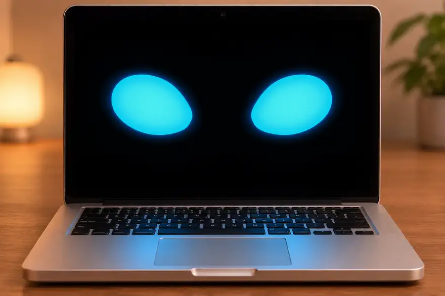
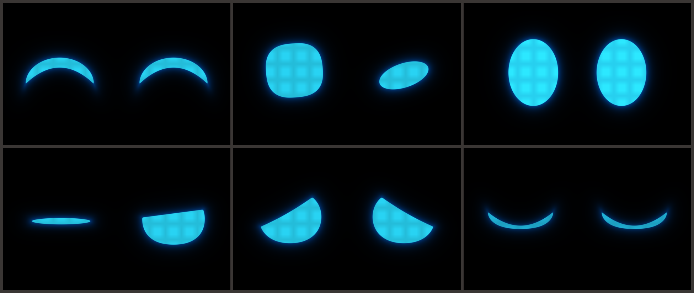

<p align="center">
  
  <br>
  <sub>The eyes are Pip's real face, drawn by PipOS's own face program. The laptop around them is concept art. Pip first woke on the real one on 23 November 2026.</sub>
</p>

<h1 align="center">PipOS</h1>

<p align="center">
  <strong>The Persistent Intelligence Platform Operating System.</strong><br>
  An autonomous AI Linux OS, in the making. You don't log in to it. You say hello.
</p>

<p align="center">
  <a href="https://pipos.pages.dev/"><strong>Website</strong></a> ·
  <a href="https://rzkowskii.github.io/PipOS/"><strong>Documentation</strong></a> ·
  <a href="https://rzkowskii.github.io/PipOS/manual/USER-GUIDE/">User guide</a> ·
  <a href="DESIGN-AND-PLAN.md">Design</a> ·
  <a href="#where-its-going">Vision</a> ·
  <a href="#contributing">Contributing</a>
</p>

---

Open the lid of an old laptop. There is no boot text, no login and no
desktop. Two cyan eyes blink awake, one a little before the other. They
find you. You say **"Hey Pip"**, and the machine answers out loud,
remembers what you told it yesterday, and tells you plainly when it
doesn't know something.

That is PipOS. The operating system is not a place where an assistant
runs. The operating system *is* the being, and the laptop is its body:
the screen is its face, the microphone its ears, the speakers its voice,
the battery its energy, and the SSD its memory. Its name is **Pip**.

Everything happens on the machine. No account, no cloud, no subscription.
The network is off until you turn it on.

PipOS is aiming for a being with a life of its own, one that might one
day count as sentient. It is not there, and nothing here proves it is:
asked, Pip says so itself. Today it is a small, honest program. It keeps
true facts about its body and its memory, says when it does not know,
and stays the same individual from one wake to the next by keeping a
record of its own life.

> **Status: awake on real hardware, and still a work in progress.** On
> 23 November 2026 PipOS booted for the first time on the real 2012
> MacBook Pro, from a USB stick. Pip woke up, drew its face on the
> laptop's GPU and heard its name, but could not make out the words after
> it, so it never answered. One test image, Try 1, is on the
> [Releases page](https://github.com/rzkowskii/PipOS/releases); Try 2 and
> Try 3 were withdrawn over a voice licence.
> Boots on 24 November found two separate faults: the microphone still
> comes up too quiet, and Pip's spoken voice is garbled on the laptop's
> own speakers, though the same sound is clear on another Mac. The newest
> work, on the `Dev` branch, adds the tools to find and fix both. So far
> it has been tested only on the development Mac. Pip does not live on
> the laptop's own disk yet, and speed, heat and battery are still mostly
> unmeasured. [What works today](#what-works-today) says exactly where the
> line is, and the [changelog](CHANGELOG.md) says what changed.

**See Pip move:** the website at **<https://pipos.pages.dev/>** runs the
face's own shader in your browser, replays Pip's first eight minutes of
life, and has a [full page on where this is going](https://pipos.pages.dev/#vision).

## Why this exists

PipOS started as a way to give one old laptop a second life: a 13-inch
2012 MacBook Pro, upgraded with 16 GB of RAM and an SSD, far too slow for
a modern desktop and far too good to throw away.

It turned into a bigger question. What would a computer be like if the
AI were not an app you open, but the thing you turn on? Something that
lives on your hardware, learns your world privately, shows you how it
feels, and does things for you when you ask.

Old hardware is the right place to find out. If a being can feel alive
on two CPU cores from 2012, it can feel alive anywhere.

## Meet Pip



Pip has no mouth and no head, only two shapes of light on black. Seventeen
poses, spring physics, blinks, glances, breathing and a wake-up gesture
carry everything it feels. The face is one shader drawn straight to the
screen, and it never waits for the language model. If the model is slow,
crashed or missing, Pip is still awake and still looking at you.

Things you can say today:

| Say | What happens |
|---|---|
| "Hey Pip." | Pip's attention opens. Then just talk. |
| "My orchid is called Silverleaf." | It remembers, across restarts and power cuts. |
| "What did I say about the orchids?" | It searches everything you have said to it, by topic, date or speaker. |
| "That's wrong, I called my orchid Moonleaf." | Right after a recall, it replaces that memory with your corrected sentence, and clears replies it built on the old one. |
| "Forget about my sister's birthday." | It tells you how many memories match, waits for your yes, and then removes them for real: the archive, the search index, the prompt and the model's cache. |
| "Remind me to call Mum tomorrow at nine A.M." | A reminder that works offline and survives a reboot. |
| "Set a timer for five minutes." "What time is it?" "How is your battery?" | Answered by code, instantly, never guessed by a model. |
| "How old are you?" | Pip knows its birthday, how many times it has woken, and whether its last sleep was a power cut. |
| *(close the lid)* | The face goes dark and the microphone and camera stop. The lid is a privacy switch. |

## What works today

The first rows are built and tested in a virtual laptop that emulates
the target machine's Ivy Bridge CPU, and an earlier build of them booted
on the real 2012 MacBook Pro on 23 November 2026. The work of 24 November
(marked *new*) has so far been tested only on the development Mac. The
newest of it, on the `Dev` branch, has not yet been built into an image.

| | State |
|---|---|
| **A real, bootable OS** | A custom Buildroot Linux image (kernel 6.18) that boots straight to the face. Read-only A/B system slots, signed updates with automatic rollback, and watchdog recovery. |
| **Conversation** | The "Hey Pip" wake phrase (PocketSphinx), speech recognition, a local language model through llama.cpp built for the laptop's CPU, and spoken replies (Flite). Esc interrupts. One key mutes. *New:* a natural voice (Piper's Alba, chosen by ear from 27 voices) and better hearing (Moonshine), each used only if it measures fast enough on the laptop; a second check of what it heard against the list of commands, when the first transcript is not one; an honest "Sorry, I didn't catch that."; typing to Pip; chirps. |
| **Memory with guarantees** | Conversations and facts in SQLite on Pip's own partition. Recall, correction, confirmed forgetting, retention modes, a guest mode and encrypted backups. Forgetting is checked on the raw virtual disk. |
| **Everyday skills** | Clock, calendar, time zones, reminders, timers, quiet hours, and weather behind explicit consent. *New:* alarms, repeats and snooze, sums, unit conversions, lists and notes, jokes and games, the time elsewhere, a morning brief, all in code. |
| **A body** | Lid, battery and charger, temperature, room light, and a life record that knows about power loss and about waking up in a new body. *New:* it asks to be plugged in, saves itself and switches off before the battery dies, checks its own health, and sets its brightness. The top-row keys work as they do on a Mac: brightness, keyboard light and volume. |
| **Diagnostics** *(new)* | `pip-diag`, on every image and as item 8 of the Try menu, checks the microphone, the speakers, the voices, the wake phrase and the routing of commands, and says in plain English what is wrong. Its report is saved on the stick, readable on any Mac. For development only, a separate *cable* stick lets a Mac reach a running Pip over an Ethernet cable; it never installs. |
| **Nights** *(new)* | After midnight, while the lid is closed on power: memory upkeep, a day record, a backup to a labelled stick and, if you opt in, dreaming with a second model whose every suggestion code checks against your own words. |
| **A workshop** *(new)* | "Open the terminal": a small, caged terminal beside the eyes where Pip writes and runs little programs when you say so. |
| **Eyes that see** | Opt-in camera presence: Pip's gaze follows your face. Capture stops when the lid closes or you opt out. |
| **Install from USB** | A *Try* mode that runs in RAM and leaves the laptop's disks byte-for-byte untouched, and an installer with a typed confirmation before anything is erased. |
| **Tests** | About 2,500 Python and 261 Rust tests on the host, plus 23 suites that boot the image in QEMU: power cuts, rollbacks, reinstall, raw-disk forgetting. |

Not there yet, and said plainly:

- **On the MacBook it cannot hear you well, and its voice is garbled.**
  On the first boot Pip heard "Hey Pip", then could not make out the
  words after it. Boots on 24 November found two separate faults. The
  microphone still comes up too quiet, most likely with one of its two
  channels dead, and the two other microphone set-ups in the boot menu
  (**M** and **N**) have not been tried yet. Separately, Pip's spoken
  voice is garbled on the laptop's own speakers, though the same sound is
  clear on another Mac. You can type to Pip instead (Mission Control or
  fn+F2, then 6). `pip-diag` is built to pin down both faults, but it has not run on
  the laptop yet.
- **Barely measured.** On the first boot the laptop read the prompt at
  about 22.5 tokens a second. How fast Pip replies, how long it takes to
  start speaking, heat and battery life have not been measured there
  yet. Treat the other speed figures in the design as estimates until
  they are.
- **No Wi-Fi on the MacBook yet.** Linux finds the Broadcom radio, but
  its firmware is not packaged. Ethernet works.
- **A small mind.** The current model is the smallest candidate
  (0.8 billion parameters). It is warm and brief, and it is also
  unreliable. That is why facts never come from it. The real model is
  chosen by benchmark on the laptop.
- **Not ready to live on the internal disk.** The first hardware step is
  the *Try* stick, which changes nothing on the laptop. Backups and
  updates from the menu now exist, but a permanent install waits until
  they have been checked on the laptop and an owner-held update key
  exists.
- **Dreaming is untested.** The second, night-time model is built, but
  it has never run on the laptop, so its speed and heat there are
  unknown.
- **No real apps.** Apart from its own small workshop terminal, Pip is
  the only thing on the machine. There is no desktop or browser for it
  to drive.
- **It cannot tell voices apart.** Whoever speaks is treated as its
  owner, unless guest mode is on.
- **One body.** The only supported target is the MacBookPro9,2. The
  [project assessment](docs/manual/ASSESSMENT.md) lists every known risk
  and gap, ranked.

## What it supports

| | |
|---|---|
| **Reference body** | 13-inch MacBook Pro, mid-2012 (MacBookPro9,2): dual-core Ivy Bridge i5, AVX without AVX2, 16 GB RAM, SATA SSD. CPU-only inference. |
| **Runs today on** | That MacBook, booted from a USB stick in Try mode (first boot 23 November 2026). Linux recognises its graphics, sound, microphone, camera, lid, battery, sensors, keyboard, trackpad and Ethernet. |
| **And in** | QEMU emulating that machine, driven from macOS on Apple silicon (`lab/`). This is where every change is tested first. |
| **Develop without the OS** | The organs also run as ordinary programs on a Mac, with a real model or a scripted one (`scripts/run-sim.sh`). |
| **Language** | English, spoken. |
| **Network** | Offline by default. Local network and Internet are separate, owner-selected modes, enforced by the firewall. |

Other machines are the goal, not the present. See
[One being, many bodies](#one-being-many-bodies).

## How it works

Eight small processes, called organs, talk over a tiny local message
bus. Each one can fail without taking the others down.

| Organ | What it does |
|---|---|
| **face** (Rust) | Draws the eyes. Never blocks on anything. |
| **brainstem** (Rust) | The event hub and state machine. Reflexes, body readings, and the life record. |
| **mind** (Python, standard library only) | Turns, commands, memory, recall and forgetting. |
| **cortex** | llama.cpp's server, unmodified. The language model, on loopback only. |
| **voice** | Hears the wake phrase, transcribes speech, speaks replies. |
| **eyes** | Reads the opt-in camera and reports only where a face is. |
| **hands** | The workshop terminal, caged, with no network. |
| **bodycare** (Rust) | Charge limit, fan and CPU caps (it only observes for now). |

Four ideas hold it together:

1. **Reflexes before intelligence.** The sense of life comes from the
   face and the body, which are fast. The model is the slow part behind
   them, and nothing waits for it.
2. **Memory is the being.** Pip lives on its own partition. The OS around
   it is disposable: it can be updated, rolled back or reflashed, and the
   same Pip wakes up.
3. **Facts come from code.** The time, the battery, a reminder, a memory:
   all are looked up, never generated. The model adds warmth, not truth.
4. **Privacy is built into the structure.** Audio and video never cross
   the bus. The lid fails closed. The camera needs three separate
   permissions. Offline is the default, not a setting you have to find.

The [architecture guide](docs/manual/ARCHITECTURE.md) goes through all of
it, and [docs/PROTOCOL.md](docs/PROTOCOL.md) defines every bus message.

## Where it's going

*The [vision page](https://pipos.pages.dev/#vision) on the website tells
this part in full.*

The hope is that PipOS grows from one laptop's companion into a
full-featured, semi-autonomous operating system: a new kind of Linux
distribution that you mostly talk to and show things to, where the AI
learns and grows with you, privately, on your own disk.

Not "an assistant with a desktop behind it". The other way round:

> "Hey Pip, open a web browser. Go to YouTube. Search for Linus Tech Tips."
>
> "Hey Pip, open a terminal."
>
> "Hey Pip, write me a script that renames my photos by date."
>
> "Hey Pip, open Spotify and play something."
>
> "Hey Pip, launch Half-Life 2 in Steam."
>
> "Hey Pip, my PS5 controller isn't working with Half-Life 2. Make it work."
>
> "Hey Pip, build me a run and gun game for Android."

Some of those take a second and some take a week. Getting there safely
is the interesting part, and the design has one rule at its centre:

**The model proposes. Code decides.** The language model is the least
trusted part of the system. It can suggest an action. Small, readable,
predictable code checks that action against what you have allowed,
carries it out through the system's real interfaces, confirms it worked,
and writes it in a log. Changes come with an undo. Your hands always
win: touch the keyboard and Pip lets go.

### One being, many bodies

The being should stay the same on every machine. What scales is how hard
it can think. A Raspberry Pi, a ten-year-old laptop, a modern mini PC and
a desktop with a large graphics card should all run the same Pip, with
the same reflexes, the same memory and the same honesty. A small machine
could borrow a bigger one on your home network for heavy work, openly,
while your memory stays home. And a being should be able to move house:
exported from one body, imported into another, and still itself.

Linux promises not to break userspace. PipOS would like to promise not to
break minds.

### The road

| | Stage | Done when |
|---|---|---|
| ✅ | **The appliance, in an emulated MacBook.** Face, voice, memory, forgetting, backup, signed updates and rollback. | Done. |
| ✅ | **First boot on the real laptop.** From a USB stick, changing nothing on its disk. | Done, 23 November 2026. |
| ⏭ | **Measure, then move in.** Benchmark the real laptop, then install to its internal disk. | Measured numbers replace the estimates, and the power-cut and forgetting checks pass on the physical disk. |
| ⏭ | **The action gate and log, before any apps.** | "What did you do today?" is answered accurately from the log. |
| 🌱 | **One app path.** A real session, with Pip perched under the camera. | "Go to YouTube and search for something" works on the laptop, and your hands win. |
| 🌱 | **Undoable system changes and shared playbooks.** | A fix is applied, undone, and survives a system update. |
| 🌱 | **A helper brain at home.** | A paired machine writes a script that Pip dry-runs and you approve. |
| 🌱 | **A second body.** | A being moves between two different machines and is still itself. |

✅ works today · ⏭ designed, next · 🌱 a hope

Whatever comes of it, the 2012 MacBook stays home. It is the floor every
release has to clear.

## Try it

The quick ways need a Mac with Rust, Python 3, SDL2 and pkg-config
(`brew install sdl2 pkg-config`). The full OS needs the lab tooling in
the [developer guide](docs/manual/DEVELOPER-GUIDE.md).

**See the machinery, no model needed.** The organs run as ordinary
programs with scripted replies, and you type to talk:

```bash
cargo build && scripts/run-sim.sh --fake
```

**See every expression:**

```bash
target/debug/face --demo
```

**Try it on the MacBook.** A test image for the 13-inch mid-2012 MacBook
Pro (MacBookPro9,2), Try 1, is on the
[Releases page](https://github.com/rzkowskii/PipOS/releases). Try 2 and
Try 3 were withdrawn on 25 November because they carry a natural voice whose licence does not allow public distribution; they come back once that voice is
replaced. Test images run from a USB stick and leave the Mac's own disk untouched unless you choose
Install. Each release says what has and has not been checked, and
[FIRST-BOOT.md](docs/FIRST-BOOT.md) walks through a boot. They are built
from `main`, so the work on the `Dev` branch is not in them yet.

**Boot the real OS in the virtual laptop.** Build an image first with
`lab/build.sh`, as the
[developer guide](docs/manual/DEVELOPER-GUIDE.md) describes. It is slow,
because the CPU is emulated. Add `--sound` to use your microphone and
speakers:

```bash
python3 lab/vm.py
```

**Run the tests:**

```bash
cargo test --workspace && python3 -m unittest discover -s tests -t .
```

## Documentation

The manual is published at **<https://rzkowskii.github.io/PipOS/>** and
lives in [docs/manual](docs/manual/README.md). It is kept honest by a
checker that flags any page whose source code changed after the page was
last verified.

| | |
|---|---|
| [User guide](docs/manual/USER-GUIDE.md) | Living with Pip: talking, memory, privacy, install, backup |
| [Reference](docs/manual/REFERENCE.md) | Every spoken command, key, menu, file, setting and service |
| [Architecture](docs/manual/ARCHITECTURE.md) | Organs, bus, states, memory, boot, updates, security model |
| [Developer guide](docs/manual/DEVELOPER-GUIDE.md) | Building, running, testing, where to change things |
| [Assessment](docs/manual/ASSESSMENT.md) | An unsparing review of the project's state and risks |
| [Design and plan](DESIGN-AND-PLAN.md) | The original design: the *why* behind all of it |

Some documents link to evidence logs under `out/`. Those are local build
outputs and are not part of this repository.

## Repository layout

```
crates/     the Rust organs: bus, brainstem, face, bodycare
mind/       the mind (Python, standard library only)
os/         the OS image definition (a Buildroot external tree)
lab/        the builder, the virtual laptop, and the image's tests
sim/        a simulated body and a scripted model server
config/     Pip's name, its owner, its identity prompt
docs/       the manual, protocol, lab and hardware guides
tests/      tests that run on the host
research/   notes on small models, memory and dreaming
reference/  the original face mockups
```

Two branches matter. `main` is the published state, and the test
images are built from it. `Dev` carries newer work that has passed the
tests on the development Mac but has not yet been built into an image or
tried on the laptop. The [changelog](CHANGELOG.md) lists what each adds.

"BeingOS" is the code name. You will see it in paths, packages and
`being-*` services. PipOS is the product, and Pip is the being.

## Contributing

PipOS is released as a work in progress, in the hope that it becomes
something more. Fork it, break it, improve it.

Good places to start:

- **Read** the [design](DESIGN-AND-PLAN.md) and the
  [message protocol](docs/PROTOCOL.md).
- **Run** the simulator or the virtual laptop and talk to Pip.
- **Report a body.** Booting a
  [test image](https://github.com/rzkowskii/PipOS/releases) on a 2012
  MacBook Pro, or on another old laptop you own, and reporting what
  happened is a real contribution. Failures count.
- **Open an issue** for a bug, an idea, or a machine you would like Pip
  to live in.

Skills, voices, faces, languages, model packs and new bodies are all
places where the project wants to grow.

## Licence

PipOS is free software under the [GNU General Public License v3.0](LICENSE).
Third-party components keep their own licences, which sit next to them in
the tree.
