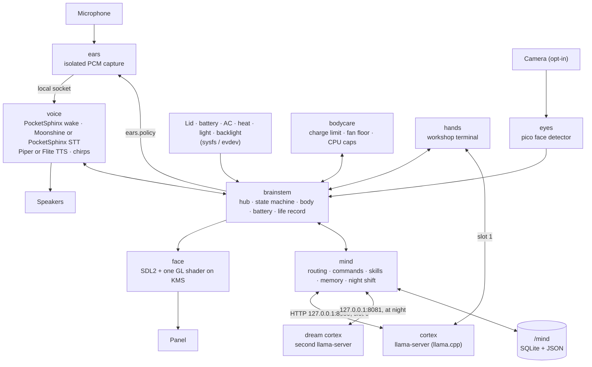

<!--
doc: architecture
verified: 2026-11-28T13:20
sources: crates/bus/src/lib.rs crates/brainstem/src/main.rs crates/brainstem/src/machine.rs crates/brainstem/src/body.rs crates/brainstem/src/battery.rs crates/brainstem/src/brightness.rs crates/brainstem/src/kbd_light.rs crates/face/src/keys.rs mind/keys.py mind/app_commands.py mind/mic_port.py mind/mic_channel.py mind/try_mode.py mind/diag.py mind/diag_sound.py mind/install_apply.py os/package/being/being-cable-link.service os/package/being/being-cable-ssh.service os/package/being/being-cable-workbench.service os/board/beingos/linux-cable.config crates/brainstem/src/peer.rs crates/brainstem/src/life.rs crates/brainstem/src/camera.rs crates/brainstem/src/linux_body.rs crates/bodycare/src/main.rs crates/bodycare/src/policy.rs crates/face/src/main.rs crates/face/src/anim.rs crates/face/src/link.rs crates/face/src/render.rs crates/face/src/eye.rs crates/face/src/pace.rs crates/face/src/dpms.rs crates/face/src/overlay.rs mind/turn.py mind/played.py mind/everyday.py mind/memory.py mind/embed.py mind/cortex.py mind/speech.py mind/voice.py mind/voice_engines.py mind/hands.py mind/night_shift.py mind/dream_model.py mind/dream_verify.py mind/eyes.py mind/retention.py mind/dream_policy.py mind/dream_store.py mind/boot_health.py mind/installer.py mind/network_policy.py mind/network_enforce.py os/package/being/being.mk os/package/cortex/being-cortex.service os/package/cortex/being-dream-cortex.service os/board/beingos/grub.cfg os/board/beingos/genimage.cfg os/board/beingos/post-build.sh os/board/beingos/rauc.conf mind/storage.py mind/backup.py mind/backup_crypto.py mind/wifi.py mind/initiative.py mind/consolidation.py mind/install_binding.py mind/usb_logs.py mind/model_pack.py mind/bus.py mind/local_screen.py mind/local_menu.py os/package/being/being-try-generator os/package/being/being-installed-generator os/package/being/being-screen-mode os/package/being/50-being.preset os/package/being/30-model-pack.conf os/board/beingos/being-update-ready os/board/beingos/slots.sh mind/diag_speech.py os/package/being/cable/sshd_config lab/build.sh os/package/being/being-health-watch os/package/being/being-health-watch.service crates/ears/src/main.rs crates/ears/src/linux.rs crates/brainstem/src/ears.rs crates/brainstem/src/camera_look.rs crates/brainstem/src/camera_usb.rs crates/bus/src/body_drives.rs crates/bus/src/body_map.rs config/body-maps.json os/package/being/being-ears.service mind/vision_describer.py mind/vitals.py mind/ponder.py mind/habits.py mind/intents.py mind/update_checkpoint.py mind/update_slots.py crates/face/src/quick_menu.rs crates/face/src/options.rs
-->

# PipOS architecture

This is the technical reference for PipOS. It describes what the code does
today. For the original intent and the reasoning behind it, see
[DESIGN-AND-PLAN.md](../../DESIGN-AND-PLAN.md) (historical) and
[DESIGN.md](../DESIGN.md); the function spec is
[PIP-FUNCTIONS.md](../PIP-FUNCTIONS.md). The documents differ in places,
and [remaining hardware and design work](#remaining-hardware-and-design-work)
lists where.

> **Naming.** The product is called **PipOS**. That name appears in the
> boot menu, the installer and the update certificate. The repository,
> packages, services and older documents still say **BeingOS** and
> `being-*`. **Pip** is the default name of the being itself, and the
> owner can rename it.

## 1. The idea in one paragraph

PipOS turns a 13-inch 2012 MacBook Pro (MacBookPro9,2: Ivy Bridge, two
cores, AVX without AVX2, 16 GB, Intel HD 4000, 1280×800) into a single
appliance character. Power it on and it boots straight to a pair of glowing
cyan eyes. There is no desktop, no login and no visible boot text. It
listens for its name, answers in a synthetic voice, remembers what you tell
it, and reports only true facts about its own body: battery, heat, light
and the lid. Conversation and memory run entirely on the laptop. The
network is optional and controlled by the owner. The project is aiming
for a being with a life of its own; nothing in it claims or proves that it
is sentient.

Three principles drive the design:

1. **Reflexes carry the sense of life, not the language model.** The face
   animates at up to 60 fps no matter what the model is doing.
2. **The mind partition is the being, and the OS is disposable.** You can
   reflash the system image, and memory survives it.
3. **Honest body, inspectable memory.** Pip only states sensor facts it
   actually read, and you can correct or delete any memory.

## 2. The organs

PipOS runs cooperating processes, called "organs", around one message
hub. They are split along failure domains, so a crashed or slow model never
freezes the face.



| Organ | Language | Binary / module | Job |
|---|---|---|---|
| **brainstem** | Rust | `being-brainstem` (`crates/brainstem`) | Bus hub, state machine, body sensors, battery care and power-off, brightness, drives, life record, camera policy, peer checks, systemd watchdog |
| **face** | Rust | `being-face` (`crates/face`) | Draws the eyes, the workshop panels and the captions overlay, and turns keys and clicks into events. Keeps animating if every other organ dies |
| **mind** | Python (standard library) | `python3 -m mind` | Routing, direct commands, everyday skills, prompt building, memory, reminders and rings, announcements, battery pleas, self-care, the night shift |
| **voice** | Python + native libraries | `python3 -m mind.voice` | Microphone audio from `being-ears` on the appliance (ALSA capture itself in lab and test runs), ALSA playback, software gain and channel choice, PocketSphinx wake phrase, transcription (Moonshine through sherpa-onnx, or PocketSphinx), synthesis (Piper through sherpa-onnx, or Flite), chirps |
| **ears** | Rust | `being-ears` (`crates/ears`) | The only owner of the capture device on the appliance. It records only while the brainstem's current `ears.policy` grant is true, and passes raw PCM over a local socket (`/run/being/ears.sock`) to the voice unit alone. It sends the bus only a count of capture overruns |
| **eyes** | Python + C++ | `python3 -m mind.eyes` → `eyes-capture` | Opt-in camera. Reports only face presence and a normalized position. On request for one addressed turn it can also pass a single frame to an optional local describer (see [Remaining work](#remaining-hardware-and-design-work)) |
| **hands** | Python (standard library) | `python3 -m mind.hands` | The workshop: a caged terminal, code written from recipes or the model's slot 1, run only when asked |
| **bodycare** | Rust | `being-bodycare` (`crates/bodycare`) | One owner of the charge limit, fan floor and CPU caps. The unit runs it in observe mode: it decides and reports, and writes nothing |
| **cortex** | C++ | `llama-server` (llama.cpp v1.0.0) | Conversation model behind a chat-completions HTTP API on loopback |
| **dream cortex** | C++ | a second `llama-server` | The night model, started and stopped by the night shift |

Audio and video never leave the organ that owns the device, and neither
ever crosses the bus. Microphone audio goes from the ears to the voice over
a private local socket that only the voice unit may open. Keystrokes, script text and program output in the
workshop never cross it either.

## 3. The bus

Each organ connects to one Unix-domain socket. The path is `--bus` if
given, otherwise `$BEING_BUS`, then `$XDG_RUNTIME_DIR/being/bus.sock`,
then `/tmp/being-$USER/bus.sock`. On the appliance, `/etc/being/env`
sets `BEING_BUS=/run/being/bus.sock`, and the units pass it as `--bus`.
Every message is one JSON object on one line, and its topic is in the
field `t`:

```json
{"t":"hear.final","text":"what time is it","speaker":"owner"}
```

The full topic list is in [PROTOCOL.md](../PROTOCOL.md). The behaviour
that matters for understanding the system:

- **Joining.** An organ's first line is `hello` with its `name` and its
  subscriptions. A subscription is an exact topic, a `prefix.*` or `*`.
  The brainstem replies with the snapshots the organ subscribes to, in a
  fixed order: `body.lid` first, then `state.changed`, `camera.policy`,
  `body.senses`, `body.state` and, once the life record is open,
  `life.woke`, then `hello.ok` if asked for. A restarted organ therefore
  learns its privacy state before it processes any conversation.
- **Who may claim a name.** On the appliance the brainstem reads each
  peer's credentials and systemd unit: only `being-mind.service` may call
  itself `mind`, only the face or local-screen units `face`, only the
  voice (or the lab body) `voice`, and likewise for `eyes`, `hands`,
  `bodycare` and the typing chat's `keyboard`.
- **Reserved topics.** Only the brainstem may send `organ.*`, `stem.*`,
  `state.*`, `body.*`, `face.*`, `camera.policy`, `voice.mute`,
  `say.stop`, `mind.cancel`, `hello.ok` and `ears.*`; bodycare alone may
  send `body.care`, and the ears alone `ears.capture`. The brainstem also
  checks who sends certain topics:
  - On the laptop, `key.*` comes only from `face`, except `key.mute`
    from the mind (and only to mute, for "stop listening") and
    `key.interrupt` from the typing chat. That includes the top row's
    `key.brightness` and `key.volume` (`dir`: `up` or `down`),
    `key.kbd_light` (`up`, `down` or `toggle`), `key.mute_speaker` and
    `key.apps` (Launchpad), which the brainstem passes on to the mind
    (`mind/keys.py`); none of them is held back by a closed lid.
  - On the laptop, `hear.*` comes only from `voice`, or from the typing
    chat (`keyboard`). No other organ can put words in the owner's mouth.
  - `see.*` comes only from `eyes`. `camera.look` and `camera.look_cancel`
    come only from the current `mind`, and `camera.look_result` only from
    `eyes`.
  - `panel.ready`, `key.panel_recover` and `key.touch` are accepted only
    from `face`. The on-panel setup console joins under that name while
    it is showing.
  - `mind.announce`, `mind.clock`, `mind.progress`, `mind.shutdown_ready`,
    `mind.dream_committed`, `mind.dreaming`, `being.brightness`,
    `being.kbd_light` and the voice controls (`voice.volume`,
    `voice.chirps`, `voice.level_request`, `voice.engine`) are accepted
    only from `mind`. `voice.volume_state` and `voice.level` only from
    `voice`.
  - The fields the keys added: `being.brightness` may carry `by` (1 to 50
    points; a key steps by 6) and `being.kbd_light` takes `step` (1 or
    −1), `level` (0 to 100) or `toggle: true`. A short `req` tag on either
    comes back on the brainstem's answer (`body.brightness` or
    `body.kbd_light`), so a spoken "brighter" never takes a key's answer;
    the mind's keys tag theirs `req: "key"`. `body.kbd_light` carries `ok`,
    `level`, `on`, `at_max`, `at_min` and `limited`, or `ok: false` with a
    `reason`. `voice.volume` may carry `persist: false` (a key mute: applied
    now, never saved) and `feedback: true` (the volume keys' click). The
    voice also follows `mind.ready` (for its one speed measurement in a
    Try session, and to report its level to a mind that connects later)
    and `app.privacy` (no transcript text in the log while a guest is
    here; the mind sends it again to a voice that restarts in guest
    mode).
  - The install screen's `voice.install_status` is accepted only from the
    local-screen unit, carries one of a fixed list of stages and no text, and
    is dropped while the lid is not open. `voice.prepare` (overnight
    synthesis of up to eight short clauses, with no playback) is accepted only from the mind unit, only while the lid is
    confirmed closed and Pip is asleep, never in guest mode, and only the
    voice unit receives it; it is left out of the bus journal.
  - An announcement's `say.done` is accepted only from `voice`.
  - `say.played`, which says what of a reply really played, is accepted
    only from the current `voice` connection in the current lid state.
- **Back-pressure.** Lines over 64 KiB are dropped. An organ whose
  512-line queue fills up, or whose write takes over a second, is
  disconnected.
- **Heartbeat.** `stem.beat` goes out about every half second, checked on
  the brainstem's 100 ms tick. The face shows a dazed look if it hears
  nothing for 3 s.
- **Lid sequencing.** Every change of lid reading increments `lid_seq`.
  Voice and mind output can carry it, and the brainstem drops packets
  from an earlier lid state. This stops a stale reply from playing after
  the lid is closed and reopened.

## 4. States

The brainstem owns one state, and two overlays sit on top of it.

| State | Entered when | Face |
|---|---|---|
| `waking` | Boot, lid opened, `being.wake`, wake phrase while asleep, morning | Eyes open |
| `idle` | Awake and nobody engaging | Neutral, wandering glances, blinks, breathing |
| `attending` | Wake phrase heard, `key.attend`, or a turn just finished | Attentive. Follow-up speech needs no wake phrase |
| `listening` | Speech started while attending | Focused |
| `thinking` | Final transcript received, or an announcement got the floor | Glances away, searching |
| `speaking` | First audio playing | Pulses with the voice level |
| `drowsy` | Idle for 15 minutes **and** the room is dark or it is night | Heavy lids, yawn |
| `asleep` | 3 minutes after drowsy, "go to sleep", or lid closed or unknown | Closed eyes. The panel goes dark only when the lid is closed or its reading is unknown (unless recovered with F9). Sleep with the lid open keeps the panel lit |

Overlays:

- **`muted`** is toggled by the **M** or **F10** key (and set by the mind
  for "stop listening"). The microphone closes, wake and speech events
  are ignored, and the face shows the `muted` pose: both eyes narrowed to
  thin, dim, flat slits.
- **`unwell`** is set when a required organ (`face`, `mind` or `voice` by
  default) is missing after the 20 s boot grace, or has disappeared after
  being seen. The face shows `dazed`. It is also set when the microphone
  safety latch trips: if capture is still open 1 s after policy closed it
  (the brainstem samples the capture device), the brainstem writes
  `/run/being/mic-policy-breach`, reports it (`body.mic_policy`), stops
  `being-ears` and `being-voice`, and stays unwell until reboot.

### Main transitions and timers

| Timer | Default | Effect |
|---|---|---|
| Minimum waking | 1.5 s | Waking lasts at least this long. It then ends once the required organs are up and the mind has sent `mind.ready`. A lid wake skips the wait for organs but still waits the minimum |
| Follow-up window (`attend`) | 20 s | Attending returns to idle |
| Listening silence | 15 s | Listening returns to attending |
| Think timeout | A mind that reports `mind.progress` is cancelled after 45 s without a report, or 600 s in all. A mind that never reports gets 300 s. QEMU lab: 300 s stall, 1800 s cap. `BEING_THINK_TIMEOUT` / `--think-timeout` and `BEING_THINK_STALL` / `--think-stall` override these | Cancels the reply, shows concern for 3 s |
| Speak timeout | 60 s (QEMU lab: 900 s) | Sends `say.stop {reason: speak_timeout}` |
| Drowsy after | 900 s of no stimulus, dark or night only | Idle becomes drowsy |
| Asleep after | 180 s drowsy | Drowsy becomes asleep (natural sleep) |
| Morning wake | 60 s asleep, lid open, not dark, not night | Natural sleep becomes waking. Sleep requested with "go to sleep" is not undone by morning |

"Night" means outside 07:00–21:59 in the owner's time zone. The mind sends
the zone with `mind.clock {utc_offset}`. "Dark" means below 5 lux.

A restarted brainstem does not wake the being again: it reads its coarse
state (waking, awake or asleep), mute and kind of sleep from `stem-state`
beside the bus socket in `/run`, which a reboot clears. For 3 s after a
restart an unknown lid is not applied to the state, so the first real
reading decides; privacy does not wait, because an unknown lid is treated
as closed from the start.

If the voice or the mind drops off the bus or comes back as a new
connection while a turn is in progress, the brainstem ends that turn at
once (`mind.cancel` with a `voice_restarted`, `voice_lost`,
`mind_restarted` or `mind_lost` reason) and goes back to attending, so the
ears open again. The exception is a reply that is already wholly with the
voice, which the voice finishes by itself. A heard final with no mind
connected counts as a missed sentence, not a thinking turn.

**Esc** (`key.interrupt`) cancels thinking or speaking at any time. It
sends `say.stop` and `mind.cancel`. Pip then remembers only the clauses
that started playing (step 8 of the reply, below).

### The lid is the privacy switch

A lid that is not *confirmed open* counts as closed. This includes a lid
whose reading is unknown. In that case:

- the state goes to `asleep`, and any reply, audio or capture in progress
  stops;
- the microphone and camera stay closed;
- the panel is blanked.

On a confirmed opening, the brainstem moves to `waking` without waiting
for the model. The face plays a 1.23 s asymmetric peek-and-blink wake
gesture and reports `panel.ready` after its first lit frame. Only then
does the brainstem restore backlight power.

If no lid reading has arrived since the full-screen face started, the
face asks for recovery after 4 s. After a further 2 s, or if no
brainstem is present, it shows itself anyway. A lid that was read and
later goes unknown stays dark until **F9** forces recovery.

### Battery care

`crates/brainstem/src/battery.rs` judges the battery from time to empty
first and percentage second, because worn cells cut out at a reported
10–30 %. A level counts only after the readings have held it for 30 s.

| Level | When (unplugged) | What happens |
|---|---|---|
| low | ≤ 15 % or < 30 min left | The mind pleads once to be plugged in |
| very low | < 10 min left | A second, more urgent plea |
| critical | ≤ 5 %, < 5 min, or the pack under 9.3 V for 30 s | `stem.shutdown {reason: battery_critical, in: 20}`: the mind saves, says goodbye and answers `mind.shutdown_ready`, then the brainstem runs `systemctl poweroff` |

The brainstem also powers off after the lid has been closed on battery
for 10 minutes (`lid_closed_on_battery`). Plugging in during the grace
cancels either. On battery the level only climbs, and plugging in earns
a "thanks". The mind takes the brainstem's level when it sends one, and
needs two `body.state` updates in a row calling for a plea before it
speaks; a critical reading starts a silent save at once. Every threshold
is a `BEING_BATTERY_*` variable ([reference](REFERENCE.md#environment-variables)).
Only a hardware body (or a test naming `--poweroff-cmd`) powers off.

## 5. The face

- **Rendering.** SDL2 on KMS/DRM, with no window system. SDL2 carries
  one local patch, `os/patches/sdl2` (XRGB8888 scan-out). It requests an
  OpenGL 3.3 Core context and falls back to GLES 3.0 (the real laptop
  used GLES 3.0 on Mesa's crocus driver). One full-screen triangle and one
  fragment shader draw two signed-distance superellipse eyes, cut by
  lids, with bloom and an LED-grid texture. The colours are cyan on black.
- **Pace.** The face draws at 60 Hz only while something moves quickly
  (speech, attention, a blink, a gesture, a glance), at 30 Hz while it
  idles or thinks, 15 Hz asleep and 5 Hz while the panel is dark. A
  software renderer such as the QEMU lab never goes above 20 Hz, at
  quarter scale. While dark, it also turns the panel connector off through
  DRM DPMS (`BEING_FACE_DPMS=0` stops that), because `bl_power` does not
  switch off the MacBook's LVDS backlight.
- **Expressions.** The expression table (`crates/face/expressions.json`)
  has 48 poses: the 17 original ones (`neutral`, `attentive`,
  `listening`, `thinking`, `speaking`, `joy`, `curiosity`, `surprise`,
  `skepticism`, `concern`, `sleepy`, `asleep`, `dreaming`, `tired`,
  `muted`, `loading` before the brainstem first answers, and `dazed`) and
  thirty-one more (`sad`, `laugh`, `love`, `embarrassed`, `scared`,
  `annoyed`, `smug`, `confused`, `wink`, `bored`, `relieved`, and the
  shock family `shocked`, `startled`, `gasp`, `amazed`, `bewildered`,
  `speechless`, `horror`, `stunned`, and the warm ladder `pleased`, `excited`, `victorious`, `angry`,
  `disappointed`, `grateful`, `amused`, `giggle`, `bashful`, `hopeful`,
  `encouraging`, `reassuring`). The brainstem and the face can ask
  for any of them except `dreaming` and `loading`; the tuned ones keep
  the pose clamp and the 60 Hz kick window the audition poses had. The model can still choose only one of seven
  emotions for its reply: neutral, joy, curiosity, surprise, skepticism,
  concern and sleepy. A clause that admits a failure ("I couldn't find
  …") shows `concern` whatever the tag. Live reactions: a failed job
  shows `sad` and a finished one `relieved` (brainstem, from
  `term.status`, once per job); a hearing that was unclear shows
  `confused`; the charger going in after a low-battery warning shows
  `relieved`; sustained heat shows the `tired` cue (below).
- **Motion.** Every expression-shape parameter is driven by a slightly
  underdamped spring (damping 0.82). Lively arrivals such as joy and
  surprise use looser springs so they overshoot a little. Gaze, blinks
  and the speech envelope have their own timing. Blinks come every
  2.5–5.6 s and wait for gaps in speech. The face also makes saccades,
  idle look-aways, room surveys and thinking "search hops". Every 20–38 s,
  while the lids are still light, there is a contented idle gesture. A
  yawn plays once when the lids first grow heavy, and again on turning
  drowsy. The lids grow heavier during long quiet spells alone. Breathing
  runs at 0.22 Hz awake and 0.13 Hz asleep. A speech envelope follows
  `say.level`. When the battery is low, the face shows a `tired` cue for
  6 s every 45 s while idle. Sustained heat does the same: after 30 s of
  Bodycare's thermal `hot` or `critical` pressure (read from
  `stem.budget`, with no temperature of its own) the cue runs until 60 s
  pass without it. It appears only where Bodycare runs, so the lab image
  never shows it; that is expected, not a fault. A low-battery cue wins
  over it.
- **Drives.** The brainstem's `body.drives` shape the idle face: a flat
  battery or heat makes the lids a little heavier, a long quiet slows the
  idle glances, and after about half an hour alone the face greets a
  returning person more eagerly.
- **Inputs.** The laptop boots with `hid_apple.fnmode=1`, as a Mac does:
  the top row sends what is printed on it, and fn+key sends F1 to F12
  (`crates/face/src/keys.rs`). The face turns these keys and clicks into
  events:

  | Input | Event |
  |---|---|
  | Esc | `key.interrupt` |
  | M, F10 (fn+F10 on the MacBook) | `key.mute` (the microphone) |
  | F9 | `key.panel_recover` |
  | F1 | Toggles local captions and their route badge. Nothing is logged |
  | Shift+F1 | Toggles the hardware and service health overlay |
  | F2, or Mission Control | Starts the local setup screen |
  | F6 (fn+F6 on the MacBook), or Command+Space | Opens or closes the Quick Menu (unless set to Off, or a guest is here) |
  | Brightness down, up | `key.brightness` |
  | Keyboard light down, up, toggle | `key.kbd_light` |
  | Volume down, up | `key.volume` |
  | Mute | `key.mute_speaker` (the speaker) |
  | Launchpad | `key.apps` |
  | Play/pause | `key.attend` while the eyes rest and no panel has focus, else `key.interrupt` |
  | Previous, next, eject | Nothing; logged, never typed anywhere |
  | Click or touch | `key.touch`: a brief downward glance |
  | Space, Return, or a click, while the eyes rest and no panel has focus | `key.attend`: the brainstem treats it like hearing its name |
  | Other keys while a workshop panel has focus | Sent to the hands organ (never the top row's printed keys) |

  The brightness, keyboard-light and volume keys repeat while held. SDL
  has no code for Mission Control and Launchpad, so the face reads those
  two from the keyboard's event device. The mind answers the top row's
  events in code and never speaks for them (`mind/keys.py`): brightness
  through `being.brightness` by 6 points, the keyboard light through
  `being.kbd_light` in sixteenths (the brainstem owns the applesmc LED,
  turns it off while the panel is dark and puts back the level it found
  when it stops), the volume through `voice.volume` on a Mac's sixteen
  steps, and Launchpad through the workshop, as "open the terminal". The
  speaker mute is for now only: `voice.volume` with `level: 0` and
  `persist: false`, a `speaker-muted` marker in `/mind`, and a ring, a
  battery plea or the next start of the mind brings the sound back. For
  1.5 s after a change, the face shows a level bar drawn from what the
  brainstem and the voice report (`body.brightness`, `body.kbd_light`,
  `voice.volume_state`), so a spoken "louder" shows it too. The full key
  table is in the [reference](REFERENCE.md#keys-and-touch).

  `hear.missed` (heard, but nothing made out) shows `skepticism` for
  about a second.
- **Panels.** The hands organ draws the workshop terminal and its apps
  into frame files under `/run/being-panel` (`being-panel-frame.h`
  defines the header). The face shows them beside the eyes, which then
  look at the panel. The face also draws some surfaces itself: the Quick
  Menu (`crates/face/src/quick_menu.rs`, which opens the apps, Care and
  settings), the keyboard Options surface (`options.rs`, whose edits are
  requests to the mind, which validates and saves them) and optional clock,
  system and weather widgets. The user guide describes how to use them.
- **Preview.** These flags help with review:

  | Flag | Effect |
  |---|---|
  | `--demo` (`target/debug/face --demo`) | Cycles every expression and a dreaming preview |
  | `--script tour\|drowse` | Plays a scripted scene |
  | `--frames DIR` | Saves a scene as numbered PNG frames |
  | `--record FILE.png` | Saves a still of the face when it quits |

## 6. The mind

### A conversational turn

1. The voice organ hears the wake phrase and sends `hear.wake` (or the
   face sends `key.attend`). The brainstem moves to `attending`, and the
   voice chirps.
2. The voice organ streams `hear.partial` messages, then sends
   `hear.final`. The brainstem moves to `thinking`. With PocketSphinx, a
   final of 4 s or less that is not a workshop command is decoded once
   more with a JSGF grammar of the safe workshop phrases
   (`app_commands.grammar_phrases()`: open, close, minimise, restore or
   say, never anything destructive). The grammar's phrase replaces the
   final only when it beats a free phone loop by 6 per 10 ms frame, the
   final already holds the phrase's own words, nothing turns it around
   ("don't …"), and at most two other words are left over.
3. The mind cleans the text: it drops "please" and an address such as
   "Pip," or "hey Pip". A follow-up heard without the name is taken only
   with a sign it was meant for Pip (a question, its name, an answer to
   its question, or a command that stores nothing); otherwise it is
   counted and dropped. Then it routes the utterance, in this order
   (PIP-FUNCTIONS 5.2):
   1. guest mode on or off, which goes ahead even while a question is
      open;
   2. an answer to something it asked: a forget offer, a skill's yes or
      no, a ring;
   3. the workshop (`mind/app_commands.py`);
   4. the direct commands: memory, time, reminders, weather, self-talk,
      volume (see the [reference](REFERENCE.md#spoken-commands));
   5. the everyday skills (`mind/everyday.py`): read-back, sums, units,
      lists and notes, play, body talk, device, removable media (an
      explicit, bounded look at or eject of a stick; inserting one never
      triggers it), the owner's opt-in file keep, doctor, action log,
      diary, requested night jobs, voice engines, opening Care settings
      by voice, the offline guide and dictionary, and the overnight
      speech preparation;
   6. a greeting or check-in, or the morning brief;
   7. the model.

   Two owner-taught layers sit beside these steps. Phrase habits
   (`mind/habits.py`: "new habit …", a trigger phrase and up to six local
   steps, confirmed by a plain yes) and learned shortcut phrases
   (`mind/intents.py`) are managed by their own spoken commands, which are
   matched before the steps above. A saved habit or shortcut phrase is tried
   only when no other step claimed the words. Managing them logs
   `everyday.habits` or `everyday.intent_shortcuts`.

   Each turn logs one line naming the step that answered it, such as
   `route {"route": "workshop.open", "chars": 15}`; the words are added
   only in voice-debug mode. While a guest is here, or while memory is
   `session-only` or `explicit-only`, the line is
   `route {"route": "private"}`
   ([reference](REFERENCE.md#voice-debug-and-route-lines)).

   An addressed owner can bookmark the latest ordinary conversation
   in persistent mode. The bookmark is an archive record linked to
   the original episode. Resuming it adds that live episode to the
   normal highlight list. Source correction, expiry and forgetting
   revoke it through the same deletion proof as the rest of the archive.
4. A code answer replies at once. It never invents anything.
5. A model turn works like this:
   1. The mind builds the prompt from these parts:
      - the identity;
      - the core profile, in persistent owner mode. A consented night
        can select up to four recent confirmed owner facts. A manual
        `core.md` takes precedence;
      - up to three dated highlights;
      - the recent conversation turns;
      - the senses line;
      - at most one recall note. The note holds either up to two facts
        within 110 characters, or one past exchange of up to 110
        characters per side.
   2. While the being is awake the prompt only grows by appending, so
      llama-server's cache is reused; rewriting (compaction) waits until
      it is idle. A byte-stable chat template
      (`config/chat-template.jinja`) renders past replies exactly as they
      were generated.
   3. It streams a reply from `llama-server`, pinned to slot 0. A grammar
      forces the reply to begin with an `[emotion]` tag. The shipped
      `reply_shape strict` grammar also holds it to one or two whole
      sentences; `open` does not. A story request keeps the open shape
      and a larger token budget.
   4. It removes any `<think>` blocks, markup and emoji.
   5. It splits the text into clauses and sends each one as a
      `say.request`.
6. Guards run before anything is spoken:
   - **EchoGuard** stops a reply that starts reciting private notes or
     senses.
   - **Parrot guard** never speaks a clause that only repeats the
     question. A reply opening with assistant boilerplate ("As an AI…")
     is retried too, unless the owner used those words first; the last
     try is spoken even then. Retries run at higher temperatures; when
     nothing is left, it says "Sorry. I lost my thought."
7. The voice organ speaks each clause with Piper or Flite and reports
   `say.started`, `say.level` and `say.done`. The microphone is closed
   while it speaks (half-duplex).
8. Each clause of a reply, model or fixed, carries the reply's token. The voice
   reports each clause when its first audio plays (`say.played`), and
   ends the reply with one final `say.played` that says whether it
   stopped short. When a reply is interrupted, the history and the
   archive keep only the clauses that started, marked cut off. A clause
   cut off partway counts. One the voice never reached does not, and a
   reply of which nothing played is not kept at all. Replies are
   written down before the voice finishes them, so a reply stopped later
   is corrected in place (`mind/played.py`, `Memory.cut_said`). A fixed
   reply's archive row and "what I just said" follow the same receipts.
   The face's captions and the typing chat show a reply's clauses only as
   the voice reports them playing. The rules are in
   [PROTOCOL.md](../PROTOCOL.md#interrupted-replies).

### Choosing the speech engines

The voice organ picks its engines at start (`mind/voice_engines.py`):

- **Speaking.** On "auto" (the default), the natural voice, Piper's Alba,
  speaks from the first reply when it is installed and its signed pack
  verifies. Its real-time factor (compute time over audio time, idle,
  over three runs of a fixed 12-word sentence) is measured later, at
  rest; above 0.7 the voice goes back to Flite. Measurements are kept in
  `/mind/audio/engines.json` by build and voice for a week. On a Try boot,
  whose `/mind` is empty, the voice takes one measurement of its own
  60 s after `mind.ready`, once Pip is at rest and the CPU is quiet
  (CPU pressure under 5 %, or a load average under 0.7 without PSI),
  giving up after 10 minutes.
- **Hearing after the wake.** On "auto", Moonshine is used only when its
  files are present, a passed Ivy Bridge speech smoke test is recorded
  for the exact sherpa-onnx and ONNX Runtime bytes installed (no image
  records one yet), and its real-time factor is at most 0.3. Otherwise
  PocketSphinx writes the words.
- **Forcing a choice.** `being.asr=` and `being.tts=` on the kernel
  command line, or `BEING_ASR` and `BEING_TTS` in the environment (which
  win), force an engine. A forced engine skips the speed rule (and, for
  Moonshine, the smoke test) but is still loaded only if its pack
  verifies.
- **Capture and decoding.** The voice drains the microphone into a
  bounded queue (10 s of audio) on a thread of its own, and the decoder
  reads from it at its own pace. A decoder that falls the whole queue
  behind loses the oldest audio, which is counted and logged, rather than
  letting the capture overrun (`mind/mic_port.py`). The diagnostic socket
  source waits instead of dropping.
- **The microphone channel.** `auto` on the laptop image: it keeps the
  one channel that carries speech when only one does. `mix` on the lab
  image. `being.mic_channel=` and `BEING_MIC_CHANNEL` override it.

### Mind invariants

- **Lid epochs.** The mind records the `lid_seq` from each `body.lid`. It
  attaches that value to every `say.request`, `mind.announce`,
  `mind.reply_done` and `mind.dream_committed`, so the brainstem can drop
  output from a previous lid epoch. The mind ignores a `body.presence`
  whose `lid_seq` is not the current lid's. The brainstem drops a
  `mind.dream_committed` unless it carries the `lid_seq` of the current
  confirmed closure while Pip is asleep.
- **Cancellation.** `mind/bus.py` has an *urgent* callback, so
  `mind.cancel` is seen while a reply is still streaming, not after it.
- **Watchdog.** The mind pings the systemd watchdog from its event loop.
  Long jobs ("forget everything", backups, the night's SQLite work) run in
  batches or worker threads so the loop never stalls.
- **Shutdown.** On SIGTERM the mind has 20 s (`TimeoutStopSec=20`) to
  write `context.json` and ask llama-server to save `being.slot`.
- **Highlights.** `mind/consolidation.py` picks at most 3 original owner
  statements from 8 candidates. Explicit memories come first. Greetings,
  filler and questions are skipped.
- **Confirmations.** Anything that cannot be undone ("forget everything",
  switching off, clearing a list) and any answer heard unnamed takes only
  a plain yes ([reference](REFERENCE.md#memory)).
- **Self-care.** About every ten minutes at rest, the doctor
  (`mind/doctor.py`) checks the organs and hearing quietly and may restart
  a stuck organ or reset the mixer. That is logged, never spoken.

### Model use

| Setting | Value |
|---|---|
| Default model | Qwen3.5-0.8B, Q4_K_M GGUF (`/models/reflex.gguf`), Apache-2.0 |
| Server | `llama-server` on `127.0.0.1:8080` with `--ctx-size 8192 --parallel 2` (slot 0 the conversation, slot 1 the workshop), 2 threads for both decode and prompt, `--reasoning-budget 0`, `--cache-ram 0`, 64-token logical batches and 7-token physical batches, flash attention off, mapped weights, boot-local slot storage, `Nice=5`, `CPUWeight=100`, sandboxed to loopback |
| Build | Static, `GGML_NATIVE=OFF`, AVX, F16C and SSE4.2 on; AVX2, FMA, BMI2 and AVX-512 off |
| Mind settings | `ctx_tokens 4096`, `max_tokens 64`, `temperature 0.7`, `top_k 20`, `top_p 0.8`, `presence_penalty 1.0`, `reply_shape strict`, `prefill false` (`config/being.json`) |
| Warm-up | On lid-open or waking, the mind restores a saved slot if the context was accepted, or else primes a verified prompt prefix. After a clean identity warm-up it saves `identity.slot`, restored after a forget, a guest change or an erase |
| Context | `context.json` can resume the conversation after a same-boot service restart for up to 24 h if the identity and memory revision are unchanged. Compaction runs above 60 % of the context. An emergency trim runs at 90 % |
| Model gate | An `ExecCondition` runs `model_pack.py verify` before each cortex starts. It checks the signed descriptor against `/etc/rauc/keyring.pem`, the same trust root as OS updates. Installed systems, benchmark boots and forced full checks verify model bytes before use. On eligible Try boots the startup path can accept a signed descriptor and matching file sizes provisionally. `being-model-check.service` hashes every pack at idle priority and restarts affected organs if a pack fails. A refused conversation model cannot confirm a trial boot. Other model roles also have signed descriptors and are checked before loading. Speech falls back to Flite or PocketSphinx and recall to words when their respective packs fail |

The model is small on purpose. On two Ivy Bridge cores, latency matters
more than intelligence. The character is written for short replies, and
anything factual (time, battery, age, memory, sums) is answered by code.

On confirmed installed boots with an encryption-capable ext4 mind partition,
`being-context-storage.service` creates the current boot's encrypted text
directory under `/mind/context-cache` and model slot directory under
`/mind/cortex/boot-cache`. The key stays in the running kernel. Mind and
llama-server use the same selection through a private file in `/run`.
Rebooting discards the key. Try, unconfirmed trials and filesystems without
fscrypt keep both directories in RAM. The conversation archive, searchable
memory and saved unfinished thread keep their usual lifetimes. Earlier
system builds may have left plaintext cache files on the disk.

On a fresh Install or Restore, type E to choose PIN protection from the final disk
review to put the entire `/mind` filesystem inside LUKS2. The installer
stages the encrypted image in RAM and keeps the installed boot records
uncommitted until after disk readback. The early local screen waits for the
PIN before checking and mounting `/mind`. Safe graphics uses the physical
text console. Both A/B slots use the same memory partition. The original
unattended choice starts without a PIN and leaves the archive unencrypted.
Keep an independent encrypted backup in case the PIN is lost. A previously
unencrypted disk needs a backup and a new installation to gain this mode.

### Memory

Memory lives in `/mind/mind.db`, a SQLite database in WAL mode with
`secure_delete` on and `synchronous=FULL` once the installed format is
confirmed writable. A trial boot of a new slot opens an existing archive
but never creates or migrates one: if the archive is missing or in a
format that needs the confirmed slot's initialisation, it refuses to open.

- **`episodes`** is the append-only conversation log. Each row records
  what was heard and what was said, with a timestamp, speaker and kind.
  The log has an FTS5 index. Only addressed speech is stored: an unnamed
  follow-up that was not meant for Pip is dropped at once.
- **`facts`** holds only things the owner explicitly asked Pip to
  remember. Each fact links back to its source episode, and the table has
  an FTS5 index.
- **Vectors.** When the blink-8M embedding model is present
  (`mind/embed.py`: a static 256-number table, memory-mapped, pure Python,
  well under a millisecond a sentence), sentences get vectors, kept up to
  date overnight.
- **Recall.** Facts are ranked by BM25 together with vector similarity
  when vectors exist (hybrid), up to three. Then history is searched by
  keyword, by who spoke (a person or Pip) and by date range. What people
  said is weighted above Pip's own replies. Recall answers quote the
  original words. A history answer also gives its date ("On November 3,
  2026, you said: …"). Declarative owner sentences with one explicit
  `today`, `yesterday` or ISO date also retain that event day separately
  from the telling timestamp. Only clearly event-shaped date questions
  opt into that field; “what did I say” readback and forgetting continue
  to use the telling timestamp, and older rows keep their old behaviour.
- **Correction** ("that's wrong, …") rewrites the fact and its source
  episode.
- **Forgetting** deletes facts and replaces episode text with
  `[forgotten]`. It follows the reply, recall and source links, and
  whole-word verbatim copies, so replies generated from the old wording
  are cleared too. It then rebuilds the search index, scrubs the live
  prompt, cancels reminders whose task holds the forgotten words, and
  erases the model's cached slot. Topic and day forgetting first say how
  many items match and wait 45 s for a yes. "Forget everything" erases in
  batches of 400 and also clears the day records, lists and notes, the
  jokes record, the action log, reminders and greeted days, and counts
  itself in `erasures.json` so an older backup cannot bring lists back.
- **Believed clock.** Timestamps normally do not go backwards. A reading
  behind the latest known time is stamped with that time instead. There
  are two exceptions: a clock that stays behind and keeps running for a
  week is accepted, and stamps are lowered if a forward jump is undone.
  Expiry counts only from a time the being trusts. A forward clock jump
  must hold for 1 to 7 days before expiry follows it. The state lives in
  the `meta` table under `clock_*` keys.
- **Memory revision.** Every correction, forgetting, expiry or replayed
  deletion advances `memory_revision` in `meta`. Logging new episodes and
  remembering facts do not. A change of revision invalidates
  `context.json`, the saved cortex slot and the warm prompt.
- **Deletion ledger.** This mechanism makes forgetting survive backups
  and restores:
  - Every episode and fact carries a random `deletion_ref`.
  - SQLite triggers on `episodes` and `facts` append each edit or delete
    to `deletion_edits`. Inside a forgetting batch they first collect
    the IDs in `deletion_pending`, then append them as one entry.
  - The ledger holds only IDs and nonces, never text. It belongs to a
    per-life `deletion_lineage`.
  - A restore applies a newer ledger only if it extends the snapshot's
    own ledger exactly. It then blanks the listed episodes, deletes the
    listed facts, rebuilds FTS and advances the revision. See
    `mind/memory.py` and `mind/backup.py`.

Lists and notes live in their own database, `/mind/lists.db`. Reminders,
alarms, repeats and timers live in `/mind/reminders.db`; timers and
delays count elapsed seconds, so a clock correction moves them.

Retention policy is stored in `/mind/memory-policy.json` and set in Care
or with `being-memory`:

| Mode | Behaviour |
|---|---|
| `persistent` (default) | Full archive, context resume and slot persistence. Optional expiry after N days |
| `explicit-only` | Only "remember …" facts survive. Ordinary conversation is not logged |
| `session-only` | Everything in RAM for this run of the mind. Owner services are off |
| Guest mode (spoken) | A temporary RAM conversation that cannot see the owner's archive. Start it with "Start guest mode" or "Don't remember this". End it with "End guest mode" |

### Announcements and rings

Reminders, alarms, timers, battery pleas, the optional daily greeting and
workshop lines are *announcements*. The mind asks for the floor with
`mind.announce`. The brainstem grants it with `stem.announce_ready` only
when all of these hold:

- the mind is ready;
- the voice organ is up;
- the lid is open;
- the state is idle, drowsy or attending (idle only for greetings).

A ring plays a bell, is said in 20 words or fewer, and is said up to
three times, two minutes apart, until it is answered ("okay", "snooze").
While the clock is doubted only timers and delays ring.

The policy lives in `/mind/initiative.json`, written by
`mind/initiative.py` (version 1, at most 1 KiB, private). It has:

- a switch for automatic reminders and timers (default on);
- a switch for daily greetings (default off; also needs the camera);
- a switch for the morning brief (default on);
- optional quiet hours, as a local `HH:MM` start and end that may cross
  midnight.

An invalid file turns all announcements off. Quiet hours hold due
reminders and timers pending and never drop them; alarms still ring. A
reminder is deleted only after the voice organ confirms playback. If it
was not spoken, it is retried after 15 s. Owners change the policy in
Setup (`mind/initiative_setup.py`).

### The night shift and dreaming

`mind/night_shift.py` runs the night's chores in small chunks, each
committed whole or not at all, in this order: database checkpoint and
check, the archive integrity schedule, gentle expiry, search-index upkeep
(one bounded merge a night, and a full optimize every 30th pass or after a
large forget), memory vectors, the rule-based journal, the day record
(`mind/diary.py`), a backup to a labelled stick, a passive and an active
hardware vital-signs pass (`mind/vitals.py`, readings only, kept apart from
conversation), owner-requested night jobs (`mind/ponder.py`, which keep only
indexes into the owner's own notes, lists and conversation), the dream model,
the core profile, the weekly model re-check, and re-warming the
conversation model. Between chunks it asks again whether it may carry
on, so a lid opening, a spoken name or a key press stops it within two
seconds; where each job got to is kept in `/mind/night-shift.json`.

It runs only in `persistent` memory mode, outside guest mode, and when
all of these hold (`mind/dream_policy.py`):

- Pip is asleep, with the lid confirmed closed;
- AC power is connected. `night_shift.Gate` has a slot for bodycare's
  leave, but the mind does not fill it yet: it passes leave whenever the
  night is eligible, so the temperature check below is the only thermal
  gate today;
- the CPU is at 65 °C or below, by a reading less than 7 s old;
- the owner's window allows it: before 05:00 local time for the night
  window, or at any hour for "whenever the lid is closed".

The upkeep jobs run on every such night. Dreaming (the journal, the
dream model and the core profile) also needs the owner's consent, `/mind/dreams-enabled`, set
in Care, or for a single night allowed from Care's "Dream tonight" page
(`/mind/dreams-once.json`, which names one local date and time zone and
lapses when that night or zone changes). While it dreams the mind sends
`mind.dreaming`, so bodycare can
hold the package at its dream target; upkeep alone is not reported as a
dream. Care saves the window, night only or "whenever the lid is closed",
in the consent file. The mind builds its `DreamPolicy` with the settings
directory, so it reads the choice live; without a saved choice the night
window applies.

- **The journal** is deterministic and uses no model. It links notable
  owner statements into `dream_journal`. The links affect recall in one
  case: the owner asks a spoken recall question of two or more words, and
  the best keyword match lacks some of them. Pip then uses the best match
  containing all of the words, if the journal links it.
- **The dream model** (`mind/dream_model.py`) starts
  `being-dream-cortex.service` (a 1.7B model on 127.0.0.1:8081, 2048
  tokens, its own verified pack, no access to `/mind`, bound to the mind's
  unit so it stops with it, and first in line for the kernel's OOM killer), hands it the day's
  conversation in tagged chunks of 800–1,200 tokens, and asks for at most
  8 claims, each with its exact quote, at temperature 0. `dream_verify`
  checks every item against the stored lines, and refuses quotes from
  questions or hedged sentences and claims about Pip itself (by the name in
  `config/being.json`). What passes is kept in
  `dream_store` only as a candidate, never told as a fact until it recurs
  on a later night or the owner confirms it.

Any wake, speech or lid event cancels the work. The next confirmed
opening adds a flutter to the wake blink. `being-dream-journal` and Care
**5** read the journal.

## 7. The body and the life record

The brainstem's Linux body reads these every 2 s, except the battery's
own files, which are read more slowly (see below):

| Reading | Source |
|---|---|
| Battery, AC and charging, energy, power, voltage, cycles, design capacity | `power_supply`. The charge is charge or energy now over full, not the driver's `capacity` (which this Mac reports against the design capacity, so a worn full pack read 80) |
| Temperature | The hottest `coretemp` channel, falling back to `applesmc` |
| Ambient light | `applesmc` light sensor |
| Lid | evdev `SW_LID`, re-queried every second and reset to unknown after a resume |
| Backlight | `intel_backlight`, preferred over firmware controls (for "brighter" and "dimmer", held above a floor, put back when the brainstem stops) |

The adapter is read on every pass, but each read of the Smart Battery's
files goes through the embedded controller, so they are read every 60 s
on AC, every 20 s on battery and every 10 s at 25 % or less. A change of
adapter or a power-supply uevent forces a read at once, and one more
follows 4 s later. A failed reading keeps its last good value for 10 s. After 30 s with no
reading, battery, power, temperature and light become *unknown*. The lid
is tracked separately. The senses line then leaves those facts out rather
than guessing. Low battery means AC confirmed disconnected and either
15 % or less or a battery-care level of low or worse (see
[Battery care](#battery-care)).

The brainstem also computes four drives, each from 0 to 1, published as
`body.drives` together with two figures derived from them, `tiredness` and
`eagerness`. The face uses them (see [§5](#5-the-face)):

| Drive | Formula |
|---|---|
| `energy` | 1.0 on AC, otherwise battery / 100 |
| `arousal` | Decays over 60 s since the last stimulus |
| `social` | Decays over an hour since the last contact |
| `comfort` | 1.0 up to 82 °C, then falling to 0 at 105 °C (TjMax). The laptop's normal idle of 71–82 °C reads as comfortable. The senses line says "cool" below 70 °C, "warm" up to 92 °C and "hot" above |

`/mind/life.json` is the being's identity:

- a random 128-bit `id`;
- `born`;
- `wakes`;
- the body string (DMI vendor, product and CPU);
- the boot ID;
- `awake_since`, the five-minute heartbeat `alive_at` (written on a worker thread, so a slow disk never holds up the hub), and `ended` when the brainstem closes the wake cleanly.

On each real boot the brainstem increments `wakes`. It also detects two
conditions:

- **unclosed wake:** `awake_since` is still set from the previous boot, producing the compatibility flag `lost_power`;
- **new body:** the DMI or CPU string changed.

For the first 15 minutes awake, the senses line mentions an unclosed wake or a changed body.
The new wake carries forward the previous end classification and the last heartbeat from that wake when available.
A same-boot restart keeps the wake number and claims a fresh writer token. A clock gap alone cannot distinguish a crash from a power cut.
Writes are atomic: a temporary file with fsync, rename, then a directory
fsync. Updates use the restore directory lock and require the current wake and writer token. A damaged record is never overwritten.

**Bodycare** (`crates/bodycare`) is the one owner of the battery charge
limit (an SMC write, only if the owner sets one), the fan floor and CPU
frequency caps, and holds the package near 80 °C while dreaming with a
PI loop. It keeps a restore journal and puts every control back when it
stops. The shipped unit runs it in observe mode, so on today's images it
writes nothing.

The fan floor (`fan1_min`; never manual mode) follows the SMC as measured
on the MacBookPro9,2: the SMC holds 2000 rpm until about 97 °C, and the
package idles at 71-82 °C but reaches 95 °C after a minute of sustained
model load (TjMax 105 °C). So the floor stays at the factory minimum until
the package passes 85 °C under sustained load (the smoothed CPU busy share
over 40%; one reply is not enough), and rises in 250 rpm steps to 65% of
the fan's maximum by 97 °C. Over 92 °C it follows the temperature whatever
the load. It is held steady while the microphone is open.

Bodycare also publishes a descriptive resource profile with each
`body.care` (`idle_awareness`, `active_conversation`, `deep_thought`,
`deep_sleep` or `dreaming`) and a pressure level, for the state the
brainstem reports. The brainstem checks the profile against its own state
and lid, and relays what passes as an observe-only `stem.budget` readout
that expires within 12 s. It is a readout only, and it never selects a
performance profile.

## 8. The appliance

### Disk layout

| Partition | Factory / lab image | Installed disk | Mounted |
|---|---|---|---|
| `esp` | 64 MiB vfat | 512 MiB vfat | `/bootstate` (GRUB environment, RAUC state) |
| `system-a` | 1 GiB SquashFS | 2 GiB | `/`, read-only |
| `system-b` | 1 GiB SquashFS | 2 GiB | Inactive slot |
| `models` | ext4, content + 96 MiB | ext4, 2 × models + 96 MiB | `/models`, read-only |
| `mind` | 1 GiB ext4 | The rest of the disk | `/mind`, `rw,noexec,discard` |

`/var` is a tmpfs and there is no swap.

Mounts are decided at boot by two early systemd generators, which run
before any unit:

- **`being-try-generator`** takes precedence on Try boots. It mounts
  `/mind` (512 MiB) and `/var` as tmpfs. It mounts `/models` only when
  exactly one valid model partition GUID is present. Otherwise it masks
  the model mount and logs why. On a `being.bench=1` boot it pulls in
  bench mode; on a `being.bench=2` boot (bench+, read-only sampling) a
  timer starts the bench after boot completes, so it never holds the boot
  open.
- **`being-installed-generator`** handles installed disks:
  1. It checks that `being.installed`, `being.esp`, `being.slot_a`,
     `being.slot_b`, `being.models`, `being.mind`, `root` and `rauc.slot`
     each appear once and are consistent.
  2. It writes the mount units and a per-disk `rauc.conf`.
  3. If those checks fail, it masks the disk mounts, updates and boot
     health.

  Before any disk is mounted, `being-installed-bind.service`
  (`mind/install_binding.py`) checks every GUID against
  `/dev/disk/by-partuuid` on the running disk. If that check fails, the
  mounts that require it do not start.

The factory lab image uses the static `fstab` instead.

### Boot

1. Apple EFI loads GRUB from the fallback path `\EFI\BOOT\BOOTX64.EFI`.
2. GRUB reads `grubenv` on the ESP. Slot state is kept in that file
   rather than in NVRAM, because an NVRAM reset would wipe NVRAM.
3. The kernel (Linux 6.18.64, MacBook drivers built in, the CPU cgroup
   controller on) mounts the slot read-only. Laptop images add
   `hid_apple.fnmode=1` and `init_on_free=1`: the top row does what is
   printed on it, and fn+key sends F1 to F12.
4. The brainstem and the face both start in early boot. The face waits
   for nothing. The mind, voice and cortex follow once `/mind` and
   `/models` are mounted; the mind never waits for the model's hash or
   the cortex, so code answers work while the model loads.
   `being-audio-init` sets the mixer first. The face, mind, voice and
   brainstem run at `CPUWeight=1000`, the cortex at 100, the hands at 20.
5. `being-boot-health` marks the slot good after 60 continuous seconds
   with a healthy brainstem and model server. The deadline is 180 s. On an
   installed disk it also runs continuity checks on the owner's life
   record, archive, saved baseline and slot records (a trial slot must also
   pass a recall check and a command-route check). A trial slot that fails
   them is not marked good. A slot already confirmed good that fails them
   stays up, with a warning left in `/run` and the face available.

A slot that is not marked good boots as a **trial** (`being.trial=1`).
If the health check fails during a trial, `being-boot-health` reboots at
once so GRUB can count the attempt. If the health check itself crashes,
`being-trial-reboot.service` does the same. After three failed trial
boots, GRUB returns to the last good slot. The counter logic is in
`os/board/beingos/grub.cfg` and `slots.sh`.

RAUC runs `being-update-ready` before every install. It refuses:

- any Try boot;
- on installed disks, any RAUC config other than the generator's, or a
  failed partition-binding check;
- any boot that has not yet written `/run/being-slot-good`. During a
  trial, the inactive slot is the only rollback copy.

### Updates

- **OS.** Signed RAUC verity bundles are written to the inactive slot,
  from Setup **U** or `rauc install`. There are two compatibility
  channels: `beingos-lab-v1` for factory and lab images, and
  `beingos-installed-v1` for installed disks. A bundle for the other
  channel, or an unsigned one, is rejected.
- **Models.** Models ship as separate signed model packs, checked at
  boot. The installed disk leaves room for a staged replacement, but
  there is no model-update path yet.
- **`/mind`.** Neither kind of update touches it. On installed disks,
  `being-update-ready` first saves an encrypted pre-update checkpoint
  (`mind/update_checkpoint.py`) when an owner has enrolled a backup
  recipient, and refuses the install if that fails. Without an enrolled
  recipient it says no checkpoint was made. RAUC's post-install hook then
  records the new slot (`mind/update_slots.py`).

Signing currently uses a self-signed lab key ("PipOS Lab Updates") kept
in the builder's Docker volume. The tooling for an owner-held release key
exists (`lab/build.sh release-key`, `release-cert`, `laptop-bundle`, and
`laptop-rotation-bundle` to move installed disks to a replacement
certificate), but no release key has been made yet.

### Watchdogs and recovery

| Mechanism | Behaviour |
|---|---|
| systemd restarts | Each organ restarts on its own: `Restart=always`, except the eyes and hands, which use `Restart=on-failure`. The brainstem backs off from 0.3 s to 30 s. The others retry after a fixed delay |
| Brainstem watchdog | The brainstem pings the systemd watchdog (`WatchdogSec=10s`). After 8 or more failures in 10 minutes, once uptime exceeds 300 s, the machine reboots. Try and verbose boots are exempt |
| Mind and voice watchdogs | Each pings the systemd watchdog from its event loop (`WatchdogSec=30s`), so a stuck loop is restarted while a busy one is not |
| Face watchdog | The face pings the systemd watchdog from its frame loop, which runs at least 5 times a second even while dark (`WatchdogSec=5s`). A frame loop stuck for 5 s is restarted |
| Bodycare watchdog | `WatchdogSec=30s`; on any stop it restores what it changed |
| Health watch | `being-health-watch.service` checks every 10 s that the brainstem and face are up. An organ systemd cannot bring back (a process stuck in the kernel that outlives SIGKILL, a restart that never stays up) counts as stuck after 10 minutes for the brainstem and 5 for the face. An installed boot then reboots once, never in the first 5 minutes after boot, and at most 3 times in 24 hours: the count lives in `/mind/log/health-reboots` (it survives reboots; cleared after 30 minutes of health), and past the limit it logs, writes the `.stuck` file and leaves Pip up. With no writable mind partition it does not limit. Try and verbose boots only log it and write `/run/being-health/<unit>.stuck`. It leaves alone an organ that was stopped on purpose or skipped by its `ExecCondition` |
| System watchdog | systemd feeds `/dev/watchdog0` with `RuntimeWatchdogSec=30s`, `RebootWatchdogSec=2min`. The lab VM has the emulated i6300esb. On the MacBookPro9,2 the chipset's TCO watchdog (`iTCO_wdt`) is disabled by the firmware ("unable to reset NO_REBOOT flag"), so the laptop kernel builds `softdog`, a kernel timer: it restarts the Mac if systemd stops feeding it (PID 1 stuck for 30 s, or a reboot that hangs for 2 minutes), but cannot catch a kernel hung with interrupts off. There are no lockup detectors. `CONFIG_WATCHDOG_SYSFS` shows which device is fed under `/sys/class/watchdog/watchdog0/` (`identity` reads "Software Watchdog"). The "show boot messages" and "safe graphics" entries turn the watchdog off (`systemd.watchdog_sec=off`) |
| Kernel | `panic=10` on installed boots, with `oops=panic` on lab boots only (on the laptop an oops panic would be a reboot loop with nothing to read); the Try stick's entries use `panic=30` or none |

### Network modes

The network policy lives in `/mind/network/policy.json` and is enforced
with nftables plus systemd units:

| Mode | Label | Traffic |
|---|---|---|
| `local-only` (default) | Offline | Loopback only. Links down, network services stopped |
| `paired-lan` | Local network | DHCPv4 to private ranges. SSH from the enrolled Mac on port 2222 (2223 for an opt-in development window) |
| `internet` | Internet | IPv4 and IPv6 egress. NTP only to an owner-approved numeric server |

A cable development stick adds its own link-local SSH link in every mode
([Cable development link](#cable-development-link)).

Weather also needs a separate **web lookups** permission. The weather
client connects only to public IP addresses. The model servers, the bench
and bodycare are confined to loopback (or no network) by their units,
whatever the mode.

The network fails closed from early boot:

1. `being-network-lockdown.service` runs `being-network lockdown` before
   `network-pre.target` and `sysinit.target`.
2. The preset `50-being.preset` disables systemd-networkd, resolved,
   timesyncd, sshd and wpa_supplicant.
3. `being-network-policy` and `being-network-reconcile` then open only
   what `/mind/network/policy.json` allows.

Wi-Fi works like this:

- A single WPA2 or WPA3 personal profile lives in
  `/mind/network/wifi.json`, set from Care or `being-wifi`.
- `being-wifi` (`mind/wifi.py`) runs its own supplicant and writes a
  networkd unit under `/run/systemd/network/`.
- The Broadcom firmware for the internal radio is not packaged yet. On
  the first real boot no Wi-Fi device came up for that reason.

### Screen ownership

Only one process owns the KMS display at a time:

1. On USB builds with `being.screen=1`, the C console `being-console`
   owns the display first. It runs `mind/local_screen.py` and
   `mind/local_menu.py`, and joins the bus under the name `face`.
2. `being-screen-mode face` keeps `being-face` from starting until
   `/run/being-screen-dismissed` exists.
3. When the console exits, `being-screen-mode face-return` creates that
   file and restarts the face.
4. F2 (or Mission Control) from the face starts
   `being-local-screen.service`, which conflicts with the face. The
   handoff then works the same way. While the face is down and the local
   screen is up, the hands organ refuses to open a workshop panel with the
   reason `no_face`, and the mind says "Close the Try menu to see my
   terminal."

This handoff is the first place to look when the screen is black.

### Try diagnostics

On laptop Try sticks, `being-usb-logs run` writes evidence to the stick's
own FAT32 `PIPLOGS` partition (GPT name `try-logs`). Each boot gets a
folder with these files:

- `summary.txt`, with the codec ids, the HDA model given to the driver,
  and whether this is a cable boot and whether voice debugging is on
  (and from where)
- `hardware-report.txt`, with a kernel features section (cgroup
  controllers, PSI; the kernel options are not read, because the
  image's Python has no zlib to unpack `/proc/config.gz`), the HDA codecs'
  sysfs ids and the `snd_hda_intel` and `snd_hda_codec` parameters
- `card0-codec0.txt` and the other full codec dumps, read with
  `snd_hda_codec`'s `dump_coef` switched on for the moment and then put
  back
- `dmesg.txt`
- `services.txt`
- `journal.txt`, synced every few seconds

Check hardware's guided checks, bench mode and `pip-diag` runs (as
`diag-<UTC>/` folders) add their results there. It looks only on the
disk that holds the running root file system, and only when that disk is
attached over USB. It never opens another disk. Hardware addresses and
serial numbers are masked, and nothing Pip heard is written, except on a
voice-debug boot (every entry of a cable development stick), where the
voice's `heard:` lines and the mind's route words reach `journal.txt`.
This is the main channel for evidence from the physical MacBook; the
first real boot's logs are in
`out/hardware-logs/first-real-boot-2026-11-23/` on the development Mac.

### Diagnostics (pip-diag)

`pip-diag` (`mind/diag.py` and `mind/diag_*.py`, standard library only)
runs checks and writes `diag.json` and a plain-English `diag.txt`. It
observes the running organs through the journal (the voice's debug lines,
the mind's route lines, unit states) and tests routing in-process by
importing the mind's own modules; it adds nothing to the brainstem's
allow-lists. Because `hw:0,0` is exclusive and the image has no dmix, a
section that opens the sound card sets the voice aside under a marker in
`/run/being-diag` and always puts it back, on errors and signals too;
as root, `systemd-run` wraps the run with `pip-diag restore` as its
`ExecStopPost`. To hear test audio through the real voice path, it
restarts `being-voice` with a runtime drop-in that sets `BEING_DIAG_MIC`:
the voice then reads 16 kHz mono from that Unix socket instead of ALSA
(`mind/mic_port.py`). Subcommands, flags, exit codes and files are in the
[reference](REFERENCE.md#diagnostics-pip-diag).

### Cable development link

A development-only image (`BEING_LAPTOP_CABLE=1`,
`BR2_PACKAGE_BEING_CABLE_DEV`) adds three units, which run only on a Try
boot, only when `/usr/share/being/cable/authorized_keys` exists and only
without `being.cable=0`:

1. `being-cable-workbench` copies `/usr/lib/being` and `/etc/being` to
   `/run/being-dev`, recompiles the copy with timestamp-checked `.pyc`
   files and bind-mounts it back, before any organ starts.
2. `being-cable-link` runs `being-network cable-up` after the lockdown:
   the first wired port (by link type, with a device and no radio) gets
   `169.254.77.1/16` and `fe80::77:1/64`, with no router advertisements or
   addresses of its own choosing, and the state goes to
   `/run/being-network/cable.json`.
3. `being-cable-ssh` runs OpenSSH with its own configuration: root, one
   Ed25519 key, from the link-local networks only, no forwarding.

The firewall exception lives in `mind/network_enforce.render_rules`: in
every network mode, SSH and ping on that port, from `169.254.0.0/16` and
`fe80::/10` only, plus neighbour discovery. Without the cable state file
the rules are exactly the release rules, and lockdown leaves the cable
port up. The kernel adds `os/board/beingos/linux-cable.config` (HD-audio
hwdep, reconfiguration and patch loader, ALSA debug) so `pip-diag codec`
can try codec fixups live. Build-time guards keep the cable files out of
every other image, and the installer, the ISO script, candidates and
update signing refuse a cable rootfs.

A separate owner-local diagnostic Try image (`BEING_LAPTOP_DIAGNOSTIC=1`)
has a root console on tty2 and measurement tools. It cannot install and
is never signed ([LAB.md](../LAB.md#try-only-maintenance-image)).

### Try, Install and Restore

The USB image boots into **Try**. In Try:

- `/mind` and `/var` are RAM tmpfs, and the model is mounted read-only;
- updates are disabled;
- nothing is written to any internal disk.

The on-screen menu (`mind/local_menu.py`, drawn by `being-console`)
offers:

1. **Try PipOS**
2. **Install PipOS**
3. **Restore a being**
4. **Setup**
5. **Check hardware**
6. **Talk to Pip by typing**
7. **Back up to a USB stick**
8. **Run diagnostics**

Installation works like this:

1. The installer lists eligible whole disks. It excludes the boot medium
   and any disk in use.
2. It shows the exact layout, then requires the device-specific
   confirmation `ERASE /dev/sdX`, and a second `ERASE MACOS` or `ERASE
   BEING` when the disk holds one. An unreadable partition table requires
   `ERASE DRIVE`.
3. It stages files in RAM, claims the selected disk exclusively, and
   checks its identity and contents again. It requests discard for the
   old archive range when the GPT identifies it, and for the sparse new
   archive range. Data may still be recoverable after discard.
4. It verifies the data it wrote and publishes the new GPT last.

Restore is an installation. It goes through the same disk choice and
`ERASE` confirmation, then writes an `age`-encrypted snapshot from
read-only mounted media into the new, inactive `/mind`.

Snapshots are made by `being-backup` (`mind/backup.py`,
`mind/backup_crypto.py`), from the F2 menu, by voice, or by the night
shift to a labelled stick. A snapshot holds the life record, profile,
time zone, memory policy, announcement policy, the archive, the lists
(not in session-only mode) and the action log. Before encrypting, it
compacts the archive:

- it expires memories older than the policy allows;
- it drops episodes (and, in session-only mode, facts) that the memory
  policy does not keep;
- it drops the dream journal and dream checkpoints;
- it truncates the WAL, vacuums the database and checks its integrity.

Backup work runs at a lower CPU priority than the face, the voice and the
turn. A newer deletion proof is applied on restore, not at backup time.
The menu shows a checkpoint fingerprint (its first and last 8
characters) for the owner to compare at restore.

During a restore, the snapshot is decrypted and the deletion proof is
applied in a private staging area. `/mind/.being-restore-in-progress` is
then written before any restored file is copied in. It is removed only
after every file has been published and the directory synced. While it
exists, the mind, voice and cortex do not start, and memory settings
cannot be edited. A being therefore never wakes on a half-restored mind.

## 9. Security and privacy model

| Concern | What PipOS does |
|---|---|
| Raw audio | Never written to disk by the voice, never on the bus. On the appliance the capture device belongs to `being-ears` (no network, `DevicePolicy=closed`), which records only under the brainstem's current grant and hands PCM to the voice unit over a local socket. If capture is seen open against policy, the safety latch stops ears and voice until reboot. The microphone closes while Pip speaks and whenever the lid is not confirmed open. `pip-diag` keeps test signals, Pip's own voice and the microphone's recordings made while those play (`loop-*.wav`, `*-tone.wav`, `tts-*-room.wav`), which also pick up the room. Silent room-floor recordings and the owner's speech, and their transcripts, stay in RAM and are removed unless the owner agrees to keep them; after a run killed outright, the owner-speech folders stay in RAM until power-off |
| Transcripts in logs | Only in voice-debug mode (`being.voice_debug=1` on a Try boot, or `BEING_VOICE_DEBUG=1`). The voice leaves them out while a guest is here (`app.privacy`, which the mind sends again to a voice that restarts during guest mode), and the mind's route line carries no words while a guest is here or in any memory mode but `persistent` |
| Overheard speech | A follow-up not meant for Pip is counted and dropped, never stored or sent to the model |
| Camera | Off by default. Needs a root-owned 0600 marker, the brainstem's per-epoch permission, an open lid and an awake state. Only `{present,x,y}` leaves the detector. Detections expire after 1.5 s. On a machine with a body map (`config/body-maps.json`, today the MacBookPro9,2) the brainstem also keeps the internal camera's USB device deauthorised except while capture is granted, so the camera is off at the kernel as well |
| Model servers | Loopback only, with no API key. Sandboxed units (`ProtectSystem=strict`, private devices, no network beyond localhost); the dream server cannot see `/mind` |
| Organ identity | On the appliance an organ's bus name is checked against its systemd unit, so no other process can speak as the mind or put words in the owner's mouth |
| Workshop | The shell runs as an unprivileged user in a transient unit, in a RAM-only `/workshop`, with no network and no view of `/run`. Scripts run only when the owner says so |
| Network | Offline by default. Firewall enforced with nftables. Web lookups need separate consent |
| Forgetting | Revision-aware deletion through derived replies, the search index, the prompt, reminders and the model cache. The lab verified a raw-disk scan on 4 KiB-cluster virtual disks. The physical SSD still needs a TRIM check |
| Backups | `age` X25519 encryption, with an optional passphrase on the key. Deletions are carried as an encrypted proof plus an independently kept checkpoint |
| Privilege | The organs still run as root, with systemd hardening where it is safe; the cortex, dream cortex, bench and bodycare units are sandboxed, and the eyes service is: AF_UNIX only, V4L only, `/mind` read-only |
| Laptop image | No getty and no console or password root login in any release build (the owner-local diagnostic Try image is the exception: a root console on tty2, Try only, never signed). No SSH unless built with `BEING_LAPTOP_MAINTENANCE=1`, which adds key-only paired-Mac access, or with `BEING_LAPTOP_CABLE=1`, a development-only Try stick that allows key-only root SSH from link-local addresses, never installs, and whose image holds its SSH host key |
| Storage discipline | Small Python state files in `/mind` are written with the helpers in `mind/storage.py`. Directories are 0700, and are rejected unless they are real directories owned by the service user with no group or other bits. Files go to a temp file, are fsynced and renamed, then the directory is fsynced. The SQLite databases, the brainstem's `life.json` (its own atomic write) and the cortex slot saves are written by their own code. Readers of trust-bearing files `lstat` them and accept only regular files. New Python code should use these helpers |

## Remaining hardware and design work

As of 26 November 2026, except that the deliberate-vision item
reflects the 28 November source:

- **Speech on the real laptop.** Native v6 tests passed Silero VAD,
  Moonshine and Piper on the MacBookPro9,2 after a temporary Python update.
  Moonshine measured about 0.15 of real time. The build can carry an Ivy
  Bridge compatibility verdict for matching runtime libraries, and auto
  still checks whether Moonshine is fast enough. The current image needs
  repeat physical tests with the owner's voice and speakers. PocketSphinx
  and Flite remain available. Pip cannot distinguish speakers by voice.
- **Deliberate vision.** The source has a path for one deliberate look
  during an addressed turn: the mind sends `camera.look`, the brainstem
  grants it only while Pip is thinking with the lid open and the camera
  granted, and the eyes pass one frame to an optional local describer
  (`mind/vision_describer.py`, which needs the signed vision pack). The
  shipped `being-eyes.service` does not start that describer, so on
  images "What do you see?" still says the camera is off, or that Pip
  can tell someone is there but cannot make out things. Eye contact does
  not open attention.
- **Body.** These are not implemented: reactions to the accelerometer,
  light-responsive backlight. The brightness, volume and keyboard-light
  keys are built but have not been tried on the laptop. Bodycare's controls are built but run in observe mode.
- **Drowsiness.** Long idle alone does not cause drowsiness; it needs
  dark or night. The panel stays lit during natural sleep with the lid
  open.
- **Owner memory.** Care lists and forgets facts. The night shift saves
  an owner core profile before prompt warm-up. Its index contains archive
  references. The prompt resolves them against the current owner and
  archive revision, and replies carry those fact IDs into deletion
  lineage. A hand-written `core.md` remains available as a manual override.
- **Model choice.** The model is not yet chosen on hardware. Qwen3.5-0.8B
  is a lab placeholder.
- **Release signing.** No owner-held release key exists yet.
- **Physical hardware.** The first Try boot drew the face on the GPU and
  heard "Hey Pip". Later v5 and v6 boots measured speech, graphics, power
  and inference over a development cable. [STATUS.md](../../STATUS.md)
  records which image each run used and the remaining SSD gates.
