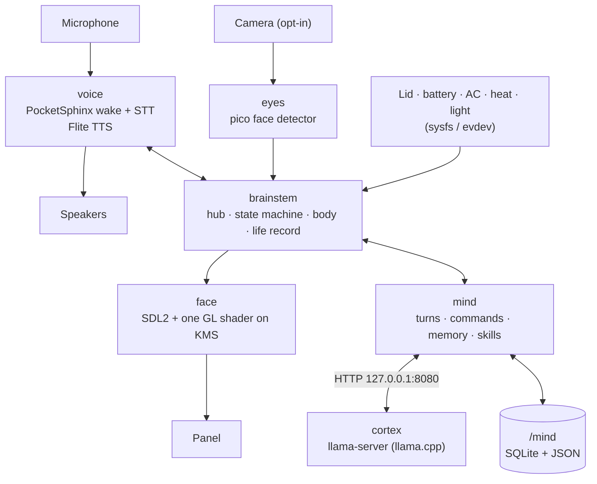

<!--
doc: architecture
verified: 2026-11-23T22:20
sources: crates/bus/src/lib.rs crates/brainstem/src/main.rs crates/brainstem/src/machine.rs crates/brainstem/src/body.rs crates/brainstem/src/life.rs crates/brainstem/src/camera.rs crates/brainstem/src/linux_body.rs crates/face/src/main.rs crates/face/src/anim.rs crates/face/src/link.rs crates/face/src/render.rs crates/face/src/eye.rs mind/turn.py mind/memory.py mind/cortex.py mind/speech.py mind/voice.py mind/eyes.py mind/retention.py mind/dream_policy.py mind/dream_store.py mind/boot_health.py mind/installer.py mind/network_policy.py mind/network_enforce.py os/package/being/being.mk os/package/cortex/being-cortex.service os/board/beingos/grub.cfg os/board/beingos/genimage.cfg os/board/beingos/post-build.sh os/board/beingos/rauc.conf mind/storage.py mind/backup.py mind/backup_crypto.py mind/wifi.py mind/initiative.py mind/consolidation.py mind/install_binding.py mind/usb_logs.py mind/model_pack.py mind/bus.py mind/local_screen.py mind/local_menu.py os/package/being/being-try-generator os/package/being/being-installed-generator os/package/being/being-screen-mode os/package/being/50-being.preset os/package/being/30-model-pack.conf os/board/beingos/being-update-ready os/board/beingos/slots.sh
-->

# PipOS architecture

This is the technical reference for PipOS. It describes what the code does
today. For the original intent and the reasoning behind it, see
[DESIGN-AND-PLAN.md](../../DESIGN-AND-PLAN.md). The two documents differ
in places, and [What is designed but not built](#what-is-designed-but-not-built)
lists where.

> **Naming.** The product is called **PipOS**. That name appears in the
> boot menu, the installer and the update certificate. The repository,
> packages, services and older documents still say **BeingOS** and
> `being-*`. **Pip** is the default name of the being itself, and the
> owner can rename it.

## 1. The idea in one paragraph

PipOS turns a 13-inch 2012 MacBook Pro (MacBookPro9,2: Ivy Bridge, two
cores, AVX without AVX2, 16 GB, Intel HD 4000, 1280×800) into a single
appliance character. Power it on and it boots straight to a pair of glowing
cyan eyes. There is no desktop, no login and no visible boot text. It
listens for its name, answers in a synthetic voice, remembers what you tell
it, and reports only true facts about its own body: battery, heat, light
and the lid. Conversation and memory run entirely on the laptop. The
network is optional and controlled by the owner.

Three principles drive the design:

1. **Reflexes carry the sense of life, not the language model.** The face
   animates at up to 60 fps no matter what the model is doing.
2. **The mind partition is the being, and the OS is disposable.** You can
   reflash the system image, and memory survives it.
3. **Honest body, inspectable memory.** Pip only states sensor facts it
   actually read, and you can correct or delete any memory.

## 2. The organs

PipOS runs six cooperating processes, called "organs", around one message
hub. They are split along failure domains, so a crashed or slow model never
freezes the face.



| Organ | Language | Binary / module | Job |
|---|---|---|---|
| **brainstem** | Rust | `being-brainstem` (`crates/brainstem`) | Bus hub, state machine, body sensors, drives, life record, camera policy, systemd watchdog |
| **face** | Rust | `being-face` (`crates/face`) | Draws the eyes and turns keys and clicks into events. Keeps animating if every other organ dies |
| **mind** | Python (standard library) | `python3 -m mind` | Turn handling, direct commands, prompt building, memory, reminders, skills, announcements, overnight journal |
| **voice** | Python + native libraries | `python3 -m mind.voice` | ALSA capture and playback, PocketSphinx wake phrase and streaming transcription, Flite synthesis |
| **eyes** | Python + C++ | `python3 -m mind.eyes` → `eyes-capture` | Opt-in camera. Reports only face presence and a normalized position |
| **cortex** | C++ | `llama-server` (llama.cpp v1.0.0, unmodified) | Language model behind an OpenAI-compatible API on loopback |

Audio and video never leave the organ that owns the device, and neither
ever crosses the bus.

## 3. The bus

Each organ connects to one Unix-domain socket. The path is `--bus` if
given, otherwise `$BEING_BUS`, then `$XDG_RUNTIME_DIR/being/bus.sock`,
then `/tmp/being-$USER/bus.sock`. On the appliance, `/etc/being/env`
sets `BEING_BUS=/run/being/bus.sock`, and the units pass it as `--bus`.
Every
message is one JSON object on one line, and its topic is in the field
`t`:

```json
{"t":"hear.final","text":"what time is it","speaker":"owner"}
```

The full topic list is in [PROTOCOL.md](../PROTOCOL.md). The behaviour
that matters for understanding the system:

- **Joining.** An organ's first line is `hello` with its `name` and its
  subscriptions. A subscription is an exact topic, a `prefix.*` or `*`.
  The brainstem replies with the snapshots the organ subscribes to, in a
  fixed order: `body.lid` first, then `state.changed`, `camera.policy`,
  `body.senses`, `body.state` and, once the life record is open,
  `life.woke`. A restarted organ therefore learns its privacy state before
  it processes any conversation.
- **Reserved topics.** Only the brainstem may send `organ.*`, `stem.*`,
  `state.*`, `body.*`, `face.*` and `camera.policy`. The brainstem also
  checks who sends certain topics:
  - `panel.ready`, `key.panel_recover` and `key.touch` are accepted only
    from the peer named `face`. The on-panel setup console joins under
    that name while it is showing.
  - `mind.announce`, `mind.clock` and `mind.dream_committed` are accepted
    only from `mind`.
  - An announcement's `say.done` is accepted only from `voice`.
- **Back-pressure.** Lines over 64 KiB are dropped. An organ whose
  512-line queue fills up is disconnected.
- **Heartbeat.** `stem.beat` goes out about every half second, checked on
  the brainstem's 100 ms tick. The face
  shows a dazed look if it hears nothing for 3 s.
- **Lid sequencing.** Every change of lid reading increments `lid_seq`.
  Voice and mind output can carry it, and the brainstem drops packets
  from an earlier lid state. This stops a stale reply from playing after
  the lid is closed and reopened.

## 4. States

The brainstem owns one state, and two overlays sit on top of it.

| State | Entered when | Face |
|---|---|---|
| `waking` | Boot, lid opened, `being.wake`, wake phrase while asleep, morning | Eyes open |
| `idle` | Awake and nobody engaging | Neutral, wandering glances, blinks, breathing |
| `attending` | Wake phrase heard, or a turn just finished | Attentive. Follow-up speech needs no wake phrase |
| `listening` | Speech started while attending | Focused |
| `thinking` | Final transcript received, or an announcement got the floor | Glances away, searching |
| `speaking` | First audio playing | Pulses with the voice level |
| `drowsy` | Idle for 15 minutes **and** the room is dark or it is night | Heavy lids, yawn |
| `asleep` | 3 minutes after drowsy, "go to sleep", or lid closed or unknown | Closed eyes. The panel goes dark only when the lid is closed or its reading is unknown (unless recovered with F9). Sleep with the lid open keeps the panel lit |

Overlays:

- **`muted`** is toggled by the **M** or **F10** key. The microphone
  closes, wake and speech events are ignored, and the face shows the
  `muted` pose: both eyes narrowed to thin, dim, flat slits.
- **`unwell`** is set when a required organ (`face`, `mind` or `voice` by
  default) is missing after the 20 s boot grace, or has disappeared after
  being seen. The face shows `dazed`.

### Main transitions and timers

| Timer | Default | Effect |
|---|---|---|
| Minimum waking | 1.5 s | Waking lasts at least this long. It then ends once the required organs are up and the mind has sent `mind.ready`. A lid wake skips the wait for organs but still waits the minimum |
| Follow-up window (`attend`) | 20 s | Attending returns to idle |
| Listening silence | 15 s | Listening returns to attending |
| Think timeout | A mind that reports `mind.progress` is cancelled after 45 s without a report, or 600 s in all. A mind that never reports gets 300 s. QEMU lab: 300 s stall, 1800 s cap. `BEING_THINK_TIMEOUT` / `--think-timeout` and `BEING_THINK_STALL` / `--think-stall` override these | Cancels the reply, shows concern for 3 s |
| Speak timeout | 60 s (QEMU lab: 900 s) | Sends `say.stop {reason: speak_timeout}` |
| Drowsy after | 900 s of no stimulus, dark or night only | Idle becomes drowsy |
| Asleep after | 180 s drowsy | Drowsy becomes asleep (natural sleep) |
| Morning wake | 60 s asleep, lid open, not dark, not night | Natural sleep becomes waking. Sleep requested with "go to sleep" is not undone by morning |

"Night" means outside 07:00–21:59 in the owner's time zone. The mind sends
the zone with `mind.clock {utc_offset}`. "Dark" means below 5 lux.

**Esc** (`key.interrupt`) cancels thinking or speaking at any time. It
sends `say.stop` and `mind.cancel`.

### The lid is the privacy switch

A lid that is not *confirmed open* counts as closed. This includes a lid
whose reading is unknown. In that case:

- the state goes to `asleep`, and any reply, audio or capture in progress
  stops;
- the microphone and camera stay closed;
- the panel is blanked.

On a confirmed opening, the brainstem moves to `waking` without waiting
for the model. The face plays a 1.23 s asymmetric peek-and-blink wake
gesture and reports `panel.ready` after its first lit frame. Only then
does the brainstem restore backlight power.

If no lid reading has arrived since the full-screen face started, the
face asks for recovery after 4 s. After a further 2 s, or if no
brainstem is present, it shows itself anyway. A lid that was read and
later goes unknown stays dark until **F9** forces recovery.

## 5. The face

- **Rendering.** SDL2 on KMS/DRM, with no window system. SDL2 carries
  one local patch, `os/patches/sdl2` (XRGB8888 scan-out). It requests an
  OpenGL 3.3 Core context and falls back to GLES 3.0. One full-screen
  triangle and one fragment shader draw two signed-distance superellipse
  eyes, cut by lids, with bloom and an LED-grid texture. The colours are
  cyan on black. The face uses vsync or a 60 Hz cap. It drops to 15 Hz
  while asleep or blank, and to 20 Hz at quarter scale on a software
  renderer such as the QEMU lab.
- **Expressions.** The face has 16 poses: `neutral`, `attentive`,
  `listening`, `thinking`, `speaking`, `joy`, `curiosity`, `surprise`,
  `skepticism`, `concern`, `sleepy`, `asleep`, `dreaming`, `tired`, `muted`
  and `dazed`. The model can choose one of seven emotions for its reply:
  neutral, joy, curiosity, surprise, skepticism, concern and sleepy.
- **Motion.** Every expression-shape parameter is driven by a slightly
  underdamped spring (damping 0.82). Lively arrivals such as joy and
  surprise use looser springs so they overshoot a little. Gaze, blinks
  and the speech envelope have their own timing.
  Blinks come every 2.5–5.6 s and wait for gaps in speech. The face also
  makes saccades, idle look-aways, room surveys and thinking "search
  hops". Every 20–38 s, while the lids are still light, there is a contented idle
  gesture. A yawn plays once when the lids first grow heavy, and again on
  turning drowsy. The
  lids grow heavier during long quiet spells alone. Breathing runs at
  0.22 Hz awake and 0.13 Hz asleep. A speech envelope follows `say.level`.
  When the battery is low, the face shows a `tired` cue for 6 s every
  45 s while idle.
- **Inputs.** The face turns these keys and clicks into events:

  | Input | Event |
  |---|---|
  | Esc | `key.interrupt` |
  | M, F10 | `key.mute` |
  | F9 | `key.panel_recover` |
  | F2 | Starts the local setup screen |
  | Click or touch | `key.touch`: a brief downward glance |
- **Preview.** These flags help with review:

  | Flag | Effect |
  |---|---|
  | `--demo` (`target/debug/face --demo`) | Cycles every expression |
  | `--script tour\|drowse` | Plays a scripted scene |
  | `--frames DIR` | Saves a scene as numbered PNG frames |
  | `--record FILE.png` | Saves a still of the face when it quits |

## 6. The mind

### A conversational turn

1. The voice organ hears the wake phrase and sends `hear.wake`. The
   brainstem moves to `attending`.
2. The voice organ streams `hear.partial` messages, then sends
   `hear.final`. The brainstem moves to `thinking`.
3. The mind cleans the text: it drops "please" and an address such as
   "Pip," or "hey Pip". It then tries, in order:
   1. the reminder and timer grammar;
   2. the direct command patterns (see the [reference](REFERENCE.md#spoken-commands));
   3. weather;
   4. local greetings;
   5. the model.
4. A direct command replies at once from code. It never invents anything.
5. A model turn works like this:
   1. The mind builds the prompt from these parts:
      - the identity;
      - `core.md`, if present (persistent mode only);
      - up to three dated highlights;
      - the recent conversation turns;
      - the senses line;
      - at most one recall note. The note holds either up to two facts
        within 110 characters, or one past exchange of up to 110
        characters per side.
   2. It streams a reply from `llama-server`. A grammar forces the reply
      to begin with an `[emotion]` tag.
   3. It removes any `<think>` blocks, markup and emoji.
   4. It splits the text into clauses and sends each one as a
      `say.request`.
6. Guards run before anything is spoken:
   - **EchoGuard** stops a reply that starts reciting private notes or
     senses.
   - **Parrot guard** never speaks a first clause that only repeats the
     question. It retries once at temperature +0.3, then says "Sorry. I
     lost my thought."
7. The voice organ speaks each clause with Flite and reports
   `say.started`, `say.level` and `say.done`. The microphone is closed
   while it speaks (half-duplex).

### Mind invariants

- **Lid epochs.** The mind records the `lid_seq` from each `body.lid`. It
  attaches that value to every `say.request`, `mind.announce`,
  `mind.reply_done` and `mind.dream_committed`, so the brainstem can drop
  output from a previous lid epoch. The mind ignores a `body.presence`
  whose `lid_seq` is not the current lid's. The brainstem drops a
  `mind.dream_committed` unless it carries the `lid_seq` of the current
  confirmed closure while Pip is asleep.
- **Cancellation.** `mind/bus.py` has an *urgent* callback, so
  `mind.cancel` is seen while a reply is still streaming, not after it.
- **Shutdown.** On SIGTERM the mind has 20 s (`TimeoutStopSec=20`) to
  write `context.json` and ask llama-server to save `being.slot`.
- **Highlights.** `mind/consolidation.py` picks at most 3 original owner
  statements from 8 candidates. Explicit memories come first. Greetings,
  filler and questions are skipped.

### Model use

| Setting | Value |
|---|---|
| Default model | Qwen3.5-0.8B, Q4_K_M GGUF (`/models/reflex.gguf`), Apache-2.0 |
| Server | `llama-server` on `127.0.0.1:8080` with `--ctx-size 4096 --parallel 1`, 2 threads, `--reasoning-budget 0`, slot files in `/mind/cortex`, `Nice=5` |
| Build | Static, `GGML_NATIVE=OFF`, AVX, F16C and SSE4.2 on; AVX2, FMA, BMI2 and AVX-512 off |
| Mind settings | `ctx_tokens 4096`, `max_tokens 96`, `temperature 0.7`, `prefill false` (`config/being.json`) |
| Warm-up | On lid-open or waking, the mind restores a saved slot if the context was accepted. Otherwise it primes a verified prompt prefix |
| Context | `context.json` restores the conversation for 24 h, but only if the identity and memory revision are unchanged. Compaction runs above 60 % of the context. An emergency trim runs at 90 % |
| Model gate | An `ExecCondition` runs `model_pack.py verify` before the cortex starts. It checks `/models/beingos-conversation.cms` with OpenSSL against `/etc/rauc/keyring.pem`, the same trust root as OS updates, compares the result with the pack descriptor, and hashes `reflex.gguf`. On failure the cortex is skipped, not restart-looped. Boot health then never sees a model server, so a trial slot with a bad pack rolls back. Packs are built with `lab/package_model.py` |

The model is small on purpose. On two Ivy Bridge cores, latency matters
more than intelligence. The character is written for short replies, and
anything factual (time, battery, age, memory) is answered by code.

### Memory

Memory lives in `/mind/mind.db`, a SQLite database in WAL mode with
`secure_delete` on.

- **`episodes`** is the append-only conversation log. Each row records
  what was heard and what was said, with a timestamp, speaker and kind.
  The log has an FTS5 index.
- **`facts`** holds only things the owner explicitly asked Pip to
  remember. Each fact links back to its source episode, and the table has
  an FTS5 index.
- **Recall.** Facts are ranked first by BM25, up to three. Then history is
  searched by keyword, by who spoke (a person or Pip) and by date range.
  What people said is weighted above Pip's own replies. Recall answers
  quote the original words. A history answer also gives its date ("On
  November 3, 2026, you said: …").
- **Correction** ("that's wrong, …") rewrites the fact and its source
  episode.
- **Forgetting** deletes facts and replaces episode text with
  `[forgotten]`. It follows the reply, recall and source links, and
  whole-word verbatim copies, so replies generated from the old wording
  are cleared too. It then rebuilds the search index, scrubs the live
  prompt, and erases the model's cached slot. Topic and day forgetting
  first say how many items match and wait 45 s for a plain "yes" from the
  same speaker.
- **Believed clock.** Timestamps normally do not go backwards. A reading
  behind the latest known time is stamped with that time instead. There
  are two exceptions: a clock that stays behind and keeps running for a
  week is accepted, and stamps are lowered if a forward jump is undone.
  Expiry counts only
  from a time the being trusts. A forward clock jump must hold for 1 to 7
  days before expiry follows it. The state lives in the `meta` table under
  `clock_*` keys.

- **Memory revision.** Every correction, forgetting, expiry or replayed
  deletion advances `memory_revision` in `meta`. Logging new episodes and
  remembering facts do not.
  A change of revision invalidates `context.json`, the saved cortex slot
  and the warm prompt.
- **Deletion ledger.** This mechanism makes forgetting survive backups
  and restores:
  - Every episode and fact carries a random `deletion_ref`.
  - SQLite triggers on `episodes` and `facts` append each edit or delete
    to `deletion_edits`. Inside a forgetting batch they first collect
    the IDs in `deletion_pending`, then append them as one entry.
  - The ledger holds only IDs and nonces, never text. It belongs to a
    per-life `deletion_lineage`.
  - A restore applies a newer ledger only if it extends the snapshot's
    own ledger exactly. It then blanks the listed episodes, deletes the
    listed facts, rebuilds FTS and advances the revision. See
    `mind/memory.py` and `mind/backup.py`.

Retention policy is stored in `/mind/memory-policy.json` and set with
`being-memory`:

| Mode | Behaviour |
|---|---|
| `persistent` (default) | Full archive, context resume and slot persistence. Optional `--expiry-days N` |
| `explicit-only` | Only "remember …" facts survive. Ordinary conversation is not logged |
| `session-only` | Everything in RAM for this run of the mind. Owner services are off |
| Guest mode (spoken) | A temporary RAM conversation that cannot see the owner's archive. Start it with "Start guest mode" or "Don't remember this". End it with "End guest mode" |

### Announcements

Reminders, timers and the optional daily greeting are *announcements*.
The mind asks for the floor with `mind.announce`. The brainstem grants it
with `stem.announce_ready` only when all of these hold:

- the mind is ready;
- the voice organ is up;
- the lid is open;
- the state is idle, drowsy or attending (idle only for greetings).

The policy lives in `/mind/initiative.json`, written by
`mind/initiative.py` (version 1, at most 1 KiB, private). It has:

- a switch for automatic reminders and timers (default on);
- a switch for daily greetings (default off; also needs the camera);
- optional quiet hours, as a local `HH:MM` start and end that may cross
  midnight.

An invalid file turns all announcements off. Quiet hours hold due items
pending and never drop them. A reminder is deleted only after the voice
organ confirms playback. If it was not spoken, it is retried after 15 s.
Owners change the policy in Setup (`mind/initiative_setup.py`).

### Overnight journal ("dreams")

Opt-in: create `/mind/dreams-enabled` to enable it. The journal runs only
in `persistent` memory mode, outside guest mode, and when all of these
hold:

- Pip is asleep, with the lid confirmed closed;
- AC power is connected;
- the CPU is at 65 °C or below, by a reading less than 7 s old;
- the owner's local time is before 05:00.

Each night it processes at most four batches of up to 32 archive rows,
one batch at most every 15 s. It is deterministic and uses no model. It
links up to three notable owner statements per batch into `dream_journal`
(at most 96 entries). The links affect recall in one case: the owner asks
a spoken recall question of two or more words, and the best keyword match
lacks some of them. Pip then uses the best match containing all of the
words, if the journal links it. Any wake,
speech or lid event cancels the work. The next confirmed opening adds a
flutter to the wake blink. `being-dream-journal` reads the journal.

## 7. The body and the life record

The brainstem's Linux body reads these every 2 s:

| Reading | Source |
|---|---|
| Battery, AC and charging | `power_supply` |
| Temperature | The hottest `coretemp` channel, falling back to `applesmc` |
| Ambient light | `applesmc` light sensor |
| Lid | evdev `SW_LID`, re-queried every second and reset to unknown after a resume |

A failed reading keeps its last good value for 10 s. After 30 s with no
reading, battery, power, temperature and light become *unknown*. The lid
is tracked separately. The senses line then leaves those facts out rather
than guessing. Low battery means 15 % or less with AC confirmed
disconnected.

The brainstem also computes four drives, each from 0 to 1:

| Drive | Formula |
|---|---|
| `energy` | 1.0 on AC, otherwise battery / 100 |
| `arousal` | Decays over 60 s since the last stimulus |
| `social` | Decays over an hour since the last contact |
| `comfort` | Falls with temperature above 50 °C |

They are published as `body.drives`. No behaviour depends on them yet.

`/mind/life.json` is the being's identity:

- a random 128-bit `id`;
- `born`;
- `wakes`;
- the body string (DMI vendor, product and CPU);
- the boot ID;
- `awake_since`.

On each real boot the brainstem increments `wakes`. It also detects two
conditions:

- **lost power:** `awake_since` is still set from the previous boot;
- **new body:** the DMI or CPU string changed.

For the first 15 minutes awake, the senses line mentions these facts, so
Pip can say truthfully that it lost power or moved to a new laptop.
Writes are atomic: a temporary file with fsync, rename, then a directory
fsync. A damaged record is never overwritten.

## 8. The appliance

### Disk layout

| Partition | Factory / lab image | Installed disk | Mounted |
|---|---|---|---|
| `esp` | 64 MiB vfat | 512 MiB vfat | `/bootstate` (GRUB environment, RAUC state) |
| `system-a` | 1 GiB SquashFS | 2 GiB | `/`, read-only |
| `system-b` | 1 GiB SquashFS | 2 GiB | Inactive slot |
| `models` | ext4, content + 96 MiB | ext4, 2 × models + 96 MiB | `/models`, read-only |
| `mind` | 1 GiB ext4 | The rest of the disk | `/mind`, `rw,noexec,discard` |

`/var` is a tmpfs and there is no swap.

Mounts are decided at boot by two early systemd generators, which run
before any unit:

- **`being-try-generator`** takes precedence on Try boots. It mounts
  `/mind` (512 MiB) and `/var` as tmpfs. It mounts `/models` only when
  exactly one valid model partition GUID is present. Otherwise it masks
  the model mount and logs why.
- **`being-installed-generator`** handles installed disks:
  1. It checks that `being.installed`, `being.esp`, `being.slot_a`,
     `being.slot_b`, `being.models`, `being.mind`, `root` and `rauc.slot`
     each appear once and are consistent.
  2. It writes the mount units and a per-disk `rauc.conf`.
  3. If those checks fail, it masks the disk mounts, updates and boot
     health.

  Before any disk is mounted, `being-installed-bind.service`
  (`mind/install_binding.py`) checks every GUID against
  `/dev/disk/by-partuuid` on the running disk. If that check fails, the
  mounts that require it do not start.

The factory lab image uses the static `fstab` instead.

### Boot

1. Apple EFI loads GRUB from the fallback path `\EFI\BOOT\BOOTX64.EFI`.
2. GRUB reads `grubenv` on the ESP. Slot state is kept in that file
   rather than in NVRAM, because an NVRAM reset would wipe NVRAM.
3. The kernel (Linux 6.18.64, MacBook drivers built in) mounts the slot
   read-only.
4. The brainstem and the face both start in early boot. The face waits
   for nothing. The mind,
   voice and cortex follow once `/mind` and `/models` are mounted.
5. `being-boot-health` marks the slot good after 60 continuous seconds
   with a healthy brainstem and model server. The deadline is 180 s.

A slot that is not marked good boots as a **trial** (`being.trial=1`).
If the health check fails during a trial, `being-boot-health` reboots at
once so GRUB can count the attempt. If the health check itself crashes,
`being-trial-reboot.service` does the same. After three failed trial
boots, GRUB returns to the last good slot. The counter logic is in
`os/board/beingos/grub.cfg` and `slots.sh`.

RAUC runs `being-update-ready` before every install. It refuses:

- any Try boot;
- on installed disks, any RAUC config other than the generator's, or a
  failed partition-binding check;
- any boot that has not yet written `/run/being-slot-good`. During a
  trial, the inactive slot is the only rollback copy.

### Updates

- **OS.** Signed RAUC verity bundles are written to the inactive slot.
  There are two compatibility channels: `beingos-lab-v1` for factory and
  lab images, and `beingos-installed-v1` for installed disks. A bundle
  for the other channel, or an unsigned one, is rejected.
- **Models.** Models ship as a separate signed model pack, checked at
  every boot. The installed disk leaves room for a staged replacement,
  but there is no model-update path yet.
- **`/mind`.** Neither kind of update touches it.

Signing currently uses a self-signed lab key ("PipOS Lab Updates") kept
in the builder's Docker volume. An owner-held release key does not exist
yet.

### Watchdogs and recovery

| Mechanism | Behaviour |
|---|---|
| systemd restarts | Each organ restarts on its own: `Restart=always`, except the eyes, which use `Restart=on-failure`. The brainstem backs off from 0.3 s to 30 s. The others retry after a fixed delay |
| Brainstem watchdog | The brainstem pings the systemd watchdog (`WatchdogSec=10s`). After 8 or more failures in 10 minutes, once uptime exceeds 300 s, the machine reboots. Try and verbose boots are exempt |
| Hardware watchdog | systemd feeds it with `RuntimeWatchdogSec=30s`, `RebootWatchdogSec=2min` |
| Kernel | `panic=10 oops=panic` |

### Network modes

The network policy lives in `/mind/network/policy.json` and is enforced
with nftables plus systemd units:

| Mode | Label | Traffic |
|---|---|---|
| `local-only` (default) | Offline | Loopback only. Links down, network services stopped |
| `paired-lan` | Local network | DHCPv4 to private ranges. SSH from the enrolled Mac on port 2222 (2223 for an opt-in development window) |
| `internet` | Internet | IPv4 and IPv6 egress. NTP only to an owner-approved numeric server |

Weather also needs a separate **web lookups** permission. The weather
client connects only to public IP addresses.

The network fails closed from early boot:

1. `being-network-lockdown.service` runs `being-network lockdown` before
   `network-pre.target` and `sysinit.target`.
2. The preset `50-being.preset` disables systemd-networkd, resolved,
   timesyncd, sshd and wpa_supplicant.
3. `being-network-policy` and `being-network-reconcile` then open only
   what `/mind/network/policy.json` allows.

Wi-Fi works like this:

- A single WPA2 or WPA3 personal profile lives in
  `/mind/network/wifi.json`.
- `being-wifi` (`mind/wifi.py`) runs its own supplicant and writes a
  networkd unit under `/run/systemd/network/`.
- The Broadcom firmware for the internal radio is not packaged yet.

### Screen ownership

Only one process owns the KMS display at a time:

1. On USB builds with `being.screen=1`, the C console `being-console`
   owns the display first. It runs `mind/local_screen.py` and
   `mind/local_menu.py`, and joins the bus under the name `face`.
2. `being-screen-mode face` keeps `being-face` from starting until
   `/run/being-screen-dismissed` exists.
3. When the console exits, `being-screen-mode face-return` creates that
   file and restarts the face.
4. F2 from the face starts `being-local-screen.service`, which conflicts
   with the face. The handoff then works the same way.

This handoff is the first place to look when the screen is black.

### Try diagnostics

On laptop Try sticks, `being-usb-logs run` writes evidence to the stick's
own FAT32 `PIPLOGS` partition (GPT name `try-logs`). Each boot gets a
folder with these files:

- `summary.txt`
- `hardware-report.txt`
- `dmesg.txt`
- `services.txt`
- `journal.txt`, synced every few seconds

It looks only on the disk that holds the running root file system, and
only when that disk is attached over USB. It never opens another disk.
This is the main channel for evidence from the physical MacBook.

### Try, Install and Restore

The USB image boots into **Try**. In Try:

- `/mind` and `/var` are RAM tmpfs, and the model is mounted read-only;
- updates are disabled;
- nothing is written to any internal disk.

The on-screen menu (`mind/local_menu.py`, drawn by `being-console`)
offers:

1. **Try PipOS**
2. **Install PipOS**
3. **Restore a being**
4. **Setup**
5. **Check hardware**

Installation works like this:

1. The installer lists eligible whole disks. It excludes the boot medium
   and any disk in use.
2. It shows the exact layout, then requires the device-specific
   confirmation `ERASE /dev/sdX`.
3. It stages files in RAM, verifies every write, and publishes the GPT
   last.

Restore is an installation. It goes through the same disk choice and
`ERASE` confirmation, then writes an `age`-encrypted snapshot from
read-only mounted media into the new, inactive `/mind`.

Snapshots are made by `being-backup` (`mind/backup.py`,
`mind/backup_crypto.py`). Before encrypting, it compacts the archive:

- it expires memories older than the policy allows;
- it drops episodes (and, in session-only mode, facts) that the memory
  policy does not keep;
- it drops the dream journal and dream checkpoints;
- it truncates the WAL, vacuums the database and checks its integrity.

A newer deletion proof is applied on restore, not at backup time.

During a restore, the snapshot is decrypted and the deletion proof is
applied in a private staging area. `/mind/.being-restore-in-progress` is
then written before any restored file is copied in. It is removed only
after every file has been published and the directory synced. While it
exists, the mind, voice and cortex do not start, and
memory settings cannot be edited. A being therefore never wakes on a
half-restored mind.

## 9. Security and privacy model

| Concern | What PipOS does |
|---|---|
| Raw audio | Never written to disk, never on the bus. The microphone closes while Pip speaks and whenever the lid is not confirmed open |
| Camera | Off by default. Needs a root-owned 0600 marker, the brainstem's per-epoch permission, an open lid and an awake state. Only `{present,x,y}` leaves the detector. Detections expire after 1.5 s |
| Model server | Loopback only, with no API key |
| Network | Offline by default. Firewall enforced with nftables. Web lookups need separate consent |
| Forgetting | Revision-aware deletion through derived replies, the search index, the prompt and the model cache. The lab verified a raw-disk scan on 4 KiB-cluster virtual disks. The physical SSD still needs a TRIM check |
| Backups | `age` X25519 encryption. Deletions are carried as an encrypted proof plus an independently kept checkpoint |
| Privilege | Every `being-*` service currently runs as root. The eyes service is sandboxed: AF_UNIX only, V4L only, `/mind` read-only |
| Laptop image | No getty and no root login in any build. No SSH unless built with `BEING_LAPTOP_MAINTENANCE=1`, which adds key-only paired-Mac access |
| Storage discipline | Small Python state files in `/mind` are written with the helpers in `mind/storage.py`. Directories are 0700, and are rejected unless they are real directories owned by the service user with no group or other bits. Files go to a temp file, are fsynced and renamed, then the directory is fsynced. The SQLite databases, the brainstem's `life.json` (its own atomic write) and the cortex slot saves are written by their own code. Readers of trust-bearing files `lstat` them and accept only regular files. New Python code should use these helpers |

## What is designed but not built

As of 2026-11-23:

- **Production speech stack.** The design proposes sherpa-onnx, Silero
  VAD, Zipformer, Piper and CAM++. The current lab baseline is
  PocketSphinx and Flite. Choosing between them is a hardware benchmark
  decision.
- **Deliberate vision.** "What do you see?" replies that Pip can't see
  yet. Eye contact does not open attention.
- **Sounds and chirps.** The procedural acknowledgement, thinking, happy
  and refusal sounds are not implemented.
- **Body.** These sensor reactions are not implemented: the
  accelerometer, keyboard glow, brightness and volume keys,
  light-responsive backlight, saving on the power button, and low-battery
  initiative.
- **Drowsiness.** Long idle alone does not cause drowsiness; it needs
  dark or night. The panel stays lit during natural sleep with the lid
  open.
- **Owner memory.** There is no owner memory inspector, and nothing
  writes `core.md`. Generated summaries are not produced.
- **Volume.** There is no volume control and no spoken mute.
- **Model choice.** The model is not yet chosen on hardware. Qwen3.5-0.8B
  is a lab placeholder.
- **Physical hardware.** No physical-hardware result exists yet. All
  evidence comes from QEMU or the development Mac.
